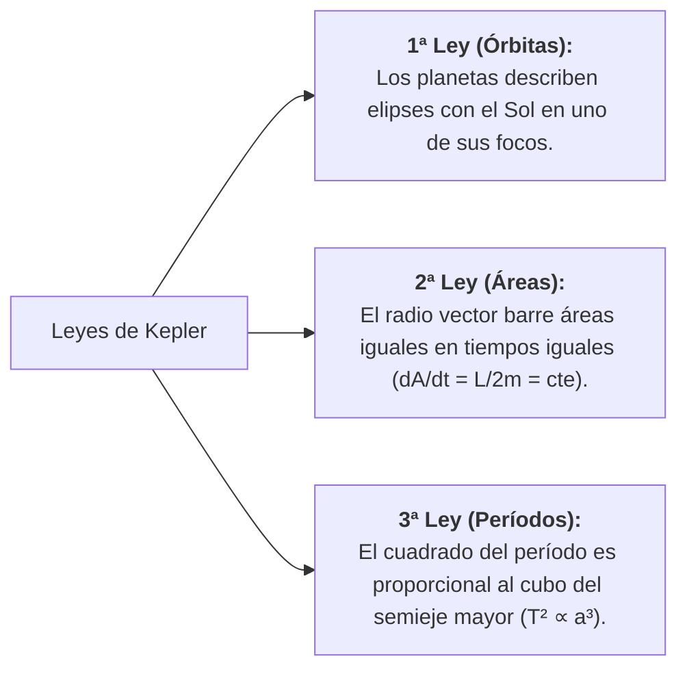
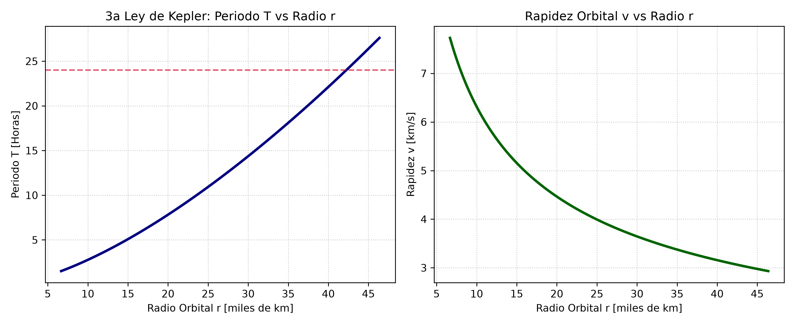

# 🌌 Tema 1.1: Ley de Gravitación Universal y Leyes de Kepler

> **Intuición y Propósito del Tema:**
> La **Gravitación Universal** es la interacción atractiva fundamental entre cuerpos con masa. 
> * **En criollo:** Dos masas cualesquiera en el universo se atraen. La fuerza es más intensa cuanto más masivos sean los cuerpos y decae rápidamente al alejarse con el cuadrado de la distancia ($1/r^2$).
> * **Eje Conceptual:** Explica cómo una única fuerza central e inversamente proporcional al cuadrado de la distancia ($F_g \propto 1/r^2$) gobierna tanto la caída de los cuerpos en la superficie terrestre como la mecánica celeste de las órbitas elípticas de los planetas y satélites (Leyes de Kepler).

---

### 📌 Contenido de esta nota (Índice interactivo)
- [🌌 Tema 1.1: Ley de Gravitación Universal y Leyes de Kepler](#-tema-11-ley-de-gravitación-universal-y-leyes-de-kepler)
    - [📌 Contenido de esta nota (Índice interactivo)](#-contenido-de-esta-nota-índice-interactivo)
  - [1. Traductor de Lenguaje Físico y Notación](#1-traductor-de-lenguaje-físico-y-notación)
  - [2. Ley de Gravitación Universal de Newton](#2-ley-de-gravitación-universal-de-newton)
    - [Enunciado Formal (Cátedra UNCA)](#enunciado-formal-cátedra-unca)
    - [Propiedades Fundamentales de la Fuerza Gravitatoria:](#propiedades-fundamentales-de-la-fuerza-gravitatoria)
  - [3. Experimento de Cavendish y Medición de $G$](#3-experimento-de-cavendish-y-medición-de-g)
  - [4. Leyes de Kepler y Deducción Teórica de la 3ª Ley](#4-leyes-de-kepler-y-deducción-teórica-de-la-3ª-ley)
  - [4. Leyes de Kepler y Deducción Teórica de la 3ª Ley](#4-leyes-de-kepler-y-deducción-teórica-de-la-3ª-ley-1)
    - [Las Tres Leyes de Kepler:](#las-tres-leyes-de-kepler)
    - [Detalle Cinemático de la 1ª y 2ª Ley:](#detalle-cinemático-de-la-1ª-y-2ª-ley)
    - [🔬 Deducción Teórica de Parcial: 3ª Ley de Kepler para Órbitas Circulares](#-deducción-teórica-de-parcial-3ª-ley-de-kepler-para-órbitas-circulares)
      - [Desarrollo Matemático Paso a Paso:](#desarrollo-matemático-paso-a-paso)
  - [📐 5. Diagramas, Código Python y Representación Gráfica](#-5-diagramas-código-python-y-representación-gráfica)
  - [⚠️ 6. Trampas y Errores Típicos en Exámenes (UNCA)](#️-6-trampas-y-errores-típicos-en-exámenes-unca)
  - [📝 7. Ejercicios Resueltos Paso a Paso de Parcial](#-7-ejercicios-resueltos-paso-a-paso-de-parcial)
    - [Desarrollo Paso a Paso (Ejercicio 1):](#desarrollo-paso-a-paso-ejercicio-1)
    - [Desarrollo Paso a Paso (Ejercicio 2):](#desarrollo-paso-a-paso-ejercicio-2)
  - [8. Conexión con el Siguiente Tema (Pozo de Potencial)](#8-conexión-con-el-siguiente-tema-pozo-de-potencial)
  - [🔗 Enlaces Relacionados](#-enlaces-relacionados)
  - [Referencias](#referencias)

---

## 1. Traductor de Lenguaje Físico y Notación

| Símbolo Formal | Lectura Universitaria | Significado Físico / Intuición | Unidades (SI) |
| :--- | :--- | :--- | :---: |
| $\vec{F}_g$ | Fuerza Gravitatoria | Fuerza vectorial de atracción dirigida sobre la línea que une ambos centros de masa. | $\text{N}$ ($\text{kg}\cdot\text{m/s}^2$) |
| $G$ | Constante de Gravitación Universal | Escalar universal fundamental ($G \approx 6,674 \times 10^{-11}$). Mide la intensidad de la interacción gravitatoria en el universo. | $\frac{\text{N}\cdot\text{m}^2}{\text{kg}^2}$ |
| $r$ | Distancia Centro a Centro | Distancia medida **estrictamente entre los centros de masa** de los cuerpos ($r = R_{\text{astro}} + h$). | $\text{m}$ |
| $\hat{r}$ | Vector Unitario Radial | Vector de módulo 1 dirigido desde la masa fuente hacia la masa atraída. El signo $-\hat{r}$ garantiza el carácter **atractivo**. | Adimensional |
| $T$ | Período Orbital | Tiempo que tarda un cuerpo orbitante en completar una revolución entera ($360^\circ$). | $\text{s}$ |
| $a$ | Semieje Mayor de la Elipse | Distancia media entre el centro de la elipse orbital y sus vértices sobre el eje focal. | $\text{m}$ |
| $e$ | Excentricidad Orbital | Grado de achatamiento de la elipse ($0 \le e < 1$). Si $e=0$, la órbita es una circunferencia perfecta. | Adimensional |

## 2. Ley de Gravitación Universal de Newton

### Enunciado Formal (Cátedra UNCA)
Dos partículas puntuales de masas $m_1$ y $m_2$ separadas una distancia $r$ se atraen mutuamente mediante una fuerza dirigida a lo largo de la línea que une sus centros, cuya magnitud es directamente proporcional al producto de sus masas e inversamente proporcional al cuadrado de la distancia que las separa:

$$\vec{F}_{12} = -G \frac{m_1 m_2}{r^2} \hat{r}_{12}$$

* **Forma Escalar (Magnitud de la Fuerza):**
  $$F_g = G \frac{m_1 m_2}{r^2}$$

### Propiedades Fundamentales de la Fuerza Gravitatoria:
1. **Fuerza Central:** Su línea de acción pasa siempre por el centro de masa del cuerpo atraedor. No genera torque respecto al centro ($\vec{\tau} = \vec{r} \times \vec{F} = \vec{0}$), lo que implica la **conservación del momento angular ($\vec{L} = \text{constante}$)**.
2. **Fuerza Conservativa:** El trabajo realizado a lo largo de cualquier trayectoria cerrada es nulo ($\oint \vec{F}_g \cdot d\vec{r} = 0$), lo que permite definir una función escalar de **Energía Potencial Gravitatoria $U(r)$**.
3. **Par de Acción y Reacción (3ª Ley de Newton):** Ambas masas experimentan fuerzas de igual módulo y sentido opuesto ($\vec{F}_{12} = -\vec{F}_{21}$).

---

## 3. Experimento de Cavendish y Medición de $G$

Debido al valor extremadamente pequeño de la constante $G$, la atracción entre objetos de escala humana es imperceptible a simple vista. 

En 1798, **Henry Cavendish** midió por primera vez el valor experimental de $G$ mediante una **balanza de torsión**:
* Consistió en dos esferas pequeñas de masa $m$ sujetas a los extremos de una varilla ligera suspendida de un hilo de fibra fina, enfrentadas a dos grandes esferas de plomo de masa $M$.
* La atracción gravitatoria entre $M$ y $m$ hizo rotar la varilla un ángulo $\theta$, torciendo la fibra hasta equilibrar el torque gravitatorio con el torque de restitución elástica de la fibra ($\tau = \kappa \theta$).
* **Importancia Histórica y Teórica:** Al determinar $G$, Cavendish pudo "pesar la Tierra", calculando por primera vez su masa $M_T = \frac{g R_T^2}{G}$ y su densidad media.

## 4. Leyes de Kepler y Deducción Teórica de la 3ª Ley

Johannes Kepler enunció tres leyes empíricas que describen el movimiento cinemático de los planetas alrededor del Sol. Newton demostró que son consecuencia directa de la fuerza de tracción gravitacional $1/r^2$.

## 4. Leyes de Kepler y Deducción Teórica de la 3ª Ley

Johannes Kepler enunció tres leyes empíricas que describen el movimiento cinemático de los planetas alrededor del Sol. Newton demostró que son consecuencia directa de la fuerza de tracción gravitacional $1/r^2$.

### Las Tres Leyes de Kepler:
1. **1ª Ley (Órbitas):** Los planetas describen elipses con el Sol en uno de sus focos.
2. **2ª Ley (Áreas):** El radio vector barre áreas iguales en tiempos iguales ($dA/dt = L/2m = \text{constante}$).
3. **3ª Ley (Períodos):** El cuadrado del período es proporcional al cubo del semieje mayor ($T^2 \propto a^3$).

### Detalle Cinemático de la 1ª y 2ª Ley:
* **1ª Ley (Geometría de la Elipse):**
  * **Perihelio (Perigeo):** Punto de máxima cercanía al centro. Distancia $r_{\min} = a(1 - e)$.
  * **Afelio (Apogeo):** Punto de máxima lejanía del centro. Distancia $r_{\max} = a(1 + e)$.
* **2ª Ley (Conservación del Momento Angular $\vec{L}$):**
  * Como el torque de la fuerza gravitatoria es nulo ($\vec{\tau} = \vec{0}$), el momento angular del cuerpo orbitante se conserva vectorialmente:
    $$\vec{L} = \vec{r} \times m\vec{v} = \text{constante}$$
  * La velocidad areal es directamente proporcional al módulo de $\vec{L}$: $\frac{dA}{dt} = \frac{L}{2m} = \text{constante}$.
  * **Consecuencia clave:** El planeta se mueve más rápido en el perihelio ($v_{\max}$) y más lento en el afelio ($v_{\min}$), cumpliéndose:
    $$v_{\text{perihelio}} \cdot r_{\min} = v_{\text{afelio}} \cdot r_{\max}$$

---

### 🔬 Deducción Teórica de Parcial: 3ª Ley de Kepler para Órbitas Circulares

> **Consigna formal de examen:** *"Demostrar analíticamente la Tercera Ley de Kepler a partir de las Leyes de Newton para un satélite de masa $m$ que describe una órbita circular de radio $r$ alrededor de un planeta de masa $M$."*

#### Desarrollo Matemático Paso a Paso:

* **Paso 1: Planteo Dinámico (2ª Ley de Newton)**
  $$\sum F_r = m \cdot a_c$$
  La fuerza gravitatoria $F_g$ es la única fuerza radial y actúa como fuerza centrípeta.

* **Paso 2: Sustitución Dinámica**
  $$G \frac{M m}{r^2} = m \frac{v^2}{r}$$
  Se reemplaza la Ley de Gravitación Universal y $a_c = \frac{v^2}{r}$.

* **Paso 3: Rapidez Orbital**
  $$v = \sqrt{\frac{G M}{r}}$$
  Se simplifica $m$. La rapidez orbital **no depende de la masa del satélite**.

* **Paso 4: Relación Cinemática**
  $$v = \frac{2\pi r}{T}$$
  Rapidez igual a la distancia recorrida en una vuelta ($2\pi r$) sobre el período $T$.

* **Paso 5: Igualación Algebraica**
  $$\left(\frac{2\pi r}{T}\right)^2 = \frac{G M}{r} \implies \frac{4\pi^2 r^2}{T^2} = \frac{G M}{r}$$

* **Paso 6: Expresión Final (3ª Ley de Kepler)**
  $$T^2 = \left(\frac{4\pi^2}{G M}\right) r^3$$

* **Constante de Kepler ($K$):**
  $$K = \frac{4\pi^2}{G M} \quad \implies \quad T^2 = K \cdot r^3$$
  * **Interpretación:** La constante $K$ depende exclusivamente de la masa del cuerpo central $M$ y es idéntica para todos los cuerpos que orbiten alrededor de ese mismo astro.
  * **Generalización Elíptica:** Para órbitas elípticas, el radio orbital $r$ se reemplaza simplemente por el semieje mayor $a$:
    $$T^2 = \left(\frac{4\pi^2}{G M}\right) a^3$$

## 📐 5. Diagramas, Código Python y Representación Gráfica

Gráfica de la relación entre el período orbital y el radio de la órbita ($T$ vs $r$), junto a la variación de la rapidez orbital ($v$ vs $r$), generada mediante el script `generar_graficos_1_1.py`:

---

## ⚠️ 6. Trampas y Errores Típicos en Exámenes (UNCA)

> ⚠️ **Trampa 1: El "Peligro de la Altura $h$" vs. Radio Orbital $r$ (Confusión de Distancia)**  
> **Error común:** Enunciados de parcial que dicen *"un satélite vuela a una altura $h = 600\,\text{km}$"* y reemplazar directamente $r = 600\,\text{km}$.  
> **Por qué se invalida:** La Ley de Gravitación Universal exige la distancia **centro a centro de masa**. La altura $h$ es solo la distancia desde la superficie del planeta.  
> **Regla de Parcial INVIOLABLE:**
> $$r = R_{\text{planeta}} + h$$

> ⚠️ **Trampa 2: Descomposición e Incompatibilidad de Unidades en el Sistema Internacional (SI)**  
> **Error grave:** Operar con el período $T$ en horas o días, o el radio $r$ en kilómetros ($\text{km}$), combinándolos directamente con $G = 6,674 \times 10^{-11}\,\frac{\text{N}\cdot\text{m}^2}{\text{kg}^2}$.  
> **Tabla de Conversión Obligatoria:**
> * Distancias: $1\,\text{km} = 10^3\,\text{m} \quad | \quad 1\,\text{UA} = 1,50 \times 10^{11}\,\text{m}$
> * Tiempos: $1\,\text{hora} = 3600\,\text{s} \quad | \quad 1\,\text{día} = 86.400\,\text{s}$

> ⚠️ **Trampa 3: Usar la Masa del Satélite en la Constante de Kepler**  
> **Error común:** En $T^2 = \left(\frac{4\pi^2}{G M}\right) r^3$, poner la masa del satélite $m$ en el denominador en lugar de la masa del cuerpo central $M$.  
> **Criterio de Cátedra:** La constante $K = \frac{4\pi^2}{GM}$ depende **únicamente del cuerpo central atraedor**.

> ⚠️ **Trampa 4: Olvidar el Vector Unitario $-\hat{r}$ y la Naturaleza Atractiva de $\vec{F}_g$**  
> **Error en preguntas teóricas:** Omitir el signo negativo en $\vec{F}_g = -G \frac{M m}{r^2} \hat{r}$.  
> **Corrección Teórica:** Indicar siempre que *"el signo negativo indica que la fuerza es atractiva y de dirección central (sentido opuesto al vector unitario radial $\hat{r}$)"*.

> ⚠️ **Trampa 5: Asumir que la Velocidad Orbital Depende de la Masa del Satélite**  
> **Error de concepto:** Creer que un satélite más pesado necesita viajar más rápido para sostener la órbita.  
> **Demostración:** $v = \sqrt{\frac{G M}{r}}$. Dos satélites de distinta masa en el mismo radio $r$ viajan exactamente a la misma rapidez $v$.

## 📝 7. Ejercicios Resueltos Paso a Paso de Parcial

> **Ejercicio 1 (Cálculo de Órbita Geoestacionaria - Parcial UNCA):**  
> *Un satélite geofísico debe colocarse en una órbita circular geoestacionaria alrededor de la Tierra ($T = 24\,\text{horas}$).*  
> *Datos: $M_T = 5,97 \times 10^{24}\,\text{kg}$, $R_T = 6,38 \times 10^6\,\text{m}$, $G = 6,674 \times 10^{-11}\,\text{N}\cdot\text{m}^2/\text{kg}^2$.*  
> 1. *Calcular el radio orbital $r$ y la altura $h$ del satélite sobre la superficie.*  
> 2. *Calcular la rapidez orbital $v$.*

### Desarrollo Paso a Paso (Ejercicio 1):

* **Paso 1: Conversión al Sistema Internacional (SI)**
  $$T = 24\,\text{h} \times 3600\,\frac{\text{s}}{\text{h}} = 86.400\,\text{s}$$

* **Paso 2: Despeje del Radio Orbital desde la 3ª Ley de Kepler**
  $$T^2 = \left(\frac{4\pi^2}{G M_T}\right) r^3 \implies r = \sqrt[3]{\frac{G M_T T^2}{4\pi^2}}$$

* **Paso 3: Sustitución Numérica y Cálculo de $r$**
  $$r = \sqrt[3]{\frac{(6,674 \times 10^{-11}) \cdot (5,97 \times 10^{24}) \cdot (86.400)^2}{4\pi^2}}$$
  $$r = \sqrt[3]{7,535 \times 10^{22}} \approx 4,224 \times 10^7\,\text{m} = 42.240\,\text{km}$$

* **Paso 4: Cálculo de la Altura $h$ sobre la Superficie Terrestre**
  $$h = r - R_T = 42.240\,\text{km} - 6.380\,\text{km} = 35.860\,\text{km}$$

* **Paso 5: Cálculo de la Rapidez Orbital $v$**
  $$v = \sqrt{\frac{G M_T}{r}} = \sqrt{\frac{(6,674 \times 10^{-11}) \cdot (5,97 \times 10^{24})}{4,224 \times 10^7}}$$
  $$v \approx 3071\,\text{m/s} = 3,07\,\text{km/s}$$

---

> **Ejercicio 2 (Punto de Anulación Gravitatoria / Equilibrio Tierra-Luna - Parcial UNCA):**  
> *Determinar a qué distancia $x$ medida desde el centro de la Tierra la fuerza gravitatoria neta ejercida por la Tierra y la Luna sobre una nave de masa $m$ es igual a cero.*  
> *Datos: Distancia Tierra-Luna $d = 3,84 \times 10^8\,\text{m}$, Masa Tierra $M_T = 5,97 \times 10^{24}\,\text{kg}$, Masa Luna $M_L = 7,35 \times 10^{22}\,\text{kg}$.*

### Desarrollo Paso a Paso (Ejercicio 2):

* **Paso 1: Condición Dinámica de Equilibrio**
  $$\vec{F}_{\text{neta}} = \vec{F}_{T-m} + \vec{F}_{L-m} = \vec{0} \implies F_{T-m} = F_{L-m}$$

* **Paso 2: Igualación de las Expresiones Gravitatorias**
  $$G \frac{M_T m}{x^2} = G \frac{M_L m}{(d - x)^2}$$

* **Paso 3: Simplificación de Constantes y Aplicación de Raíz Cuadrada**
  $$\frac{M_T}{x^2} = \frac{M_L}{(d - x)^2} \implies \frac{\sqrt{M_T}}{x} = \frac{\sqrt{M_L}}{d - x}$$

* **Paso 4: Despeje Algebraico de $x$**
  $$\sqrt{M_T} (d - x) = \sqrt{M_L} \cdot x \implies \sqrt{M_T} d = (\sqrt{M_T} + \sqrt{M_L}) x$$
  $$x = d \cdot \left(\frac{\sqrt{M_T}}{\sqrt{M_T} + \sqrt{M_L}}\right)$$

* **Paso 5: Sustitución Numérica**
  $$\sqrt{M_T} = 2,443 \times 10^{12} \quad | \quad \sqrt{M_L} = 2,711 \times 10^{11}$$
  $$x = (3,84 \times 10^8\,\text{m}) \cdot \left(\frac{2,443 \times 10^{12}}{2,443 \times 10^{12} + 0,2711 \times 10^{12}}\right)$$
  $$x \approx 3,456 \times 10^8\,\text{m} \quad (345.600\,\text{km})$$
  *Interpretación:* La fuerza se anula a $345.600\,\text{km}$ del centro de la Tierra (aproximadamente al $90\%$ del camino hacia la Luna).

## 8. Conexión con el Siguiente Tema (Pozo de Potencial)

El estudio de la fuerza $F_g \propto \frac{1}{r^2}$ establece el punto de partida directo para definir el **Campo Gravitatorio $\vec{g}$** y el **Potencial Gravitatorio $V$**:
* La fuerza depende de la masa de prueba $m$. Al normalizarla por unidad de masa ($\vec{g} = \vec{F}_g / m$), obtenemos una propiedad intrínseca del espacio creada por la masa fuente $M$.
* Al integrar la fuerza respecto a la distancia ($W = \int \vec{F}_g \cdot d\vec{r}$), pasamos de una dependencia $1/r^2$ en la fuerza a un **pozo de potencial de energía $1/r$**, fundamento central del **Tema 1.2**.

---

## 🔗 Enlaces Relacionados
* [[1.2-Campo-y-Potencial-Gravitatorio|➡️ Tema 1.2: Campo y Potencial Gravitatorio]]
* [[2.1-Elasticidad-Modulos-y-Ley-de-Hooke|➡️ Unidad 2: Elasticidad y Ley de Hooke]]
* [[../README|📚 Menú Principal de Física II]]

## Referencias
* *Cátedra:* Física II – UNCA (Unidad 1: Gravitación y Mecánica Celeste, Sección 1.1).