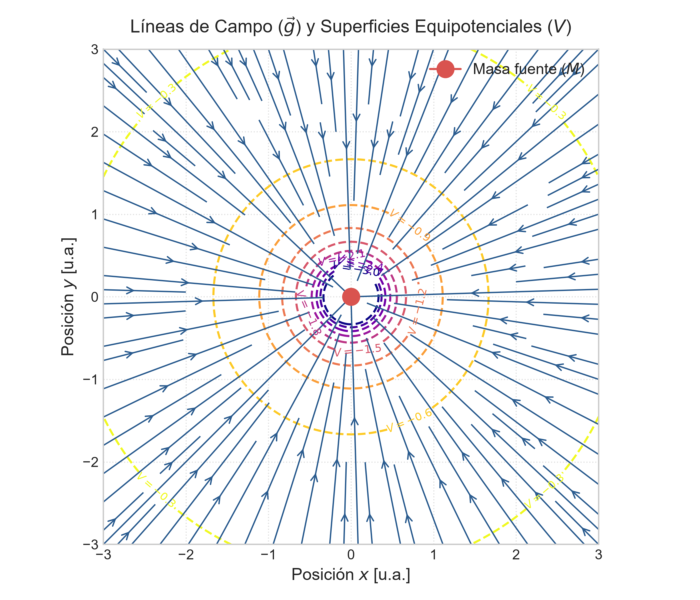
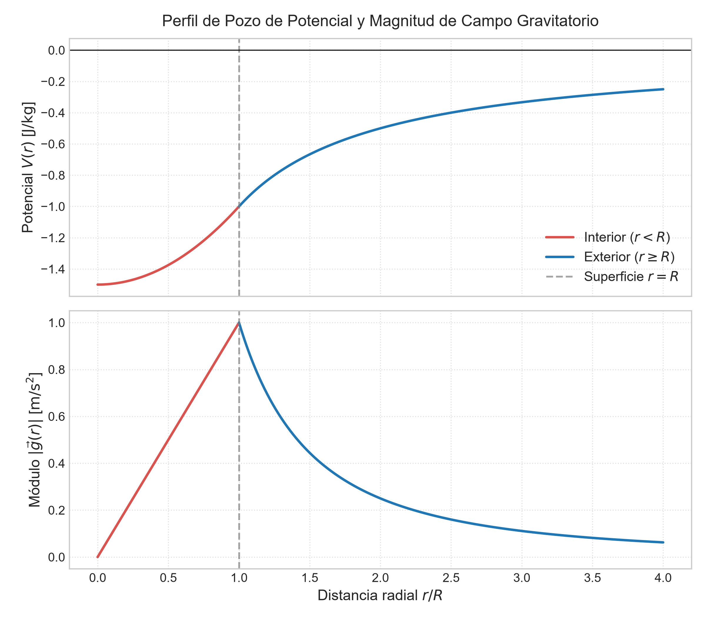

# 🌌 Tema 1.2: Campo y Potencial Gravitatorio

> **Intuición y Propósito del Tema:**
> * **El problema:** La masa no "sabe" mágicamente que otra masa está cerca; altera la estructura geométrica del espacio a su alrededor.
> * **En criollo:** Una masa $M$ crea un "pozo" o deformación en el espacio. Cualquier masa de prueba $m_0$ sumergida en ese espacio siente una fuerza que la arrastra hacia el fondo del pozo.
> * **Eje Conceptual:** Unificamos la descripción vectorial del **Campo Gravitatorio ($\vec{g}$)** (la fuerza por unidad de masa) con la descripción escalar del **Potencial Gravitatorio ($V$)** (la energía por unidad de masa), conectadas mediante la relación de gradiente $\vec{g} = -\nabla V$.

---

### 📌 Contenido de esta nota (Índice interactivo)
- [1. Traductor de Lenguaje Físico y Notación](#1-traductor-de-lenguaje-físico-y-notación)
- [2. Vector Campo Gravitatorio (\vec{g})](#2-vector-campo-gravitatorio-g)
- [3. Potencial Gravitatorio (V) y Energía Potencial (U)](#3-potencial-gravitatorio-v-y-energía-potencial-u)
- [4. Relación de Gradiente y Superficies Equipotenciales](#4-relación-de-gradiente-y-superficies-equipotenciales)
- [5. Campo y Potencial en Distribuciones Continuas Clásicas](#5-campo-y-potencial-en-distribuciones-continuas-clásicas)

---

## 1. Traductor de Lenguaje Físico y Notación

| Símbolo Formal | Lectura Universitaria | Significado Físico / Intuición | Unidades (SI) |
| :--- | :--- | :--- | :---: |
| $\vec{g}$ | Vector Campo Gravitatorio | Intensidad del campo en un punto. Mide la aceleración que experimentaría una masa libre en ese lugar. | $\text{N/kg}$ o $\text{m/s}^2$ |
| $V$ | Potencial Gravitatorio | Escalar que mide el "nivel de altura o energía" del espacio en un punto. Siempre es negativo en un sistema ligado. | $\text{J/kg}$ o $\text{m}^2/\text{s}^2$ |
| $U$ | Energía Potencial Gravitatoria | Energía almacenada por la interacción de un sistema de masas: $U = m_0 V$. | $\text{J}$ ($\text{kg}\cdot\text{m}^2/\text{s}^2$) |
| $\nabla$ | Operador Gradiente | Vector de derivadas parciales $\left(\frac{\partial}{\partial x}, \frac{\partial}{\partial y}, \frac{\partial}{\partial z}\right)$. Mide la máxima pendiente de cambio. | $\text{m}^{-1}$ |
| $W_{\text{campo}}$ | Trabajo Realizado por el Campo | Trabajo de la fuerza gravitatoria. Se relaciona con el potencial como $W_{\text{campo}} = -m_0 \Delta V$. | $\text{J}$ |

---

## 2. Vector Campo Gravitatorio ($\vec{g}$)

### Definición Formal (Cátedra UNCA)
El **campo gravitatorio** $\vec{g}$ en un punto del espacio se define como la fuerza gravitatoria $\vec{F}_g$ ejercida sobre una masa de prueba $m_0$ ubicada en dicho punto, por unidad de masa de prueba cuando esta tiende a cero:

$$\vec{g} = \lim_{m_0 \to 0} \frac{\vec{F}_g}{m_0}$$

Para una masa puntual fuente $M$:
$$\vec{g}(r) = -G \frac{M}{r^2} \hat{r}$$

* **Propiedades Claves:**
  1. **Independencia de la prueba:** $\vec{g}$ es una propiedad **exclusiva del espacio** generada por la masa fuente $M$. No depende de $m_0$.
  2. **Principio de Superposición Vectorial:** Para $N$ masas puntuales:
     $$\vec{g}_{\text{total}} = \sum_{i=1}^N \vec{g}_i = -G \sum_{i=1}^N \frac{M_i}{r_i^2} \hat{r}_i$$

---

## 3. Potencial Gravitatorio ($V$) y Energía Potencial ($U$)

### Deducción Teórica del Potencial
Dado que el campo $\vec{g}$ es conservativo ($\nabla \times \vec{g} = \vec{0}$), el trabajo realizado por el campo sobre una masa de prueba $m_0$ al moverla desde un punto $A$ hasta un punto $B$ no depende de la trayectoria:

$$W_{A \to B} = \int_A^B \vec{F}_g \cdot d\vec{r} = m_0 \int_A^B \vec{g} \cdot d\vec{r}$$

Se define la **Energía Potencial Gravitatoria $U(r)$** fijando el nivel de referencia nulo en el infinito ($U(\infty) = 0$):

$$U(r) = -\int_{\infty}^r F_g dr = -\int_{\infty}^r \left(-G \frac{M m_0}{r'^2}\right) dr' = -G \frac{M m_0}{r}$$

Dividiendo $U(r)$ por la masa de prueba $m_0$, obtenemos el **Potencial Gravitatorio Escalar $V(r)$**:

$$V(r) = \frac{U(r)}{m_0} = -G \frac{M}{r}$$

> 💡 **¿Por qué el Potencial Gravitatorio es Siempre Negativo?**  
> Como la fuerza gravitatoria es atractiva, debemos realizar trabajo *en contra* del campo para alejar un objeto hacia el infinito ($r \to \infty$). Si asignamos $V(\infty) = 0$, todos los puntos finitos del universo se encuentran atrapados en un **pozo de potencial negativo** ($V(r) < 0$).

---

## 4. Relación de Gradiente y Superficies Equipotenciales

### 🗺️ Analogía Topográfica y Gradiente
El potencial $V(x,y,z)$ actúa como la "altitud" en una montaña. El campo $\vec{g}$ representa la dirección de caída de máxima pendiente:

$$\vec{g} = -\nabla V = -\left( \frac{\partial V}{\partial x}\hat{i} + \frac{\partial V}{\partial y}\hat{j} + \frac{\partial V}{\partial z}\hat{k} \right)$$

* En coordenadas esféricas con simetría radial: $\vec{g}(r) = -\frac{d V}{d r} \hat{r}$.

### Superficies Equipotenciales
Una **superficie equipotencial** es el lugar geométrico donde el potencial toma un valor constante ($V = \text{Cte} \implies dV = 0$).

* **Condición de Ortogonalidad:** Como $dV = -\vec{g} \cdot d\vec{r} = 0$, el campo gravitatorio $\vec{g}$ es **estrictamente perpendicular (ortogonal)** a la superficie equipotencial en cada punto.
* Para una masa puntual, las equipotenciales son **esferas concéntricas**.

---

## 5. Campo y Potencial en Distribuciones Continuas Clásicas

Para un cuerpo masivo extendido con densidad $\rho$, sumamos infinitesimales $dm$:

$$V = -G \int \frac{dm}{r} \quad | \quad \vec{g} = -G \int \frac{dm}{r^2} \hat{r}$$

### A. Anillo Masivo Uniforme (En un punto sobre su eje $z$)
Para un anillo de radio $R$ y masa total $M$:

* **Potencial sobre el eje:**  
  $$V(z) = -G \frac{M}{\sqrt{z^2 + R^2}}$$
* **Campo sobre el eje (vía gradiente $g_z = -dV/dz$):**  
  $$\vec{g}(z) = -G \frac{M z}{(z^2 + R^2)^{3/2}} \hat{k}$$

### B. Esfera Masiva Uniforme (Sólida de Radio $R$ y Masa $M$)

* **Exterior ($r \ge R$):** Se comporta idénticamente a una masa puntual concentrada en el centro:
  $$V_{\text{ext}}(r) = -G \frac{M}{r} \quad | \quad \vec{g}_{\text{ext}}(r) = -G \frac{M}{r^2} \hat{r}$$
* **Interior ($r < R$):**
  $$V_{\text{int}}(r) = -\frac{GM}{2R} \left(3 - \frac{r^2}{R^2}\right) \quad | \quad \vec{g}_{\text{int}}(r) = -G \frac{M}{R^3} r \hat{r}$$

## ⚠️ 6. Trampas y Errores Típicos en Exámenes (UNCA)

> ⚠️ **Trampa 1: Error de Signos en el Cálculo del Trabajo ($W_{\text{campo}}$ vs. $W_{\text{agente externo}}$)**  
> **Error común:** Confundir el trabajo que realiza el propio campo gravitatorio con el trabajo necesario que realiza una fuerza externa para mover una masa.  
> **Ecuaciones Inviolables de Parcial:**
> * Trabajo realizado **por el campo gravitatorio**:  
>   $$W_{\text{campo}} = -\Delta U = -m_0 (V_B - V_A) = m_0 (V_A - V_B)$$
> * Trabajo realizado **por un agente externo** (a velocidad constante, $\Delta K = 0$):  
>   $$W_{\text{ext}} = +\Delta U = m_0 (V_B - V_A)$$
> **Explicación para Parcial:** Si acercamos una masa a otra, el campo realiza trabajo **positivo** ($W_{\text{campo}} > 0$), reduciendo la energía potencial del sistema. Un agente externo debe realizar trabajo **negativo** para frenarla o retenerla.

> ⚠️ **Trampa 2: Sumar Vectorialmente Potenciales o Escalarmente Campos**  
> **Error grave de concepto:** Tratar el campo $\vec{g}$ como un escalar o el potencial $V$ como un vector.  
> **Criterio de Cátedra:**
> * $\vec{g}$ es un **vector**: Se descompone obligatoriamente en componentes Cartesianas ($g_x, g_y, g_z$) usando senos/cosenos antes de sumar.
> * $V$ es un **escalar**: Se suma algebraicamente conservando los signos negativos de cada término ($V_{\text{total}} = V_1 + V_2 + \dots$). ¡Jamás lleva componentes ni ángulos!

> ⚠️ **Trampa 3: Descontinuidad e Integración Errónea en Distribuciones Continuas**  
> **Error común:** Olvidar que el potencial $V(r)$ debe ser una **función continua** en las fronteras (por ejemplo, en $r = R$ en una esfera uniforme).  
> **Regla de Validación:** Al evaluar la fórmula del interior $V_{\text{int}}(R)$ y del exterior $V_{\text{ext}}(R)$, ambas expresiones **deben dar exactamente el mismo valor**:  
> $$V_{\text{int}}(R) = -\frac{GM}{2R}(3 - 1) = -\frac{GM}{R} = V_{\text{ext}}(R)$$

---

## 📝 7. Ejercicios Resueltos Paso a Paso de Parcial

> **Ejercicio 1 (Sistema Discreto de Masas Puntuales - Parcial UNCA):**  
> *Tres masas puntuales de $M_1 = 100\,\text{kg}$, $M_2 = 200\,\text{kg}$ y $M_3 = 100\,\text{kg}$ se ubican en las esquinas de un cuadrado de lado $a = 2\,\text{m}$ sobre el plano $xy$: $M_1$ en $(0,a)$, $M_2$ en $(0,0)$ y $M_3$ en $(a,0)$.*  
> 1. *Calcular el vector campo gravitatorio total $\vec{g}$ en la esquina vacía $P(a,a)$.*  
> 2. *Calcular el potencial gravitatorio $V$ en el punto $P(a,a)$.*  
> 3. *Calcular el trabajo necesario realizado por un agente externo para traer una cuarta masa $m_0 = 10\,\text{kg}$ desde el infinito hasta $P(a,a)$.*

### Desarrollo Paso a Paso (Ejercicio 1):

* **Paso 1: Cálculo de Distancias y Vectores Unitarios hacia $P(a,a)$**
  * Distancia de $M_1(0,a)$ a $P(a,a)$: $r_1 = a = 2\,\text{m}$ (Dirección $+\hat{i}$).
  * Distancia de $M_3(a,0)$ a $P(a,a)$: $r_3 = a = 2\,\text{m}$ (Dirección $+\hat{j}$).
  * Distancia de $M_2(0,0)$ a $P(a,a)$: $r_2 = \sqrt{a^2 + a^2} = a\sqrt{2} = 2\sqrt{2}\,\text{m}$ (Ángulo $\theta = 45^\circ$).

* **Paso 2: Componentes del Campo Gravitatorio Total $\vec{g}_P$**
  * Nota: El campo siempre apunta **hacia las masas fuentes**.
  * Componente $g_x$:  
    $$g_x = -G \frac{M_1}{r_1^2} - G \frac{M_2}{r_2^2} \cos(45^\circ) = -G \left( \frac{100}{2^2} + \frac{200}{(2\sqrt{2})^2} \frac{\sqrt{2}}{2} \right)$$
    $$g_x = -G \left( 25 + 25\sqrt{2} \right) \approx -60,355 \cdot G = -4,028 \times 10^{-9}\,\text{m/s}^2$$
  * Componente $g_y$:  
    $$g_y = -G \frac{M_3}{r_3^2} - G \frac{M_2}{r_2^2} \operatorname{sen}(45^\circ) = -G \left( \frac{100}{2^2} + \frac{200}{8} \frac{\sqrt{2}}{2} \right)$$
    $$g_y = -G \left( 25 + 17,677 \right) \approx -60,355 \cdot G = -4,028 \times 10^{-9}\,\text{m/s}^2$$
  * Vector Campo Final:  
    $$\vec{g}_P = (-4,03 \hat{i} - 4,03 \hat{j}) \times 10^{-9}\,\text{m/s}^2$$

* **Paso 3: Cálculo del Potencial Gravitatorio Escalar $V_P$**
  $$V_P = -G \sum_{i=1}^3 \frac{M_i}{r_i} = -G \left( \frac{M_1}{a} + \frac{M_2}{a\sqrt{2}} + \frac{M_3}{a} \right)$$
  $$V_P = -G \left( \frac{100}{2} + \frac{200}{2\sqrt{2}} + \frac{100}{2} \right) = -G \left( 50 + 70,71 + 50 \right)$$
  $$V_P = -G (170,71) \approx -1,139 \times 10^{-8}\,\text{J/kg}$$

* **Paso 4: Cálculo del Trabajo del Agente Externo desde el Infinito**
  Como $V(\infty) = 0$:
  $$W_{\text{ext}} = m_0 (V_P - V_\infty) = m_0 V_P$$
  $$W_{\text{ext}} = (10\,\text{kg}) \cdot (-1,139 \times 10^{-8}\,\text{J/kg}) = -1,139 \times 10^{-7}\,\text{J}$$
  *Interpretación:* El trabajo del agente externo es **negativo**, lo que indica que el agente debe frenar la masa $m_0$, ya que la atracción gravitatoria del sistema la atrae espontáneamente hacia el pozo de potencial.

---

> **Ejercicio 2 (Potencial de Anillo Masivo - Parcial UNCA):**  
> *Demostrar que el potencial sobre el eje de un anillo masivo $V(z) = -G \frac{M}{\sqrt{z^2 + R^2}}$ tiende al comportamiento de una masa puntual cuando $z \gg R$.*

### Desarrollo Formal de Parcial:

* **Paso 1: Extracción del Término Dominante en la Raíz**
  $$V(z) = -G \frac{M}{\sqrt{z^2 \left(1 + \frac{R^2}{z^2}\right)}} = -G \frac{M}{|z| \sqrt{1 + \frac{R^2}{z^2}}}$$

* **Paso 2: Aplicación del Límite de Aproximación ($z \gg R$)**
  Cuando $z \to \infty$, la relación $\frac{R^2}{z^2} \to 0$. Aplicando la aproximación binomial $(1 + x)^{-1/2} \approx 1 - \frac{1}{2}x$:
  $$V(z) \approx -G \frac{M}{z} \left( 1 - \frac{1}{2} \frac{R^2}{z^2} \right) \xrightarrow{z \gg R} -G \frac{M}{z}$$
  *Conclusión:* A distancias muy grandes comparadas con el radio del anillo ($z \gg R$), la geometría extendida se vuelve despreciable y el campo/potencial coincide exactamente con el de una **masa puntual $M$**.

---

## 8. Conexión con el Siguiente Tema (Leyes de Conservación)

El análisis del pozo de potencial $-GM/r$ nos brinda la herramienta matemática fundamental para abordar el **Tema 1.3: Conservación de la Energía Mecánica y Órbitas Satelitales**:
* Evaluaremos la energía mecánica total $E = K + U = \frac{1}{2}mv^2 - \frac{GMm}{r}$.
* Demostraremos cómo el valor y signo de $E$ clasifica las cónicas de las órbitas (Elíptica/Circular si $E < 0$, Parabólica si $E = 0$, Hiperbólica si $E > 0$).
* Derivaremos analíticamente la **Velocidad de Escape ($v_e$)**.

---

## 🔗 Enlaces Relacionados
* [[1.1-Gravitacion-Universal-y-Leyes-de-Kepler|⬅️ Tema 1.1: Ley de Gravitación Universal y Leyes de Kepler]]
* [[1.3-Energia-Orbital-y-Velocidad-de-Escape|➡️ Tema 1.3: Energía Orbital y Velocidad de Escape]]
* [[../README|📚 Menú Principal de Física II]]

## Referencias
* *Cátedra:* Física II – UNCA (Unidad 1: Gravitación y Mecánica Celeste, Sección 1.2).