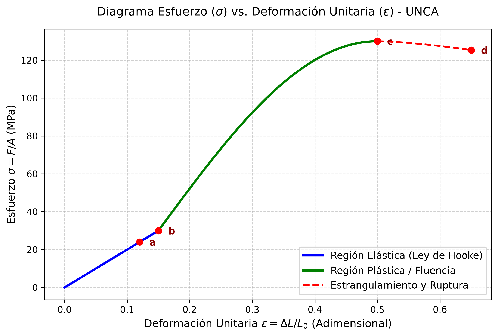
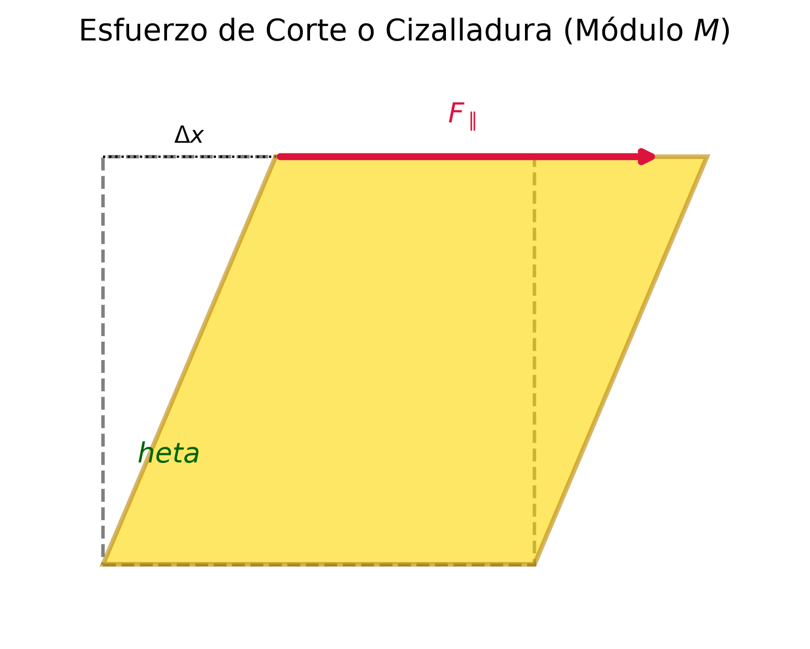
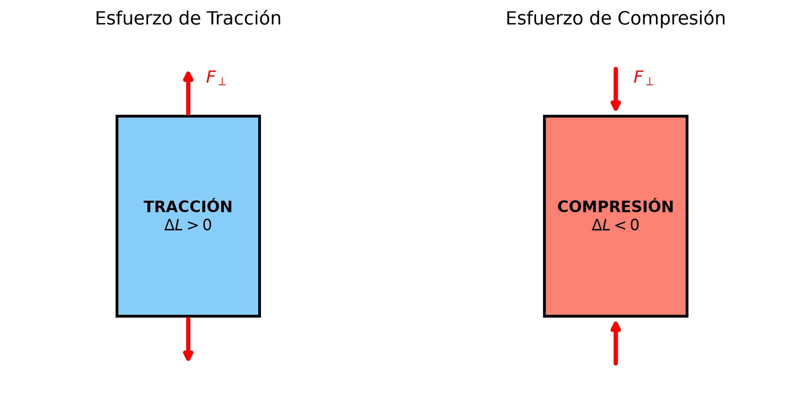

# 🧱 Tema 2.1: Elasticidad, Módulos y Ley de Hooke

> **Intuición y Propósito del Tema:**
> La **Mecánica de Materiales** estudia cómo responden los cuerpos reales cuando se les aplican fuerzas externas.
> * **En criollo:** A diferencia del "cuerpo rígido ideal" que no cambia su forma jamás, los materiales reales se estiran, se aplastan, se tuercen o se comprimen. Dependiendo de la magnitud del esfuerzo y del material, el cuerpo puede volver a su forma original (comportamiento elástico) o quedar deformado para siempre (comportamiento plástico).
> * **Eje Conceptual:** Relacionar las fuerzas aplicadas por unidad de área (**Esfuerzo**) con la deformación relativa resultante (**Deformación Unitaria**). La constante de proporcionalidad entre ambas es el **Módulo de Elasticidad** (Young, Corte o Volumétrico), característico de cada material.

---

### 📌 Contenido de esta nota (Índice interactivo)
- [🧱 Tema 2.1: Elasticidad, Módulos y Ley de Hooke](#-tema-21-elasticidad-módulos-y-ley-de-hooke)
    - [📌 Contenido de esta nota (Índice interactivo)](#-contenido-de-esta-nota-índice-interactivo)
  - [1. Traductor de Lenguaje Físico y Notación](#1-traductor-de-lenguaje-físico-y-notación)
  - [Clasificación según la Cátedra (UNCA):](#clasificación-según-la-cátedra-unca)
  - [3. Definición: Esfuerzo, Deformación y Módulo](#3-definición-esfuerzo-deformación-y-módulo)
    - [1. Esfuerzo ($\\epsilon$ o $\\sigma$)](#1-esfuerzo-epsilon-o-sigma)
    - [2. Deformación Unitaria ($\\delta$)](#2-deformación-unitaria-delta)
    - [3. Módulo Elástico](#3-módulo-elástico)
  - [4. Módulos de Elasticidad y Tipos de Esfuerzo](#4-módulos-de-elasticidad-y-tipos-de-esfuerzo)
    - [4.1 Tracción y Compresión (Módulo de Young $Y$)](#41-tracción-y-compresión-módulo-de-young-y)
      - [Fórmulas Formales:](#fórmulas-formales)
    - [4.2 Corte o Cizalladura (Módulo de Corte $M$)](#42-corte-o-cizalladura-módulo-de-corte-m)
      - [Fórmulas Formales:](#fórmulas-formales-1)
    - [4.3 Volumétrico y Presión Hydrostática (Módulo $B$ y Compresibilidad $k$)](#43-volumétrico-y-presión-hydrostática-módulo-b-y-compresibilidad-k)
      - [Fórmulas Formales:](#fórmulas-formales-2)
  - [5. Ley de Hooke y Diagrama Esfuerzo-Deformación](#5-ley-de-hooke-y-diagrama-esfuerzo-deformación)
    - [Formulación de la Ley de Hooke](#formulación-de-la-ley-de-hooke)
    - [Diagrama Esfuerzo ($\\sigma$) vs Deformación ($\\epsilon$)](#diagrama-esfuerzo-sigma-vs-deformación-epsilon)
      - [Puntos Críticos del Diagrama (Examen UNCA):](#puntos-críticos-del-diagrama-examen-unca)
  - [6. Análisis Dimensional y Cancelación de Unidades Paso a Paso](#6-análisis-dimensional-y-cancelación-de-unidades-paso-a-paso)
    - [Caso 1: Demostración de las Unidades del Módulo de Young ($Y$)](#caso-1-demostración-de-las-unidades-del-módulo-de-young-y)
    - [Caso 2: Unidades del Coeficiente de Compresibilidad ($k$)](#caso-2-unidades-del-coeficiente-de-compresibilidad-k)
  - [⚠️ 7. Trampas y Errores Típicos en Exámenes (UNCA)](#️-7-trampas-y-errores-típicos-en-exámenes-unca)
  - [📝 8. Ejercicios Resueltos Paso a Paso de Parcial](#-8-ejercicios-resueltos-paso-a-paso-de-parcial)
    - [Desarrollo Paso a Paso (Ejercicio 1):](#desarrollo-paso-a-paso-ejercicio-1)
    - [Desarrollo Paso a Paso (Ejercicio 2):](#desarrollo-paso-a-paso-ejercicio-2)
  - [9. Conexión con el Siguiente Tema](#9-conexión-con-el-siguiente-tema)
  - [🔗 Enlaces Relacionados](#-enlaces-relacionados)
  - [Referencias](#referencias)

## 1. Traductor de Lenguaje Físico y Notación

| Símbolo Formal | Lectura Universitaria | Significado Físico / Intuición | Unidades SI | Unidades Fundamentales |
| :--- | :--- | :--- | :---: | :---: |
| $\epsilon$ (o $\sigma$) | Esfuerzo / Tensión | Fuerza distribuida por unidad de área transversal que causa la deformación. | $\text{N/m}^2 = \text{Pa}$ | $\text{kg} \cdot \text{m}^{-1} \cdot \text{s}^{-2}$ |
| $\delta$ (o $\epsilon_u$) | Deformación Unitaria | Cambio relativo de dimensión (cambio de longitud, ángulo o volumen sobre dimensión inicial). | Adimensional ($1$) | $1$ (sin dimensiones) |
| $Y$ | Módulo de Young | Resistencia de un sólido a cambiar su longitud ante tracción o compresión. | $\text{N/m}^2 = \text{Pa}$ | $\text{kg} \cdot \text{m}^{-1} \cdot \text{s}^{-2}$ |
| $M$ (o $G$) | Módulo de Corte / Rigidez | Resistencia de un sólido al deslizamiento de sus capas paralelas (cizalla). | $\text{N/m}^2 = \text{Pa}$ | $\text{kg} \cdot \text{m}^{-1} \cdot \text{s}^{-2}$ |
| $B$ | Módulo Volumétrico | Resistencia de un fluido o sólido a cambiar su volumen ante una presión uniforme. | $\text{N/m}^2 = \text{Pa}$ | $\text{kg} \cdot \text{m}^{-1} \cdot \text{s}^{-2}$ |
| $k$ | Compresibilidad | Facilidad con la que una sustancia cambia de volumen bajo presión ($k = 1/B$). | $\text{Pa}^{-1} = \text{m}^2/\text{N}$ | $\text{kg}^{-1} \cdot \text{m} \cdot \text{s}^2$ |
| $L_0$ | Longitud Inicial | Dimensión longitudinal original del cuerpo antes de aplicar la fuerza. | $\text{m}$ | $\text{m}$ |
| $\Delta L$ | Alargamiento / Acortamiento | Variación absoluta de la longitud ($\Delta L = L - L_0$). | $\text{m}$ | $\text{m}$ |
| $A$ | Área de Sección Transversal | Superficie sobre la cual actúa la fuerza externa ($A_\perp$ o $A_\parallel$). | $\text{m}^2$ | $\text{m}^2$ |
| $\theta$ | Ángulo de Cizalladura | Ángulo de distorsión angular en radianes debido al esfuerzo de corte. | $\text{rad}$ | $1$ (Adimensional) |

## Clasificación según la Cátedra (UNCA):
- **Cuerpo Elástico:** Aquel que recupera sus dimensiones originales cuando cesa la acción de la fuerza deformadora. (Ejemplo: alambre de acero con cargas pequeñas, resorte helicoidal).
- **Cuerpo Inelástico:** Aquel que no recupera su forma original tras retirar el esfuerzo.
- **Cuerpo Plástico:** Aquel que experimenta una deformación permanente y no genera fuerzas internas de restitución para volver al estado inicial. 

---

## 3. Definición: Esfuerzo, Deformación y Módulo

Para caracterizar el comportamiento de un material independientemente de sus dimensiones geométricas, la física define tres conceptos universales:

### 1. Esfuerzo ($\epsilon$ o $\sigma$)
Es la intensidad de la fuerza interna distribuida por unidad de área de la sección sobre la cual actúa[cite: 3]:

$$\epsilon = \frac{F}{A}$$

* **Unidades en el SI:** $\frac{\text{N}}{\text{m}^2} = \text{Pascal} \, (\text{Pa})$[cite: 3].

---

### 2. Deformación Unitaria ($\delta$)
Es el cambio relativo en las dimensiones del cuerpo respecto a su dimensión inicial[cite: 3]:

$$\delta = \frac{\text{Variación de Dimensión}}{\text{Dimensión Inicial}}$$

* **Propiedad clave:** La deformación unitaria es un **número adimensional** (sin unidades)[cite: 3]. 

---

### 3. Módulo Elástico
Es la constante de proporcionalidad entre el esfuerzo aplicado y la deformación unitaria producida[cite: 3]. Mide la "rigidez" del material:

$$\text{Módulo Elástico} = \frac{\text{Esfuerzo}}{\text{Deformación Unitaria}}$$

$$\text{Módulo} = \frac{\epsilon}{\delta}$$

* **Unidades en el SI:** Al ser la deformación unitaria adimensional, el Módulo de Elasticidad tiene **exactamente las mismas unidades que el esfuerzo** ($\text{N/m}^2$ o $\text{Pa}$)[cite: 3].

---

## 4. Módulos de Elasticidad y Tipos de Esfuerzo

Se distinguen tres tipos fundamentales de alteración estructural de los sólidos[cite: 3]:

---

### 4.1 Tracción y Compresión (Módulo de Young $Y$)

Se presenta cuando una fuerza perpendicular $F_\perp$ actúa de forma uniforme sobre la sección transversal $A$ de una barra o alambre de longitud inicial $L_0$[cite: 3].

* **Tracción:** La fuerza tiende a estirar el cuerpo ($\Delta L > 0$)[cite: 3].
* **Compresión:** La fuerza tiende a aplastar el cuerpo ($\Delta L < 0$)[cite: 3].

#### Fórmulas Formales:
* **Esfuerzo Longitudinal:**
  $$\epsilon = \frac{F_\perp}{A}$$

* **Deformación Unitaria Longitudinal:**
  $$\delta = \frac{\Delta L}{L_0}$$

* **Módulo de Young ($Y$):**
  $$Y = \frac{\frac{F_\perp}{A}}{\frac{\Delta L}{L_0}} = \frac{F_\perp \cdot L_0}{A \cdot \Delta L}$$

---

### 4.2 Corte o Cizalladura (Módulo de Corte $M$)

Ocurre cuando sobre un cuerpo actúa una fuerza paralela $F_\parallel$ a una de sus caras de área $A$, mientras que la cara opuesta se mantiene fija[cite: 3]. Esto provoca un desplazamiento lateral $\Delta x$ entre planos paralelos y un distorsionamiento angular $\theta$[cite: 3].

#### Fórmulas Formales:
* **Esfuerzo de Corte:**
  $$\epsilon_{\text{corte}} = \frac{F_\parallel}{A}$$

* **Deformación Unitaria de Corte:**
  Para ángulos pequeños ($\theta \ll 1\,\text{rad}$), se cumple $\tan\theta \approx \sin\theta \approx \theta$[cite: 3]:
  $$\delta_{\text{corte}} = \frac{\Delta x}{L} = \tan\theta \approx \theta \quad (\text{en radianes})$$

* **Módulo de Corte o Rigidez ($M$):**
  $$M = \frac{\frac{F_\parallel}{A}}{\frac{\Delta x}{L}} = \frac{F_\parallel}{A \cdot \theta}$$

---

### 4.3 Volumétrico y Presión Hydrostática (Módulo $B$ y Compresibilidad $k$)

Se produce cuando un cuerpo sumergido en un fluido recibe una fuerza perpendicular uniforme en toda su superficie externa[cite: 3]. La fuerza por unidad de área se denomina **Presión ($P = F_\perp / A$)**[cite: 3].

#### Fórmulas Formales:
* **Esfuerzo Volumétrico (Presión):**
  $$P = \frac{F_\perp}{A}$$

* **Deformación Unitaria Volumétrica:**
  $$\delta_V = \frac{\Delta V}{V_0}$$

* **Módulo Volumétrico ($B$):**
  $$B = -\frac{\frac{F_\perp}{A}}{\frac{\Delta V}{V_0}} = -\frac{\Delta P}{\frac{\Delta V}{V_0}}$$
  > **Nota sobre el Signo Negativo ($-$):** Se incluye explícitamente porque un aumento de presión ($\Delta P > 0$) siempre produce una disminución del volumen ($\Delta V < 0$), garantizando que el módulo $B$ sea una cantidad estrictamente positiva[cite: 3].

* **Coeficiente de Compresibilidad ($k$):**
  Es el recíproco o inverso multiplicativo del módulo volumétrico[cite: 3]:
  $$k = \frac{1}{B} = -\frac{\frac{\Delta V}{V_0}}{\Delta P}$$

---

## 5. Ley de Hooke y Diagrama Esfuerzo-Deformación

### Formulación de la Ley de Hooke
Enunciada por Robert Hooke, establece que para deformaciones elásticas pequeñas, **el esfuerzo es directamente proporcional a la deformación unitaria**[cite: 3].

* **Forma General:**
  $$\text{Esfuerzo} \propto \text{Deformación Unitaria}$$

* **Forma Escalar de la Fuerza Restauradora:**
  $$F = -k \cdot \Delta x$$
  * $k$: Constante elástica del cuerpo o resorte ($\text{N/m}$).
  * Signo negativo ($-$): Indica que la fuerza recuperadora es opuesta al sentido del desplazamiento $\Delta x$[cite: 3].

---

### Diagrama Esfuerzo ($\sigma$) vs Deformación ($\epsilon$)
Representa la respuesta mecánica completa de un material metálico (ductil) sometido a tracción progresiva[cite: 3]:

#### Puntos Críticos del Diagrama (Examen UNCA):
1. **Punto a (Límite de Proporcionalidad):** Fin del tramo rectilíneo. Hasta aquí se cumple estrictamente la Ley de Hooke ($\sigma = Y \cdot \epsilon$)[cite: 3].
2. **Punto b (Límite Elástico):** Esfuerzo máximo que el material puede soportar sin sufrir deformaciones permanentes. Si se quita la carga antes de $b$, el objeto recupera su longitud $L_0$[cite: 3].
3. **Límite de Cedencia / Fluencia ($LC$):** Valor mínimo de esfuerzo a partir del cual el material "fluye" o se deforma plásticamente con muy poco incremento de carga[cite: 3]:
   $$LC = \frac{F_{\min}}{A}$$
4. **Punto c (Comportamiento Plástico / Deformación Permanente):** Tramo no lineal por encima del límite elástico. Al retirar la fuerza en esta zona, el material conserva un estiramiento remanente[cite: 3].
5. **Límite de Resistencia a la Rotura ($LRR$):** Esfuerzo máximo absoluto que puede soportar el material antes de colapsar[cite: 3]:
   $$LRR = \frac{F_{\max}}{A}$$
6. **Punto d (Punto de Ruptura):** Instante en el que el material se fractura físicamente[cite: 3].

---

## 6. Análisis Dimensional y Cancelación de Unidades Paso a Paso

En la cátedra de la UNCA es obligatorio justificar la eliminación algebraica de magnitudes para validar el resultado final[cite: 2, 3].

### Caso 1: Demostración de las Unidades del Módulo de Young ($Y$)
Partiendo de la definición:
$$Y = \frac{\frac{F_\perp}{A}}{\frac{\Delta L}{L_0}}$$

1. **Expresión de Unidades en el Sistema Internacional (SI):**
   $$[Y] = \frac{\frac{\text{N}}{\text{m}^2}}{\frac{\text{m}}{\text{m}}}$$

2. **Cancelación Estricta en la Deformación Unitaria:**
   $$\frac{\text{m}}{\text{m}} = \text{m}^{1-1} = \text{m}^0 = 1 \quad \implies \text{Adimensional}$$

3. **Reemplazo en la Fracción Principal:**
   $$[Y] = \frac{\frac{\text{N}}{\text{m}^2}}{1} = \frac{\text{N}}{\text{m}^2} = \text{Pa}$$

4. **Descomposición a Unidades Fundamentales del SI ($\text{kg}, \text{m}, \text{s}$):**
   Como $1\,\text{N} = 1\,\text{kg} \cdot \text{m} \cdot \text{s}^{-2}$:
   $$[Y] = \frac{\text{kg} \cdot \text{m} \cdot \text{s}^{-2}}{\text{m}^2} = \text{kg} \cdot \text{m}^{1-2} \cdot \text{s}^{-2} = \text{kg} \cdot \text{m}^{-1} \cdot \text{s}^{-2}$$

---

### Caso 2: Unidades del Coeficiente de Compresibilidad ($k$)
$$k = \frac{1}{B} \implies [k] = \frac{1}{[B]} = \frac{1}{\frac{\text{N}}{\text{m}^2}} = \frac{\text{m}^2}{\text{N}} = \text{Pa}^{-1}$$

Descomposición fundamental:
$$[k] = \frac{\text{m}^2}{\text{kg} \cdot \text{m} \cdot \text{s}^{-2}} = \text{kg}^{-1} \cdot \text{m}^{2-1} \cdot \text{s}^2 = \text{kg}^{-1} \cdot \text{m} \cdot \text{s}^2$$

---

## ⚠️ 7. Trampas y Errores Típicos en Exámenes (UNCA)

> ⚠️ **Trampa 1: Conversión Incompleta de Milímetros Cuadrados ($\text{mm}^2$) a Metros Cuadrados ($\text{m}^2$)**  
> **Error común:** Escribir $15\,\text{mm}^2 = 15 \times 10^{-3}\,\text{m}^2$.  
> **Por qué se invalida:** El prefijo mili ($10^{-3}$) debe elevarse al cuadrado:  
> $$1\,\text{mm} = 10^{-3}\,\text{m} \implies 1\,\text{mm}^2 = (10^{-3}\,\text{m})^2 = 10^{-6}\,\text{m}^2$$  
> **Regla Inviolable:** $15\,\text{mm}^2 = 15 \times 10^{-6}\,\text{m}^2$.

> ⚠️ **Trampa 2: Área de Corte en Punzonado de Placas vs. Área Transversal de Pernos**  
> **Error de cizalladura:** Al calcular la fuerza para perforar una placa de espesor $t$ con un punzón circular de diámetro $d$, usar el área del círculo ($A = \pi d^2 / 4$)[cite: 3].  
> **Corrección:** El corte de la placa ocurre en la **superficie lateral del cilindro extraído**[cite: 3]:  
> $$A_{\text{lateral}} = \text{Perímetro} \times \text{Espesor} = (\pi \cdot d) \cdot t$$

> ⚠️ **Trampa 3: Confundir Deformación Unitaria con Porcentaje de Deformación**  
> **Error:** Reemplazar un alargamiento del $0,125\%$ como $\delta = 0,125$.  
> **Corrección:** El porcentaje incluye un factor $100$. La deformación unitaria pura es[cite: 3]:  
> $$\delta = \frac{0,125}{100} = 1,25 \times 10^{-3}$$

> ⚠️ **Trampa 4: Omitir la Masa o Masa por Gravedad ($F = m \cdot g$)**  
> **Error:** Usar la masa $M = 454\,\text{kg}$ directamente en la fórmula de esfuerzo $\epsilon = F/A$.  
> **Corrección:** Convertir siempre la masa suspendida a Fuerza Peso (en Newtons)[cite: 3]:  
> $$F = M \cdot g = 454\,\text{kg} \times 9,8\,\text{m/s}^2 = 4449,2\,\text{N}$$

---

## 📝 8. Ejercicios Resueltos Paso a Paso de Parcial

> **Ejercicio 1 (Cálculo del Módulo de Young - Apunte Cátedra UNCA):**  
> *Una carga de $M = 454\,\text{kg}$ se suspende de un alambre de acero de $L_0 = 2,4\,\text{m}$ de longitud y $A = 15\,\text{mm}^2$ de sección transversal.*  
> *Produce un alargamiento de $\Delta L = 3\,\text{mm}$.*  
> *Calcular: a) El esfuerzo ($\epsilon$), b) La deformación unitaria ($\delta$), c) El Módulo de Young ($Y$).*[cite: 3]

### Desarrollo Paso a Paso (Ejercicio 1):

* **Paso 1: Conversión de datos al SI**
  * $F_\perp = M \cdot g = 454\,\text{kg} \times 9,8\,\frac{\text{m}}{\text{s}^2} = 4449,2\,\text{N}$[cite: 3]
  * $A = 15\,\text{mm}^2 = 15 \times 10^{-6}\,\text{m}^2$[cite: 3]
  * $\Delta L = 3\,\text{mm} = 3 \times 10^{-3}\,\text{m}$[cite: 3]

* **Paso 2: Cálculo del Esfuerzo ($\epsilon$)**
  $$\epsilon = \frac{F_\perp}{A} = \frac{4449,2\,\text{N}}{15 \times 10^{-6}\,\text{m}^2} = 2,966 \times 10^8\,\frac{\text{N}}{\text{m}^2} \approx 2,97 \times 10^8\,\text{Pa}$$[cite: 3]

* **Paso 3: Cálculo de la Deformación Unitaria ($\delta$)**
  $$\delta = \frac{\Delta L}{L_0} = \frac{3 \times 10^{-3}\,\text{m}}{2,4\,\text{m}} = 1,25 \times 10^{-3} \quad (0,125\%)$$[cite: 3]

* **Paso 4: Cálculo del Módulo de Young ($Y$)**
  $$Y = \frac{\epsilon}{\delta} = \frac{2,97 \times 10^8\,\frac{\text{N}}{\text{m}^2}}{1,25 \times 10^{-3}} = 2,376 \times 10^{11}\,\frac{\text{N}}{\text{m}^2} \approx 2,38 \times 10^{11}\,\text{Pa}$$[cite: 3]

---

> **Ejercicio 2 (Esfuerzo de Corte y Punzonado - Apunte Cátedra UNCA):**  
> *El esfuerzo de corte máximo para romper el acero es de $4,00 \times 10^8\,\text{N/m}^2$.*[cite: 3]  
> *Determinar la fuerza de corte necesaria para:*  
> *a) Cortar un perno de acero de $d = 1,00\,\text{cm}$ de diámetro.*[cite: 3]  
> *b) Hacer un orificio de $d = 1,00\,\text{cm}$ de diámetro en una placa de acero de $t = 0,500\,\text{cm}$ de espesor.*[cite: 3]

### Desarrollo Paso a Paso (Ejercicio 2):

* **Paso 1: Parte a) Corte de Perno (Área de Sección Transversal Circular)**
  $$A_{\text{perno}} = \pi \frac{d^2}{4} = \pi \frac{(1,00 \times 10^{-2}\,\text{m})^2}{4} = \frac{\pi}{4} \times 10^{-4}\,\text{m}^2$$[cite: 3]
  $$F = M_{\text{ruptura}} \cdot A_{\text{perno}} = (4,00 \times 10^8\,\frac{\text{N}}{\text{m}^2}) \cdot \left(\frac{\pi}{4} \times 10^{-4}\,\text{m}^2\right) = \pi \times 10^4\,\text{N} \approx 31.416\,\text{N}$$[cite: 3]

* **Paso 2: Parte b) Punzonado de Placa (Área Lateral Cilíndrica)**
  $$A_{\text{lateral}} = \pi \cdot d \cdot t = \pi \cdot (1,00 \times 10^{-2}\,\text{m}) \cdot (0,500 \times 10^{-2}\,\text{m}) = 0,500\pi \times 10^{-4}\,\text{m}^2$$[cite: 3]
  $$F = M_{\text{ruptura}} \cdot A_{\text{lateral}} = (4,00 \times 10^8\,\frac{\text{N}}{\text{m}^2}) \cdot (0,500\pi \times 10^{-4}\,\text{m}^2) = 2\pi \times 10^4\,\text{N} \approx 62.832\,\text{N}$$[cite: 3]

---

## 9. Conexión con el Siguiente Tema

El estudio de las deformaciones elásticas bajo la Ley de Hooke ($F = -k \Delta x$) sienta las bases dinámicas y energéticas directas para:
* **Tema 2.2:** Integrar la fuerza recuperadora para definir el Trabajo ($W = \int F dx$) y la **Energía Potencial Elástica ($U = \frac{1}{2} k x^2$)** acumulada en los cuerpos deformados[cite: 2].
* **Unidad III:** Formular la ecuación diferencial del **Movimiento Armónico Simple (M.A.S.)** a partir de la constante elástica $k$ y la masa $m$[cite: 2, 3].

---

## 🔗 Enlaces Relacionados
* [[2.2-Energia-Potencial-Elastica-y-Trabajo|➡️ Tema 2.2: Energía Potencial Elástica y Trabajo]]
* [[../Unidad III/3.1-Movimiento-Armonico-Simple-MAS-Ecuaciones|➡️ Unidad III: Movimiento Armónico Simple]]
* [[../README|📚 Menú Principal de Física II]]

## Referencias
* *Cátedra:* Física II – UNCA (Unidad 2: Elasticidad de Cuerpos Sólidos, Módulos y Ley de Hooke).