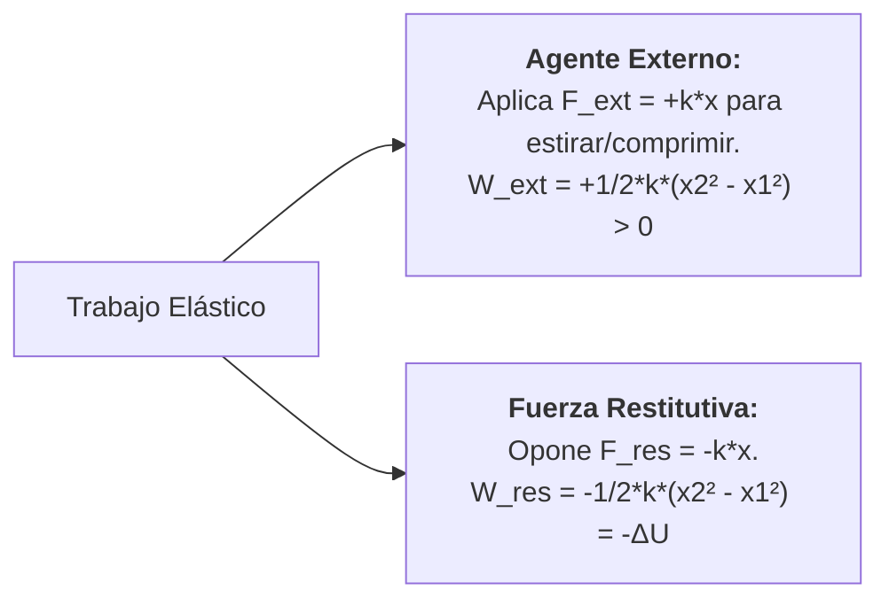
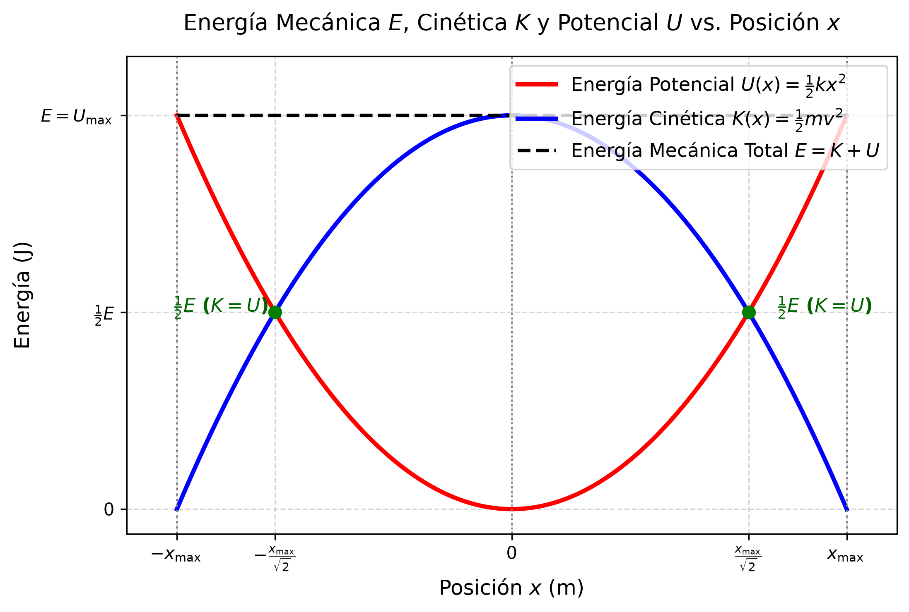

# ⚡ Tema 2.2: Energía Potencial Elástica y Trabajo

> **Intuición y Propósito del Tema:**
> La fuerza elástica o recuperadora dada por la Ley de Hooke ($F = -k \Delta x$) es una **fuerza variable** y **conservativa**.
> * **En criollo:** Cuanto más estiras o compprimes un resorte, más fuerza tenés que hacer. Como la fuerza no es constante, el trabajo no se calcula como un simple producto ($F \cdot d$), sino integrando la fuerza. Ese trabajo que realizás contra el resorte queda "almacenado" en forma de **Energía Potencial Elástica** ($U$).
> * **Eje Conceptual:** Calcular el trabajo realizado por y contra la fuerza recuperadora elástica, demostrar la conservación de la energía mecánica en sistemas elásticos sin fricción y deducción analítica de variables de velocidad en función de la posición.

---

### 📌 Contenido de esta nota (Índice interactivo)
- [⚡ Tema 2.2: Energía Potencial Elástica y Trabajo](#-tema-22-energía-potencial-elástica-y-trabajo)
    - [📌 Contenido de esta nota (Índice interactivo)](#-contenido-de-esta-nota-índice-interactivo)
    - [📌 Contenido de esta nota (Índice interactivo)](#-contenido-de-esta-nota-índice-interactivo-1)
  - [1. Traductor de Lenguaje Físico y Notación](#1-traductor-de-lenguaje-físico-y-notación)
  - [2. Trabajo de la Fuerza Elástica (Fuerza Variable)](#2-trabajo-de-la-fuerza-elástica-fuerza-variable)
    - [🔬 Cálculo Integral del Trabajo de la Fuerza Restitutiva (Explicación Paso a Paso)](#-cálculo-integral-del-trabajo-de-la-fuerza-restitutiva-explicación-paso-a-paso)
      - [Justificación Analítica de cada Paso:](#justificación-analítica-de-cada-paso)
  - [3. Deducción de la Energía Potencial Elástica $U(x)$](#3-deducción-de-la-energía-potencial-elástica-ux)
  - [4. Conservación de la Energía Mecánica en Sistemas Elásticos](#4-conservación-de-la-energía-mecánica-en-sistemas-elásticos)
    - [Deducción Analítica de la Rapidez en función de la Posición $v(x)$:](#deducción-analítica-de-la-rapidez-en-función-de-la-posición-vx)
      - [Desarrollo Paso a Paso:](#desarrollo-paso-a-paso)
      - [Puntos Extremos Físicos:](#puntos-extremos-físicos)
  - [5. Análisis Dimensional y Cancelación de Unidades Paso a Paso](#5-análisis-dimensional-y-cancelación-de-unidades-paso-a-paso)
    - [Caso 1: Unidades de la Energía Potencial Elástica $U$](#caso-1-unidades-de-la-energía-potencial-elástica-u)
    - [Caso 2: Unidades de la Rapidez $v(x)$ a partir de $\\sqrt{k/m}$](#caso-2-unidades-de-la-rapidez-vx-a-partir-de-sqrtkm)
  - [⚠️ 6. Trampas y Errores Típicos en Exámenes (UNCA)](#️-6-trampas-y-errores-típicos-en-exámenes-unca)
  - [📝 7. Ejercicios Resueltos Paso a Paso de Parcial](#-7-ejercicios-resueltos-paso-a-paso-de-parcial)
    - [Desarrollo Paso a Paso (Ejercicio 1):](#desarrollo-paso-a-paso-ejercicio-1)
  - [8. Conexión con la Unidad III (Movimiento Armónico Simple)](#8-conexión-con-la-unidad-iii-movimiento-armónico-simple)
  - [🔗 Enlaces Relacionados](#-enlaces-relacionados)
  - [Referencias](#referencias)

> **Intuición y Propósito del Tema:**
> La fuerza elástica o recuperadora dada por la Ley de Hooke ($F = -k \Delta x$) es una **fuerza variable** y **conservativa**.
> * **En criollo:** Cuanto más estiras o compprimes un resorte, más fuerza tenés que hacer. Como la fuerza no es constante, el trabajo no se calcula como un simple producto ($F \cdot d$), sino integrando la fuerza. Ese trabajo que realizás contra el resorte queda "almacenado" en forma de **Energía Potencial Elástica** ($U$).
> * **Eje Conceptual:** Calcular el trabajo realizado por y contra la fuerza recuperadora elástica, demostrar la conservación de la energía mecánica en sistemas elásticos sin fricción y deducción analítica de variables de velocidad en función de la posición.

---

### 📌 Contenido de esta nota (Índice interactivo)
- [⚡ Tema 2.2: Energía Potencial Elástica y Trabajo](#-tema-22-energía-potencial-elástica-y-trabajo)
    - [📌 Contenido de esta nota (Índice interactivo)](#-contenido-de-esta-nota-índice-interactivo)
    - [📌 Contenido de esta nota (Índice interactivo)](#-contenido-de-esta-nota-índice-interactivo-1)
  - [1. Traductor de Lenguaje Físico y Notación](#1-traductor-de-lenguaje-físico-y-notación)
  - [2. Trabajo de la Fuerza Elástica (Fuerza Variable)](#2-trabajo-de-la-fuerza-elástica-fuerza-variable)
    - [🔬 Cálculo Integral del Trabajo de la Fuerza Restitutiva (Explicación Paso a Paso)](#-cálculo-integral-del-trabajo-de-la-fuerza-restitutiva-explicación-paso-a-paso)
      - [Justificación Analítica de cada Paso:](#justificación-analítica-de-cada-paso)
  - [3. Deducción de la Energía Potencial Elástica $U(x)$](#3-deducción-de-la-energía-potencial-elástica-ux)
  - [4. Conservación de la Energía Mecánica en Sistemas Elásticos](#4-conservación-de-la-energía-mecánica-en-sistemas-elásticos)
    - [Deducción Analítica de la Rapidez en función de la Posición $v(x)$:](#deducción-analítica-de-la-rapidez-en-función-de-la-posición-vx)
      - [Desarrollo Paso a Paso:](#desarrollo-paso-a-paso)
      - [Puntos Extremos Físicos:](#puntos-extremos-físicos)
  - [5. Análisis Dimensional y Cancelación de Unidades Paso a Paso](#5-análisis-dimensional-y-cancelación-de-unidades-paso-a-paso)
    - [Caso 1: Unidades de la Energía Potencial Elástica $U$](#caso-1-unidades-de-la-energía-potencial-elástica-u)
    - [Caso 2: Unidades de la Rapidez $v(x)$ a partir de $\\sqrt{k/m}$](#caso-2-unidades-de-la-rapidez-vx-a-partir-de-sqrtkm)
  - [⚠️ 6. Trampas y Errores Típicos en Exámenes (UNCA)](#️-6-trampas-y-errores-típicos-en-exámenes-unca)
  - [📝 7. Ejercicios Resueltos Paso a Paso de Parcial](#-7-ejercicios-resueltos-paso-a-paso-de-parcial)
    - [Desarrollo Paso a Paso (Ejercicio 1):](#desarrollo-paso-a-paso-ejercicio-1)
  - [8. Conexión con la Unidad III (Movimiento Armónico Simple)](#8-conexión-con-la-unidad-iii-movimiento-armónico-simple)
  - [🔗 Enlaces Relacionados](#-enlaces-relacionados)
  - [Referencias](#referencias)

## 1. Traductor de Lenguaje Físico y Notación

| Símbolo Formal | Lectura Universitaria | Significado Físico / Intuición | Unidades SI | Unidades Fundamentales |
| :--- | :--- | :--- | :---: | :---: |
| $W_{\text{ext}}$ | Trabajo de la Fuerza Externa | Trabajo realizado por una agente externo para deformar un cuerpo elástico. | $\text{Joule} \, (\text{J})$ | $\text{kg} \cdot \text{m}^2 \cdot \text{s}^{-2}$ |
| $W_{\text{cons}}$ | Trabajo de la Fuerza Recuperadora | Trabajo realizado por la propia fuerza interna del resorte ($W_{\text{cons}} = -\Delta U$). | $\text{Joule} \, (\text{J})$ | $\text{kg} \cdot \text{m}^2 \cdot \text{s}^{-2}$ |
| $U$ (o $E_p$) | Energía Potencial Elástica | Energía mecánica almacenada en el cuerpo debido a su deformación elástica. | $\text{Joule} \, (\text{J})$ | $\text{kg} \cdot \text{m}^2 \cdot \text{s}^{-2}$ |
| $K$ (o $E_c$) | Energía Cinética | Energía asociada al estado de movimiento traslacional de la masa ($K = \frac{1}{2} m v^2$). | $\text{Joule} \, (\text{J})$ | $\text{kg} \cdot \text{m}^2 \cdot \text{s}^{-2}$ |
| $E$ (o $E_m$) | Energía Mecánica Total | Suma de energía cinética y energía potencial ($E = K + U$). | $\text{Joule} \, (\text{J})$ | $\text{kg} \cdot \text{m}^2 \cdot \text{s}^{-2}$ |
| $k$ | Constante de Rigidez / Elástica | Medida de la rigidez del resorte u objeto deformable. | $\text{N/m}$ | $\text{kg} \cdot \text{s}^{-2}$ |
| $x_{\max}$ (o $A$) | Deformación Máxima / Amplitud | Desplazamiento máximo desde el punto de equilibrio ($x = 0$). | $\text{m}$ | $\text{m}$ |

## 2. Trabajo de la Fuerza Elástica (Fuerza Variable)

En la Ley de Hooke, la fuerza elástica es opuesta y proporcional a la deformación[cite: 2, 3]:
$$F_{\text{resorte}} = -k \cdot x$$

Como la fuerza varía continuamente con la posición $x$, no se puede usar la fórmula simple $W = F \cdot \Delta x$. Se debe recurrir al cálculo integral[cite: 2]:

$$W = \int_{x_1}^{x_2} F(x) \, dx$$

### 🔬 Cálculo Integral del Trabajo de la Fuerza Restitutiva (Explicación Paso a Paso)

> **Pregunta de Parcial UNCA:** *"Demostrar analíticamente el trabajo realizado por la fuerza restauradora de un resorte al desplazarse desde una posición $x_1$ hasta $x_2$."*

$$\begin{aligned}
W_{\text{resorte}} &= \int_{x_1}^{x_2} (-k \cdot x) \, dx \\
&= -k \int_{x_1}^{x_2} x \, dx \\
&= -k \left[ \frac{x^2}{2} \right]_{x_1}^{x_2} \\
&= -\frac{1}{2} k x_2^2 - \left( -\frac{1}{2} k x_1^2 \right) \\
&= -\left( \frac{1}{2} k x_2^2 - \frac{1}{2} k x_1^2 \right)
\end{aligned}$$

#### Justificación Analítica de cada Paso:

1. **Paso 1 (Planteo de la Integral Definida):**  
   $$W_{\text{resorte}} = \int_{x_1}^{x_2} (-k \cdot x) \, dx$$  
   * **¿Por qué?** La fuerza elástica no es constante, varía linealmente con la posición ($F = -k \cdot x$). Para sumar infinitos aportes infinitamente pequeños de trabajo ($dW = F \cdot dx$), aplicamos la integral definida entre el punto inicial $x_1$ y el punto final $x_2$.

2. **Paso 2 (Extracción de la Constante de Rigidez):**  
   $$= -k \int_{x_1}^{x_2} x \, dx$$  
   * **¿Por qué?** La constante del resorte $k$ es un escalar fijo. Por la propiedad de linealidad de las integrales, las constantes multiplicativas salen fuera de la integral.

3. **Paso 3 (Integración de la Función Potencia):**  
   $$= -k \left[ \frac{x^2}{2} \right]_{x_1}^{x_2}$$  
   * **¿Por qué?** Aplicamos la regla fundamental de integración para potencias: $\int x^n \, dx = \frac{x^{n+1}}{n+1}$. Como la potencia de $x$ es $1$, la primitiva es $\frac{x^2}{2}$. Los corchetes indican que debemos evaluar entre los límites $[x_1, x_2]$.

4. **Paso 4 (Aplicación del Regla de Barrow / Teorema Fundamental del Cálculo):**  
   $$= -k \left( \frac{x_2^2}{2} - \frac{x_1^2}{2} \right) = -\frac{1}{2} k x_2^2 - \left( -\frac{1}{2} k x_1^2 \right)$$  
   * **¿Por qué?** Evaluamos la primitiva en el límite superior $x_2$ y le restamos la primitiva evaluada en el límite inferior $x_1$. Luego distribuimos el factor $-k$.

5. **Paso 5 (Agrupación Algebraica y Factor Común del Signo Negativo):**  
   $$= -\left( \frac{1}{2} k x_2^2 - \frac{1}{2} k x_1^2 \right)$$  
   * **¿Por qué?** Al sacar el signo negativo ($-$) como factor común exterior, el paréntesis representa directamente la variación de la energía potencial elástica ($\Delta U = U_2 - U_1$). Con esto se demuestra formalmente que $W_{\text{resorte}} = -\Delta U$.

## 3. Deducción de la Energía Potencial Elástica $U(x)$

En la mecánica clásica, para toda **fuerza conservativa**, el trabajo realizado por dicha fuerza sobre una partícula que se desplaza entre dos puntos es igual al negativo de la variación de su energía potencial[cite: 2]:

$$W_{\text{conservativa}} = -\Delta U = -(U_2 - U_1)$$

Comparando con el resultado integral obtenido en la sección anterior[cite: 2]:

$$W_{\text{resorte}} = -\left( \frac{1}{2} k x_2^2 - \frac{1}{2} k x_1^2 \right)$$

Igualando término a término:
$$-\Delta U = -\left( U_2 - U_1 \right) = -\left( \frac{1}{2} k x_2^2 - \frac{1}{2} k x_1^2 \right)$$

Tomando como **nivel de referencia de energía potencial cero** el punto de equilibrio libre de deformación ($x = 0 \implies U(0) = 0$)[cite: 2]:

$$U(x) = \frac{1}{2} k x^2$$

> **Interpretación Cátedra UNCA:**
> La Energía Potencial Elástica es una cantidad escalar **siempre positiva o nula** ($U(x) \ge 0$), independientemente de si la deformación $x$ es por estiramiento ($x > 0$) o compresión ($x < 0$), ya que la deformación está elevada al cuadrado[cite: 2].

## 4. Conservación de la Energía Mecánica en Sistemas Elásticos

En ausencia de fuerzas disipativas (como el rozamiento o la fricción viscosa), la **Energía Mecánica Total ($E$)** de un sistema masa-resorte se conserva constante en todo instante del movimiento[cite: 2]:

$$E = K + U = \text{constante}$$

$$\frac{1}{2} m v^2 + \frac{1}{2} k x^2 = \frac{1}{2} k x_{\max}^2$$

### Deducción Analítica de la Rapidez en función de la Posición $v(x)$:
> **Pregunta de Parcial UNCA:** *"Obtener la expresión de la rapidez $v$ de una masa $m$ sujeta a un resorte de constante $k$ para cualquier posición arbitraria $x$ a partir del Principio de Conservación de la Energía Mecánica."*[cite: 2]

#### Desarrollo Paso a Paso:
1. **Planteo del Principio de Conservación:**
   $$\frac{1}{2} m v^2 + \frac{1}{2} k x^2 = \frac{1}{2} k x_{\max}^2$$[cite: 2]

2. **Multiplicación de toda la ecuación por 2:**
   $$m v^2 + k x^2 = k x_{\max}^2$$[cite: 2]

3. **Despeje del término cinético:**
   $$m v^2 = k x_{\max}^2 - k x^2 = k (x_{\max}^2 - x^2)$$[cite: 2]

4. **Despeje de $v^2$:**
   $$v^2 = \frac{k}{m} (x_{\max}^2 - x^2)$$[cite: 2]

5. **Aplicación de raíz cuadrada a ambos miembros:**
   $$v(x) = \pm \sqrt{\frac{k}{m} (x_{\max}^2 - x^2)} = \pm \omega \sqrt{x_{\max}^2 - x^2}$$[cite: 2]

#### Puntos Extremos Físicos:
* En la posición de equilibrio ($x = 0$): La energía es puramente cinética, por lo que la rapidez alcanza su **valor máximo**[cite: 2]:
  $$v_{\max} = \sqrt{\frac{k}{m}} x_{\max} = \omega x_{\max}$$[cite: 2]
* En los puntos de retorno ($x = \pm x_{\max}$): La rapidez es **cero** ($v = 0$), y toda la energía es puramente potencial elástica[cite: 2].

## 5. Análisis Dimensional y Cancelación de Unidades Paso a Paso

### Caso 1: Unidades de la Energía Potencial Elástica $U$
$$U = \frac{1}{2} k x^2$$

1. **Expresión de Unidades en el SI:**
   $$[U] = [k] \cdot [x]^2 = \left( \frac{\text{N}}{\text{m}} \right) \cdot \text{m}^2$$[cite: 2]

2. **Cancelación Estricta de Metros:**
   $$[U] = \frac{\text{N} \cdot \text{m}^2}{\text{m}} = \text{N} \cdot \text{m}^{2-1} = \text{N} \cdot \text{m} = \text{Joule} \, (\text{J})$$[cite: 2]

3. **Descomposición a Unidades Fundamentales ($\text{kg}, \text{m}, \text{s}$):**
   Como $1\,\text{N} = 1\,\text{kg} \cdot \text{m} \cdot \text{s}^{-2}$:
   $$[U] = (\text{kg} \cdot \text{m} \cdot \text{s}^{-2}) \cdot \text{m} = \text{kg} \cdot \text{m}^2 \cdot \text{s}^{-2}$$

---

### Caso 2: Unidades de la Rapidez $v(x)$ a partir de $\sqrt{k/m}$
$$v = \sqrt{\frac{k}{m}} \cdot \sqrt{x_{\max}^2 - x^2}$$

1. **Análisis del radicando $\frac{k}{m}$:**
   $$\left[ \frac{k}{m} \right] = \frac{\frac{\text{N}}{\text{m}}}{\text{kg}} = \frac{\frac{\text{kg} \cdot \text{m} \cdot \text{s}^{-2}}{\text{m}}}{\text{kg}} = \frac{\text{kg} \cdot \text{s}^{-2}}{\text{kg}} = \text{s}^{-2}$$[cite: 2]

2. **Aplicación de la Raíz Cuadrada:**
   $$\left[ \sqrt{\frac{k}{m}} \right] = \sqrt{\text{s}^{-2}} = \text{s}^{-1} = \frac{1}{\text{s}}$$[cite: 2]

3. **Multiplicación por el término de distancia ($\sqrt{\text{m}^2} = \text{m}$):**
   $$[v] = \left(\frac{1}{\text{s}}\right) \cdot \text{m} = \frac{\text{m}}{\text{s}}$$

## ⚠️ 6. Trampas y Errores Típicos en Exámenes (UNCA)

> ⚠️ **Trampa 1: Usar la Fórmula de Trabajo Constante ($W = F \cdot x$) para Resortes**  
> **Error común:** Calcular el trabajo para estirar un resorte $18\,\text{cm}$ con constante $k = 19,6\,\text{N/m}$ multiplicando $W = (-k \cdot x) \cdot x = -k x^2$.  
> **Por qué se invalida:** La fuerza es variable. El trabajo correcto requiere el factor $1/2$ derivado de la integración: $W = \frac{1}{2} k x^2$[cite: 2].

> ⚠️ **Trampa 2: Olvidar Elevar al Cuadrado la Conversión de Centímetros a Metros**  
> **Error grave:** Reemplazar $x = 18\,\text{cm}$ directamente como $0,18$ sin verificar la potencia en $x^2$.  
> **Regla de Parcial:**  
> $$x = 18\,\text{cm} = 0,18\,\text{m} \implies x^2 = (0,18\,\text{m})^2 = 0,0324\,\text{m}^2$$

> ⚠️ **Trampa 3: Signo del Trabajo de la Fuerza Externa vs. Trabajo del Resorte**  
> **Pregunta Teórica de Parcial:** El trabajo realizado **por el resorte** al estirarse desde el equilibrio es **negativo** ($W_{\text{resorte}} = -\frac{1}{2} k x^2$), mientras que el trabajo realizado **por la fuerza externa** aplicante es **positivo** ($W_{\text{ext}} = +\frac{1}{2} k x^2$)[cite: 2].

## 📝 7. Ejercicios Resueltos Paso a Paso de Parcial

> **Ejercicio 1 (Cálculo Energético Completo - Apunte Cátedra UNCA):**  
> *Un resorte de constante de rigidez $k = 19,6\,\text{N/m}$ se estira $18,0\,\text{cm}$ desde el punto de equilibrio y se libera a partir del reposo.*  
> *Para la oscilación resultante con una masa $m = 0,3\,\text{kg}$, determine:*  
> *a) La Energía Mecánica Total ($E$).*[cite: 2]  
> *b) La velocidad $v$ cuando la masa se encuentra a $x = 0,09\,\text{m}$ de la posición de equilibrio.*[cite: 2]

### Desarrollo Paso a Paso (Ejercicio 1):

* **Paso 1: Conversión de datos al Sistema Internacional (SI)**
  * $k = 19,6\,\text{N/m}$[cite: 2]
  * $x_{\max} = 18,0\,\text{cm} = 0,18\,\text{m}$[cite: 2]
  * $m = 0,3\,\text{kg}$[cite: 2]
  * $x = 0,09\,\text{m}$[cite: 2]

* **Paso 2: a) Cálculo de la Energía Mecánica Total ($E$)**
  Como se libera del reposo en la máxima deformación ($v = 0$ en $x_{\max}$):
  $$E = U_{\max} = \frac{1}{2} k x_{\max}^2$$[cite: 2]
  $$E = \frac{1}{2} \cdot (19,6\,\frac{\text{N}}{\text{m}}) \cdot (0,18\,\text{m})^2 = 0,5 \cdot 19,6 \cdot 0,0324 = 0,31752\,\text{J} \approx 0,32\,\text{J}$$[cite: 2]

* **Paso 3: b) Cálculo de la Frecuencia Angular ($\omega$)**
  $$\omega = \sqrt{\frac{k}{m}} = \sqrt{\frac{19,6\,\frac{\text{N}}{\text{m}}}{0,3\,\text{kg}}} = \sqrt{65,333}\,\text{s}^{-1} \approx 8,083\,\text{s}^{-1}$$[cite: 2]

* **Paso 4: b) Cálculo de la velocidad en $x = 0,09\,\text{m}$**
  $$v = \omega \sqrt{x_{\max}^2 - x^2}$$[cite: 2]
  $$v = 8,083 \cdot \sqrt{(0,18)^2 - (0,09)^2} = 8,083 \cdot \sqrt{0,0324 - 0,0081} = 8,083 \cdot \sqrt{0,0243}$$
  $$v = 8,083 \cdot 0,15588 = 1,26\,\frac{\text{m}}{\text{s}}$$[cite: 2]

## 8. Conexión con la Unidad III (Movimiento Armónico Simple)

El estudio de la conservación de la energía elástica e hipervínculo con la constante $\omega = \sqrt{k/m}$ concluye el tratamiento de la **Unidad II** y abre paso a la **Unidad III**:
* **Tema 3.1:** Reemplazar las posiciones $x(t) = x_{\max} \cos(\omega t + \phi)$ en las expresiones de $K(t)$ y $U(t)$ para demostrar que $E = \frac{1}{2} k x_{\max}^2 [\sin^2(\omega t + \phi) + \cos^2(\omega t + \phi)] = \frac{1}{2} k x_{\max}^2$[cite: 2].

---

## 🔗 Enlaces Relacionados
* [[2.1-Elasticidad-Modulos-y-Ley-de-Hooke|⬅️ Tema 2.1: Elasticidad, Módulos y Ley de Hooke]]
* [[../Unidad III/3.1-Movimiento-Armonico-Simple-MAS-Ecuaciones|➡️ Tema 3.1: Movimiento Armónico Simple - Ecuaciones]]
* [[../README|📚 Menú Principal de Física II]]

## Referencias
* *Cátedra:* Física II – UNCA (Unidad 2: Consideraciones Energéticas en Sistemas Elásticos).