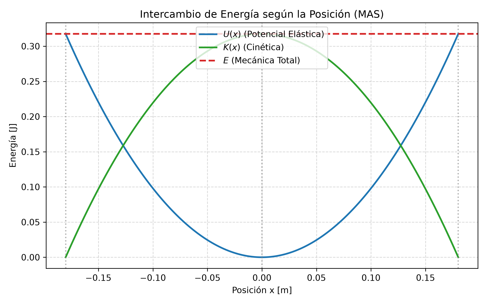
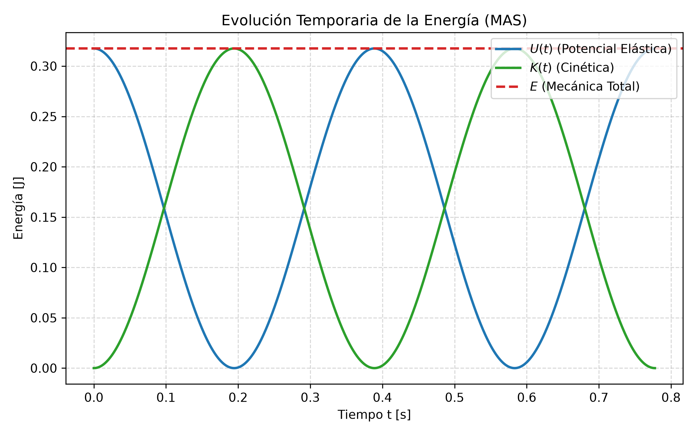

# 3.2 Energía en el MAS y Sistemas Oscilantes

---

## 1. La Intuición Física: ¿Qué es realmente oscilar?

Imaginate cualquier objeto que tenga un punto donde le gusta estar en reposo. Ese punto es su **Posición de Equilibrio ($x = 0$)**[cite: 32, 36].

Para que exista un movimiento oscilatorio, tienen que competir dos factores:
1. **Una Fuerza Restauradora o de Restitución:** Una fuerza "celosa" que, apenas sacás al objeto de su posición neutra, lo tira de vuelta hacia el centro[cite: 31, 35]. Cuanto más lejos lo llevás, más fuerte lo tira[cite: 31, 35].
2. **La Inercia (Masa):** Cuando el objeto vuelve impulsado por la fuerza y llega al centro ($x = 0$), la fuerza se hace cero[cite: 36]. Pero el objeto viene con tanto vuelo (*cantidad de movimiento*) que no puede frenar de golpe y se pasa de largo hacia el otro lado[cite: 36].

Al pasarse al otro lado, la fuerza restauradora vuelve a aparecer pero apuntando en sentido contrario, frenándolo y volviéndolo a traer[cite: 36]. **Ese "ida y vuelta" infinito promovido por el tira y afloja entre la fuerza y la inercia es una oscilación**[cite: 31, 36].

---

## 2. El MAS en la Vida Real y en la Ingeniería

El **Movimiento Armónico Simple (MAS)** es el modelo "ideal": **sin rozamiento, sin aire y con un resorte/elemento que nunca se deforma permanentemente (cumple la Ley de Hooke)**[cite: 17, 36, 54].

Aunque en el mundo real siempre hay fricción (*movimiento amortiguado*), el MAS es el modelo base para analizar[cite: 54, 94]:

* **En Ingeniería en Minas y Geología:** El funcionamiento de las zarandas o tamices vibratorios que separan material por tamaño de grano, o el comportamiento de un péndulo de torsión para calibrar instrumentos[cite: 83].
* **En Estructuras y Arquitectura:** La frecuencia natural con la que flamea o bambolea un edificio o puente cuando lo perturba el viento o un sismo[cite: 97]. Si la fuerza externa coincide con su frecuencia natural, ocurre el fenómeno de **Resonancia** (como el colapso del puente Tacoma Narrows)[cite: 97].
* **En Mecánica General:** Los pistones de un motor, la suspensión de un vehículo al absorber un impacto o la vibración de una cuerda de instrumento[cite: 31].

---

## 3. ¿Cómo identificar un ejercicio de MAS en un Parcial?

No adivines. Buscá estas pistas concretas en el enunciado:

| Pista en el Enunciado | Significado Físico Oculto |
| :--- | :--- |
| *"Se suelta desde el reposo a X cm del centro"* | Te están dando la **Amplitud ($A$)**. En el reposo la velocidad es cero[cite: 36]. |
| *"Superficie horizontal sin fricción / lisa"* | **Conservación de la Energía Mecánica ($E = \text{cte}$)**[cite: 36, 54]. |
| *"Realiza N oscilaciones en T segundos"* | Te dan datos para sacar el **Período ($T = \text{tiempo}/N$)** y la **Frecuencia ($f = 1/T$)**[cite: 33]. |
| *"Péndulo con separación angular pequeña ($\theta < 15^\circ$)"* | Habilita la aproximación $\sin\theta \approx \theta$, transformando el péndulo en un MAS perfecto[cite: 74, 75]. |

---

## 4. El "Detector de Trampas" para el Examen

| La Trampa del Profesor | El Error Típico | La Verdad Física |
| :--- | :--- | :--- |
| **Recorrido total:** *"La masa recorre $40\text{ cm}$ de extremo a extremo"*. | Tomar $A = 40\text{ cm}$. | De extremo a extremo hay dos amplitudes ($2A$). La amplitud es $A = 20\text{ cm}$[cite: 32, 33]. |
| **Modo Calculadora:** Resolver $x(t) = A \cos(\omega t + \phi)$. | Usar la calculadora en **DEG** (Grados). | Las fases y frecuencias angulares $(\omega t + \phi)$ van en **RADIANES (RAD)**[cite: 37, 38]. |
| **Constante de Fase ($\phi$):** Asumir que $\phi = 0$ por defecto. | Olvidar verificar dónde arrancó el movimiento. | Si el cronómetro arranca ($t=0$) con el objeto en el centro o con velocidad, $\phi \neq 0$[cite: 37, 41]. |
| **Confusión de Frecuencias:** Confundir $f$ con $\omega$. | Poner el valor de Hertz ($\text{Hz}$) directo en $\omega$. | $f$ está en $\text{Hz}$ ($1/\text{s}$)[cite: 33]. $\omega$ es la frecuencia angular en $\text{rad/s}$ ($\omega = 2\pi f$)[cite: 37, 39]. |

---

## 5. El Tanque de Energía: ¿Cómo se intercambia en el MAS?

Pensá en la energía como un tanque cerrado con dos compartimentos: **Energía Potencial Elástica ($U$)** y **Energía Cinética ($K$)**[cite: 54, 56, 57]. La suma de ambas siempre llena el mismo tanque total ($E$)[cite: 57].

| Extremo ($x = +A$)[cite: 59] | Centro de Equilibrio ($x = 0$)[cite: 59] | Extremo ($x = -A$)[cite: 59] |
| :--- | :--- | :--- |
| • Masa parada ($v = 0$)[cite: 59] | • Resorte sin estirar ($U = 0$)[cite: 59] | • Masa parada ($v = 0$)[cite: 59] |
| • $U$ es MÁXIMA[cite: 56, 59] | • Rapidez MÁXIMA ($v = v_{\text{máx}}$)[cite: 59] | • $U$ es MÁXIMA[cite: 56, 59] |
| • $K = 0$[cite: 56, 59] | • $K$ es MÁXIMA[cite: 56, 59] | • $K = 0$[cite: 56, 59] |

1. **En los extremos ($x = \pm A$):** El objeto se frena un instante para pegar la vuelta ($v = 0 \implies K = 0$)[cite: 36, 59]. Toda la energía está almacenada en el resorte apretado o estirado: $E = U_{\text{máx}} = \frac{1}{2} k A^2$[cite: 54, 57, 59].
2. **En el centro ($x = 0$):** El resorte no está comprimido ni estirado ($U = 0$)[cite: 35, 59]. La masa pasa a fondo: $E = K_{\text{máx}} = \frac{1}{2} m v_{\text{máx}}^2$[cite: 56, 57, 59].
3. **En puntos intermedios ($x$ cualquiera):** La energía se reparte: $E = \frac{1}{2} m v^2 + \frac{1}{2} k x^2$[cite: 58].

---

## 6. Deducción y Expresiones Matemáticas

### A. Energía Potencial ($U$)
A partir del trabajo de la fuerza conservativa del resorte ($F = -kx$)[cite: 54]:

$$U = \frac{1}{2} k x^2$$

Sustituyendo la ecuación de posición $x(t) = A \cos(\omega t + \phi)$[cite: 37, 54]:

$$U(t) = \frac{1}{2} k A^2 \cos^2(\omega t + \phi)$$

### B. Energía Cinética ($K$)
A partir de la definición $K = \frac{1}{2} m v^2$ y reemplazando la velocidad $v(t) = -A \omega \sin(\omega t + \phi)$[cite: 40, 55]:

$$K(t) = \frac{1}{2} m A^2 \omega^2 \sin^2(\omega t + \phi)$$

Como $\omega^2 = \frac{k}{m} \implies m\omega^2 = k$[cite: 39, 55]:

$$K(t) = \frac{1}{2} k A^2 \sin^2(\omega t + \phi)$$

### C. Energía Mecánica Total ($E$)
Sumando ambas y usando la identidad $\sin^2\theta + \cos^2\theta = 1$[cite: 56]:

$$E = K + U = \frac{1}{2} k A^2 \left[ \sin^2(\omega t + \phi) + \cos^2(\omega t + \phi) \right] \implies E = \frac{1}{2} k A^2$$

### D. Ecuación Útil de Rapidez según Posición $v(x)$
Igualando la energía en un punto cualquiera con la energía total ($K + U = E$)[cite: 58]:

$$\frac{1}{2} m v^2 + \frac{1}{2} k x^2 = \frac{1}{2} k A^2 \implies v(x) = \pm \omega \sqrt{A^2 - x^2}$$

---

## 7. Ejercicio Modelo de Parcial (Analizado con Criterio)

**Consigna:** Un resorte con constante de fuerza $k = 19.6 \text{ N/m}$ montado horizontalmente sin rozamiento se estira $18.0 \text{ cm}$ desde su punto neutro y se suelta a partir del reposo con una masa de $0.3 \text{ kg}$[cite: 60]. 

1. Determinar la energía total del sistema[cite: 60].
2. Escribir la expresión de $K(t)$ y $U(t)$[cite: 60].
3. Calcular la velocidad cuando la masa se encuentra a $x = 0.09 \text{ m}$[cite: 60].

### Análisis Técnico Previo:
* **Sin rozamiento:** Se conserva la energía mecánica ($E = \text{constante}$)[cite: 54].
* **Se suelta del reposo a $18 \text{ cm}$:** Como $v_0 = 0$, ese punto inicial es la amplitud máxima: $A = 0.18 \text{ m}$[cite: 36, 60].
* **Posición inicial en el extremo:** El ángulo de fase es $\phi = 0$[cite: 40].

### Resolución:

**1. Energía Total ($E$):**[cite: 61]
$$E = \frac{1}{2} k A^2 = \frac{1}{2} (19.6 \text{ N/m}) (0.18 \text{ m})^2 = 0.3175 \text{ J} \approx 0.32 \text{ J}$$

**2. Expresiones temporales $K(t)$ y $U(t)$:**
Primero calculamos la velocidad angular $\omega$[cite: 39]:
$$\omega = \sqrt{\frac{k}{m}} = \sqrt{\frac{19.6 \text{ N/m}}{0.3 \text{ kg}}} \approx 8.08 \text{ rad/s}$$

Sustituyendo $E = 0.32 \text{ J}$ y $\omega = 8.08 \text{ rad/s}$[cite: 61]:
* **Energía Potencial:** $U(t) = 0.32 \cos^2(8.08 t) \text{ [J]}$[cite: 61]
* **Energía Cinética:** $K(t) = 0.32 \sin^2(8.08 t) \text{ [J]}$[cite: 61]

**3. Rapidez en $x = 0.09 \text{ m}$ (mitad de la amplitud):**[cite: 60, 61]
$$v = \omega \sqrt{A^2 - x^2} = 8.08 \sqrt{(0.18)^2 - (0.09)^2} = 8.08 \sqrt{0.0324 - 0.0081} \approx 1.26 \text{ m/s}$$