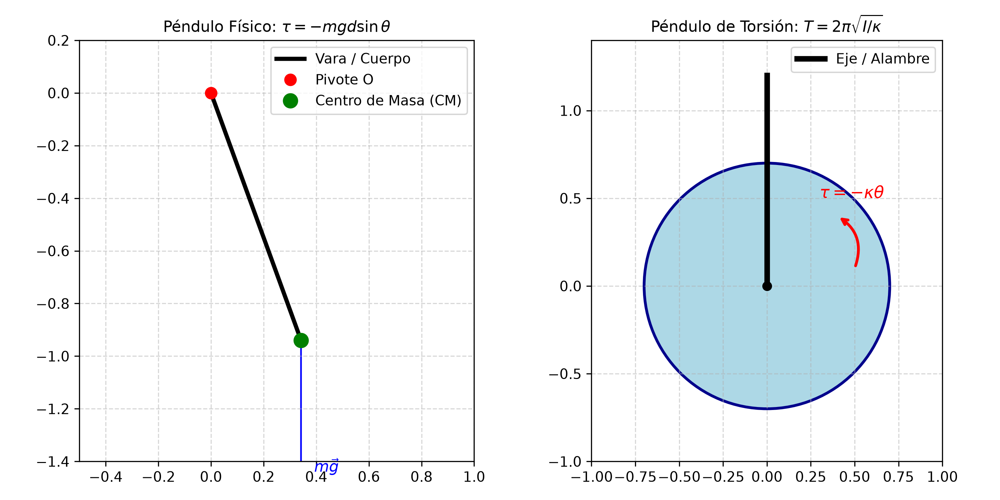
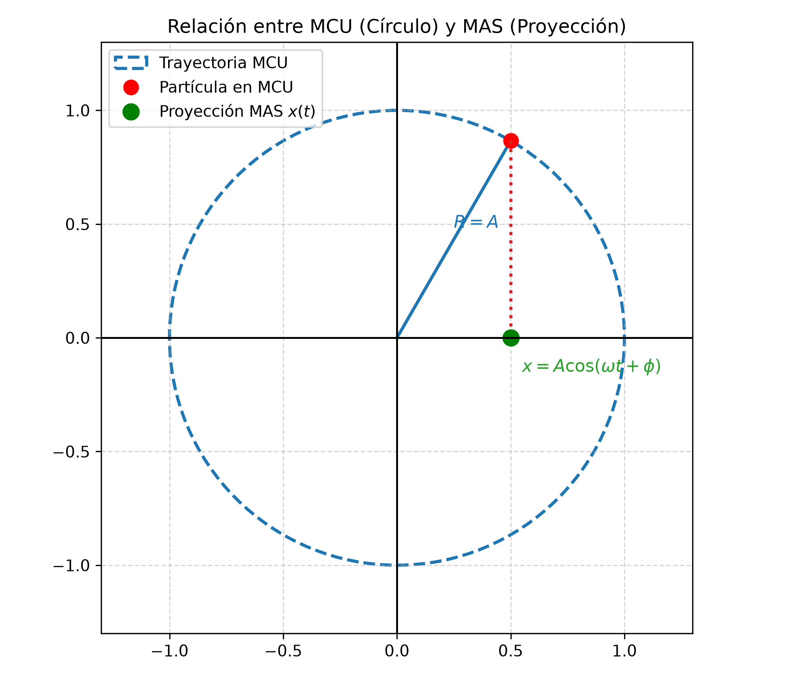

# 3.3 Sistemas Oscilantes Reales y Avanzados

---

## 1. La Intuición Física: Más allá del resorte ideal

En la práctica profesional de la ingeniería y la arquitectura, los sistemas oscilantes rara vez son masas puntuales atadas a un resorte sin peso. 

* **Cuerpos extensos (Péndulo Físico):** Una viga, una pieza de maquinaria o una vara colgada de un extremo no oscilan como una partícula puntual; su distribución de masa e inercia rotacional ($I$) determinan la rapidez del movimiento.
* **Torsión:** Ejes de motores, cables de puentes o barras sometidas a retorcimiento angular experimentan torcas de restitución ($\tau = -\kappa \theta$).
* **Rodadura:** Componentes mecánicos (como cilindros o ruedas) que oscilan combinando movimiento de traslación y rotación sin resbalar.

---

## 2. Péndulo Físico vs. Péndulo de Torsión vs. Rodadura

### A. Péndulo Físico (Cuerpo Rígido Oscilante)
Es cualquier cuerpo rígido de masa $m$ suspendido de un pivote $O$ ubicado a una distancia $d$ de su centro de masa ($CM$). 

* **Torca de restitución:** La componente del peso produce una torca $\tau = -m g d \sin\theta \approx -m g d \theta$ (para $\theta < 15^\circ$).
* **Ecuación del Período:**

$$T = 2\pi \sqrt{\frac{I}{m g d}}$$

Donde $I$ es el momento de inercia respecto al eje de rotación $O$.

> **Herramienta Clave de Examen (Teorema de Steiner / Ejes Paralelos):**  
> Si conocés el momento de inercia respecto al centro de masa ($I_{CM}$), el momento de inercia respecto al pivote a distancia $d$ es:  
> $$I = I_{CM} + m d^2$$

---

### B. Péndulo de Torsión
Consiste en un cuerpo suspendido de un alambre o varilla vertical. Al girar un ángulo $\theta$, el alambre ejerce una torca restauradora angular:

$$\tau = -\kappa \theta$$

Donde $\kappa$ (kappa) es la constante de torsión del alambre.
* **Ecuación del Período:**

$$T = 2\pi \sqrt{\frac{I}{\kappa}}$$

---

### C. Sistemas de Rodadura sin Resbalar (Cilindros / Discos)
Cuando un cilindro de masa $M$ y radio $R$ rueda sin resbalar sujeto a un resorte de constante $k$, la energía cinética total es la suma de la traslación y la rotación:

$$K_{\text{total}} = K_{\text{traslación}} + K_{\text{rotación}} = \frac{1}{2} M v^2 + \frac{1}{2} I_{CM} \omega_{\text{rot}}^2$$

Como para rodadura pura $v = \omega_{\text{rot}} R$ e $I_{CM} = \frac{1}{2} M R^2$:

$$K_{\text{total}} = \frac{1}{2} M v^2 + \frac{1}{2} \left(\frac{1}{2} M R^2\right) \left(\frac{v}{R}\right)^2 = \frac{3}{4} M v^2$$

El factor $\frac{3}{2}M$ actúa como una "masa efectiva" en la oscilación, dando un período:

$$T = 2\pi \sqrt{\frac{3 M}{2 k}}$$

---

---

## 3. Relación MAS vs. MCU (Círculo de Referencia)

El Movimiento Armónico Simple se puede interpretar geométricamente como la **proyección horizontal (o vertical)** de una partícula que realiza un Movimiento Circular Uniforme (MCU) de radio $R = A$ con velocidad angular constante $\omega$.

| Movimiento Circular Uniforme (MCU) | Proyección en Movimiento Armónico Simple (MAS) |
| :--- | :--- |
| • Partícula girando en círculo de radio $R = A$ | • Masa oscilando en eje horizontal $x$ |
| • Ángulo instantáneo: $\theta(t) = \omega t + \phi$ | • Posición: $x(t) = A \cos(\omega t + \phi)$ |
| • Rapidez tangencial: $v_{\text{tg}} = \omega A$ | • Velocidad: $v_x(t) = -\omega A \sin(\omega t + \phi)$ |
| • Aceleración centrípeta: $a_c = \omega^2 A$ | • Aceleración: $a_x(t) = -\omega^2 A \cos(\omega t + \phi)$ |

> **Nota visual:** La posición $x(t)$ de la masa oscilante es simplemente la sombra proyectada por el punto en movimiento circular sobre el eje $x$.

* **Posición:** $x(t) = A \cos(\omega t + \phi)$
* **Velocidad:** $v_x(t) = -v_{\text{tg}} \sin(\omega t + \phi) = -\omega A \sin(\omega t + \phi)$
* **Aceleración:** $a_x(t) = -a_c \cos(\omega t + \phi) = -\omega^2 A \cos(\omega t + \phi)$

---

## 4. Detector de Trampas de Parcial

| La Trampa del Profesor | El Error Típico | La Verdad Física |
| :--- | :--- | :--- |
| **Péndulo Físico:** Poner la distancia al extremo en lugar de al $CM$. | Usar la longitud total de la vara como $d$. | $d$ es **estrictamente** la distancia entre el pivote y el centro de masa ($CM$). |
| **Rodadura pura:** Olvidar la energía rotacional. | Usar $T = 2\pi\sqrt{M/k}$ para un cilindro que rueda. | La inercia rotacional aumenta el período a $T = 2\pi\sqrt{\frac{3M}{2k}}$. |
| **Péndulo Físico:** Usar $I_{CM}$ directo en la fórmula de período. | Olvidar aplicar el Teorema de Ejes Paralelos. | $T = 2\pi\sqrt{I/mgd}$ requiere el momento de inercia **respecto al pivote**, no al $CM$. |

---

## 5. Esquemas Gráficos

---

## 6. Ejercicios Resueltos con Análisis Dimensional Explícito

### Ejercicio 1: Medición de Momento de Inercia en Péndulo Físico
**Consigna:** Una vara no uniforme de masa $m = 1.0 \text{ kg}$ se equilibra sobre su $CM$ a $d = 0.42 \text{ m}$ de uno de sus extremos. Si se la hace oscilar suspendida desde ese extremo, registra un período de $T = 1.6 \text{ s}$.  
a) Calcule el momento de inercia $I$ respecto al pivote.  
b) Calcule el momento de inercia $I_{CM}$ respecto a su centro de masa.

#### Desarrollo y Cancelación de Unidades:

**Paso a): Hallar $I$ respecto al pivote**
Despejando de $T = 2\pi \sqrt{\frac{I}{m g d}}$:

$$T^2 = 4\pi^2 \frac{I}{m g d} \implies I = \frac{m \cdot g \cdot d \cdot T^2}{4\pi^2}$$

Sustituyendo valores numéricos con sus magnitudes:

$$I = \frac{(1.0 \text{ kg}) \cdot \left(9.8 \frac{\text{m}}{\text{s}^2}\right) \cdot (0.42 \text{ m}) \cdot (1.6 \text{ s})^2}{4\pi^2}$$

Desarrollando las unidades paso a paso:

$$[\text{Unidades}] = \frac{[\text{kg}] \cdot \left[\frac{\text{m}}{\text{s}^2}\right] \cdot [\text{m}] \cdot [\text{s}^2]}{1} = \text{kg} \cdot \frac{\text{m}}{\cancel{\text{s}^2}} \cdot \text{m} \cdot \cancel{\text{s}^2} = \text{kg} \cdot \text{m}^2$$

Operación numérica:

$$I = \frac{1.0 \cdot 9.8 \cdot 0.42 \cdot 2.56}{39.4784} = \frac{10.53696}{39.4784} \approx 0.267 \text{ kg}\cdot\text{m}^2 \approx 0.27 \text{ kg}\cdot\text{m}^2$$

---

**Paso b): Hallar $I_{CM}$ mediante Teorema de Ejes Paralelos**
$$I = I_{CM} + m d^2 \implies I_{CM} = I - m d^2$$

Sustituyendo con magnitudes:

$$I_{CM} = 0.267 \text{ kg}\cdot\text{m}^2 - (1.0 \text{ kg}) \cdot (0.42 \text{ m})^2$$

$$I_{CM} = 0.267 \text{ kg}\cdot\text{m}^2 - (1.0 \text{ kg}) \cdot (0.1764 \text{ m}^2)$$

$$I_{CM} = 0.267 \text{ kg}\cdot\text{m}^2 - 0.1764 \text{ kg}\cdot\text{m}^2 = 0.0906 \text{ kg}\cdot\text{m}^2 \approx 0.09 \text{ kg}\cdot\text{m}^2$$

---

### Ejercicio 2: Cilindro Rodando Sujeto a Resorte
**Consigna:** Dos cilindros sólidos idénticos de masa total $M = 3 \text{ kg}$ y radio $R = 0.08 \text{ m}$ ruedan sin resbalar apoyados en una mesa horizontal, sujetos a un resorte de $k = 60 \text{ N/m}$. Calcule el período de oscilación $T$.

#### Desarrollo y Cancelación de Unidades:

Fórmula deducción de rodadura:

$$T = 2\pi \sqrt{\frac{3 M}{2 k}}$$

Reemplazando valores y magnitudes:

$$T = 2\pi \sqrt{\frac{3 \cdot (3 \text{ kg})}{2 \cdot \left(60 \frac{\text{N}}{\text{m}}\right)}} = 2\pi \sqrt{\frac{9 \text{ kg}}{120 \frac{\text{N}}{\text{m}}}}$$

Analizando y simplificando las unidades de la raíz (recordando que $1 \text{ N} = 1 \frac{\text{kg}\cdot\text{m}}{\text{s}^2}$):

$$\left[\text{Unidades dentro de } \sqrt{\phantom{x}}\right] = \frac{[\text{kg}]}{\left[\frac{\text{N}}{\text{m}}\right]} = \frac{[\text{kg}]}{\left[\frac{\frac{\text{kg}\cdot\text{m}}{\text{s}^2}}{\text{m}}\right]} = \frac{[\text{kg}]}{\left[\frac{\text{kg}}{\text{s}^2}\right]} = \frac{\cancel{\text{kg}} \cdot \text{s}^2}{\cancel{\text{kg}}} = \text{s}^2$$

Al aplicar la raíz cuadrada $\sqrt{\text{s}^2} = \text{s}$.

Operación numérica final:

$$T = 2\pi \sqrt{0.075 \text{ s}^2} = 2\pi \cdot (0.27386 \text{ s}) \approx 1.72 \text{ s}$$