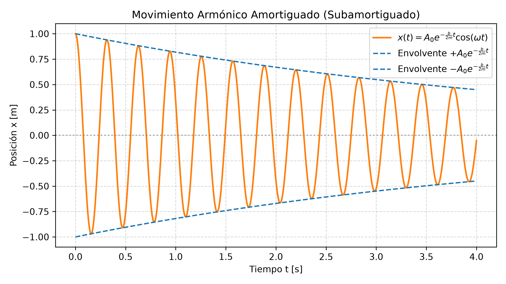
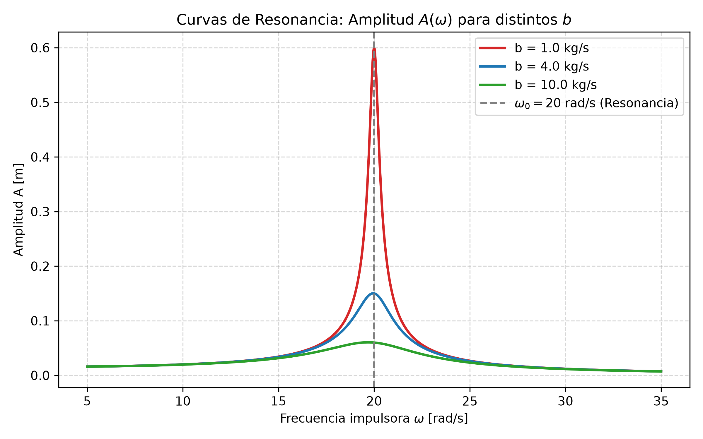

# 3.4 Oscilaciones Amortiguadas, Forzadas, Resonancia y Superposición

---

## 1. La Intuición Física: Sistemas Oscilantes Reales y Complejos

En los temas anteriores analizamos el oscilador ideal (MAS), donde la energía total se conservaba indefinidamente. En los sistemas reales de ingeniería y arquitectura, la fricción y la viscosidad disipan energía continuamente.

* **Oscilaciones Amortiguadas:** Ocurren cuando actúan fuerzas disipativas (como la resistencia del aire o el rozamiento viscoso de un fluido). La amplitud del movimiento decrece exponencialmente con el tiempo hasta detenerse. Un ejemplo práctico son los amortiguadores de la suspensión de un vehículo.
* **Oscilaciones Forzadas:** Para evitar que el movimiento muera por amortiguamiento, se aplica una fuerza impulsora externa periódica que inyecta energía al sistema. Un ejemplo simple es empujar rítmicamente a alguien en una hamaca.
* **Resonancia:** Ocurre cuando la frecuencia de la fuerza impulsora externa ($\omega$) coincide exactamente o está muy cerca de la frecuencia natural del sistema ($\omega_0$). En ese instante, la transferencia de energía es máxima y la amplitud se dispara drásticamente. Un ejemplo histórico dramático fue el colapso del puente Tacoma Narrows en 1940.
* **Superposición de MAS:** Cuando un cuerpo se ve sometido a dos o más fuerzas oscilatorias simultáneas, el movimiento resultante es la suma vectorial de los movimientos componentes.

---

## 2. Desarrollo Matemático y Expresiones Clave

### A. Movimiento Armónico Amortiguado
Considerando una fuerza de rozamiento viscoso proporcional a la velocidad: $F_R = -b v$ (donde $b$ es el coeficiente de amortiguamiento en $\text{kg/s}$ o $\text{N}\cdot\text{s/m}$). 

Aplicando la Segunda Ley de Newton:

$$\sum F = -k x - b v = m a \implies m \frac{d^2x}{dt^2} + b \frac{dx}{dt} + k x = 0$$

Para amortiguamiento débil ($b < 2\sqrt{m k}$), la solución de posición es:

$$x(t) = \left(A_0 e^{-\frac{b}{2m}t}\right) \cos(\omega t + \phi)$$

Donde:
* **Envolvente de la amplitud:** $A(t) = A_0 e^{-\frac{b}{2m}t}$
* **Frecuencia angular amortiguada:** $\omega = \sqrt{\omega_0^2 - \left(\frac{b}{2m}\right)^2}$, siendo $\omega_0 = \sqrt{\frac{k}{m}}$ la frecuencia natural sin amortiguamiento.

---

### B. Oscilaciones Forzadas y Resonancia
Si aplicamos una fuerza impulsora senoidal $F(t) = F_0 \cos(\omega t)$:

$$m \frac{d^2x}{dt^2} + b \frac{dx}{dt} + k x = F_0 \cos(\omega t)$$

En estado estacionario, el sistema oscila a la frecuencia $\omega$ de la fuerza impulsora, con una **Amplitud ($A$)** dada por:

$$A = \frac{\frac{F_0}{m}}{\sqrt{(\omega^2 - \omega_0^2)^2 + \left(\frac{b \omega}{m}\right)^2}}$$

> **Condición de Resonancia:**  
> Cuando $\omega \approx \omega_0$, el término $(\omega^2 - \omega_0^2)^2 \to 0$, por lo que la amplitud alcanza su valor pico $A_{\text{máx}} \approx \frac{F_0}{b \omega_0}$.

---

### C. Superposición de dos MAS de la misma Frecuencia
Si una partícula recibe simultáneamente dos oscilaciones en el mismo eje:  
$x_1(t) = A_1 \cos(\omega t + \phi_1)$ y $x_2(t) = A_2 \cos(\omega t + \phi_2)$.

El movimiento resultante es $x(t) = x_1(t) + x_2(t) = A \cos(\omega t + \phi)$, donde la amplitud total $A$ se calcula mediante suma de fasores (vectores rotantes):

$$A = \sqrt{A_1^2 + A_2^2 + 2 A_1 A_2 \cos(\phi_2 - \phi_1)}$$

---

## 3. Detector de Trampas de Parcial

| La Trampa del Profesor | El Error Típico | La Verdad Física |
| :--- | :--- | :--- |
| **Frecuencia en Amortiguado:** Asumir que oscila a la frecuencia natural $\omega_0$. | Usar $\omega = \sqrt{k/m}$ en sistemas con rozamiento. | La fricción ralentiza el movimiento: la frecuencia amortiguada es siempre menor ($\omega = \sqrt{\omega_0^2 - (b/2m)^2}$). |
| **Exponente de la Envolvente:** Olvidar el factor $2$ en el denominador. | Escribir $e^{-\frac{b}{m}t}$. | El exponente correcto de la amplitud es $-\frac{b}{2m}t$. |
| **Resonancia Indefinida:** Pensar que en la resonancia la amplitud es siempre infinita. | Ignorar el coeficiente de amortiguamiento $b$. | La amplitud en resonancia solo sería infinita si $b = 0$. Con rozamiento real ($b > 0$), la amplitud máxima es finita ($A_{\text{máx}} = \frac{F_0}{b \omega_0}$). |

---

## 4. Esquemas Gráficos

---

## 5. Ejercicios Resueltos con Análisis Dimensional Explícito

### Ejercicio 1: Pérdida de Amplitud en Oscilación Amortiguada
**Consigna:** Un objeto de masa $m = 0.25 \text{ kg}$ se conecta a un resorte de $k = 100 \text{ N/m}$ y se sumerge en un fluido con constante de amortiguamiento $b = 0.10 \text{ kg/s}$.  
a) Calcule el tiempo necesario para que la amplitud se reduzca a la mitad de su valor inicial ($A(t) = \frac{1}{2} A_0$).  
b) Calcule la frecuencia angular amortiguada $\omega$.

#### Desarrollo y Cancelación de Unidades:

**Paso a): Tiempo para reducir la amplitud a la mitad ($t_{1/2}$)**

Igualamos la expresión de la envolvente a $\frac{1}{2} A_0$:

$$A_0 e^{-\frac{b}{2m}t} = \frac{1}{2} A_0 \implies e^{-\frac{b}{2m}t} = 0.5$$

Aplicando logaritmo natural ($\ln$) a ambos lados:

$$-\frac{b}{2m}t = \ln(0.5) \implies t = \frac{-2 m \ln(0.5)}{b} = \frac{2 m \ln(2)}{b}$$

Sustituyendo con magnitudes físicas:

$$t = \frac{2 \cdot (0.25 \text{ kg}) \cdot 0.69315}{0.10 \frac{\text{kg}}{\text{s}}}$$

Desglose dimensional de unidades:

$$[\text{Unidades}] = \frac{[\text{kg}]}{\left[\frac{\text{kg}}{\text{s}}\right]} = \frac{\cancel{\text{kg}} \cdot \text{s}}{\cancel{\text{kg}}} = \text{s}$$

Operación numérica:

$$t = \frac{0.34657 \text{ kg}}{0.10 \frac{\text{kg}}{\text{s}}} = 3.4657 \text{ s} \approx 3.47 \text{ s}$$

---

**Paso b): Frecuencia angular amortiguada ($\omega$)**

Primero calculamos $\omega_0^2$ y la constante de atenucación $\left(\frac{b}{2m}\right)^2$:

$$\omega_0^2 = \frac{k}{m} = \frac{100 \frac{\text{N}}{\text{m}}}{0.25 \text{ kg}} = 400 \frac{\text{rad}^2}{\text{s}^2}$$

Verificación dimensional de $\frac{k}{m}$:

$$\left[\frac{\text{N}}{\text{m} \cdot \text{kg}}\right] = \left[\frac{\frac{\text{kg}\cdot\text{m}}{\text{s}^2}}{\text{m} \cdot \text{kg}}\right] = \frac{\cancel{\text{kg}}\cdot\cancel{\text{m}}}{\text{s}^2 \cdot \cancel{\text{m}} \cdot \cancel{\text{kg}}} = \frac{1}{\text{s}^2} = \text{s}^{-2}$$

Ahora calculamos $\frac{b}{2m}$:

$$\frac{b}{2m} = \frac{0.10 \frac{\text{kg}}{\text{s}}}{2 \cdot 0.25 \text{ kg}} = \frac{0.10 \frac{\text{kg}}{\text{s}}}{0.50 \text{ kg}} = 0.20 \text{ s}^{-1}$$

$$\left(\frac{b}{2m}\right)^2 = (0.20 \text{ s}^{-1})^2 = 0.04 \text{ s}^{-2}$$

Calculamos $\omega$:

$$\omega = \sqrt{\omega_0^2 - \left(\frac{b}{2m}\right)^2} = \sqrt{400 \text{ s}^{-2} - 0.04 \text{ s}^{-2}} = \sqrt{399.96 \text{ s}^{-2}} \approx 19.999 \text{ rad/s}$$

> **Conclusión del ejercicio:** Como el amortiguamiento es pequeño ($b$ bajo), la frecuencia angular prácticamente no se altera respecto a la frecuencia natural sin fricción ($\omega \approx \omega_0 = 20 \text{ rad/s}$).

---

### Ejercicio 2: Amplitud en Resonancia (Oscilación Forzada)
**Consigna:** Un motor mecánico de masa $m = 2.0 \text{ kg}$ sujeto a un soporte de constante $k = 800 \text{ N/m}$ experimenta una fuerza impulsora periódica de amplitud $F_0 = 12.0 \text{ N}$. El coeficiente de fricción es $b = 4.0 \text{ kg/s}$. Calcule la amplitud de movimiento $A$ cuando la frecuencia impulsora está exactamente en resonancia ($\omega = \omega_0$).

#### Desarrollo y Cancelación de Unidades:

**Paso 1: Frecuencia de resonancia ($\omega_0$)**

$$\omega_0 = \sqrt{\frac{k}{m}} = \sqrt{\frac{800 \frac{\text{N}}{\text{m}}}{2.0 \text{ kg}}} = \sqrt{400 \text{ s}^{-2}} = 20 \text{ rad/s}$$

**Paso 2: Amplitud en Resonancia**

Como estamos en resonancia exacta ($\omega = \omega_0$), el término $(\omega^2 - \omega_0^2)^2 = 0$ en la fórmula general de amplitud:

$$A_{\text{res}} = \frac{\frac{F_0}{m}}{\sqrt{0 + \left(\frac{b \omega_0}{m}\right)^2}} = \frac{\frac{F_0}{m}}{\frac{b \omega_0}{m}} = \frac{F_0}{b \omega_0}$$

Sustituyendo magnitudes:

$$A_{\text{res}} = \frac{12.0 \text{ N}}{\left(4.0 \frac{\text{kg}}{\text{s}}\right) \cdot \left(20 \frac{1}{\text{s}}\right)}$$

Desglose dimensional de unidades:

$$[\text{Unidades}] = \frac{[\text{N}]}{\left[\frac{\text{kg}}{\text{s}}\right] \cdot \left[\frac{1}{\text{s}}\right]} = \frac{\frac{\text{kg}\cdot\text{m}}{\text{s}^2}}{\frac{\text{kg}}{\text{s}^2}} = \frac{\cancel{\text{kg}}\cdot\text{m}}{\cancel{\text{s}^2}} \cdot \frac{\cancel{\text{s}^2}}{\cancel{\text{kg}}} = \text{m}$$

Operación numérica:

$$A_{\text{res}} = \frac{12.0 \text{ N}}{80.0 \frac{\text{kg}}{\text{s}^2}} = 0.15 \text{ m} = 15 \text{ cm}$$