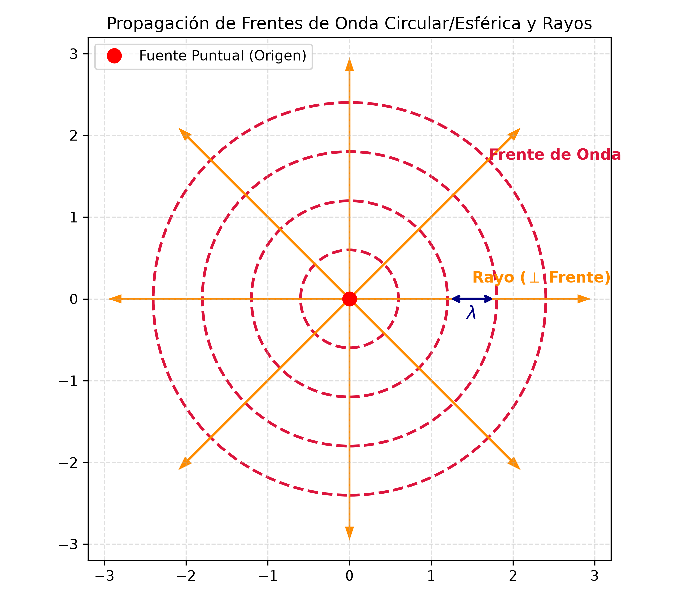
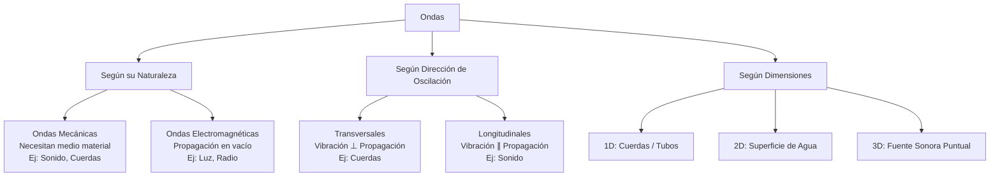

# 4.1 Ondas Mecánicas: Transversales y Longitudinales

## 1. Concepto Fundante de Onda
Una **onda** es una perturbación de una condición de equilibrio que se propaga en el tiempo a través del espacio[cite: 106]. La propiedad fundamental de todo movimiento ondulatorio es que **transporta energía y momento lineal sin transporte neto de materia**[cite: 106].

> **Reflexión Histórica (Leonardo da Vinci, s. XV):**  
> *"A menudo sucede que la onda escapa del sitio de su creación, mientras que el agua no. Como las ondas que se forman en un campo de trigo por efecto del viento, donde las vemos correr a través del campo mientras las espigas permanecen en su lugar..."*[cite: 104]

### Requisitos de una Onda Mecánica
Para que exista y se propague una onda mecánica, se requieren tres condiciones indispensables[cite: 107]:
1. **Fuente de perturbación:** Un agente externo que suministre energía inicial[cite: 107].
2. **Medio material elástico:** Un conjunto de partículas interconectadas capaces de experimentar desplazamientos respecto a su posición de equilibrio[cite: 105, 107].
3. **Mecanismo de acoplamiento físico:** Fuerzas interatómicas o intermoleculares que permitan a los elementos del medio influirse mutuamente y transmitir la perturbación[cite: 105, 107].

---

## 2. Clasificación Sistemática de las Ondas

### A. Según su Naturaleza Física
* **Ondas Mecánicas:** Requieren obligatoriamente de un medio material (sólido, líquido o gaseoso) para propagarse[cite: 105, 113].  
  * *Ejemplos:* Ondas en cuerdas, sonido, ondas sísmicas, olas superficiales en agua[cite: 113].
* **Ondas Electromagnéticas:** Se originan por la aceleración de cargas eléctricas y no requieren medio material, pudiendo propagarse en el vacío a la velocidad de la luz $c \approx 3 \times 10^8 \text{ m/s}$[cite: 105, 113].  
  * *Ejemplos:* Luz visible, ondas de radio, rayos X, radiación UV[cite: 113].

### B. Según la Dirección de Oscilación respecto a la Propagación
* **Ondas Transversales:** Las partículas del medio oscilan en una dirección **perpendicular** a la dirección de propagación de la onda[cite: 114].  
  * *Ejemplo:* Onda viajando a lo largo de una cuerda en dirección $x$, mientras las partículas de la cuerda se mueven en dirección $y$[cite: 114].
* **Ondas Longitudinales:** Las partículas del medio oscilan en la **misma dirección** (paralela) en la que se propaga la onda[cite: 114, 148].  
  * *Ejemplo:* Ondas sonoras en fluidos o pulsos de compresión y rarefacción en un resorte Slinky[cite: 114, 148].

### C. Según las Dimensiones Espaciales de Propagación
* **Unidimensionales (1D):** La energía se transmite a lo largo de una sola línea recta[cite: 115]. *(Ej. Cuerda tensa, tubo sonoro angosto)*[cite: 115].
* **Bidimensionales (2D):** La energía se propaga sobre una superficie plano-espacial[cite: 115]. *(Ej. Olas en la superficie de un lago)*[cite: 115].
* **Tridimensionales (3D):** La energía se propaga esféricamente en todas las direcciones del espacio[cite: 115]. *(Ej. Ondas sonoras de una fuente puntual, ondas sísmicas desde el hipocentro)*[cite: 112, 115].

### D. Según la Duración y Período
* **Pulso de Onda:** Una única perturbación aislada de extensión y duración limitada[cite: 107, 108].
* **Tren de Ondas / Onda Periódica:** Una sucesión continua e ininterrumpida de pulsos producida a intervalos de tiempo regulares[cite: 109, 110]. Si las partículas ejecutan Movimiento Armónico Simple (MAS), la onda se denomina **armónica**[cite: 110].

---

## 3. Topología de las Perturbaciones: Frente de Onda y Rayos

* **Frente de Onda:** Es el lugar geométrico formado por todos los puntos adyacentes del medio que en un instante determinado se encuentran exactamente en la misma fase de perturbación[cite: 111].
* **Rayo:** Línea recta o curva perpendicular a los frentes de onda que indica la dirección y el sentido de propagación de la energía[cite: 111].

---

## 4. Parámetros Cinemáticos y Magnitudes de una Onda Armónica

Las ondas armónicas sinusoidales se caracterizan por los siguientes elementos periódicos en el espacio y en el tiempo[cite: 101, 117, 118]:

| Magnitud / Parámetro | Símbolo | Unidad (SI) | Definición Física |
| :--- | :---: | :---: | :--- |
| **Amplitud** | $A$ ó $y_m$ | $\text{m}$ | Desplazamiento máximo de un elemento del medio respecto de su posición de equilibrio[cite: 116]. |
| **Longitud de Onda** | $\lambda$ | $\text{m}$ | Distancia mínima entre dos puntos idénticos consecutivos en la misma fase[cite: 116]. |
| **Período** | $T$ | $\text{s}$ | Tiempo necesario para que una onda complete un ciclo completo (o el tiempo que tarda en pasar una longitud de onda por un punto fijo)[cite: 117]. |
| **Frecuencia** | $f$ | $\text{Hz}$ ($\text{s}^{-1}$) | Número de ciclos completos o crestas que pasan por un punto en cada unidad de tiempo[cite: 117]. ($f = \frac{1}{T}$)[cite: 117]. |
| **Velocidad de Propagación** | $v$ | $\text{m/s}$ | Rapidez con la que se desplaza el perfil de la onda o la cresta a través del medio[cite: 118]. |

### Relación Fundamental del Movimiento Ondulatorio
Dado que en un tiempo $t = T$ la onda recorre una distancia $x = \lambda$, la rapidez de fase está dada por[cite: 118]:

$$v = \frac{\lambda}{T} = \lambda f$$[cite: 118]

> **Propiedad del Medio:** En un medio homogéneo e isótropo, la rapidez de propagación $v$ depende exclusivamente de las propiedades mecánicas (elásticas e inerciales) del medio y es independiente de la frecuencia o la longitud de onda[cite: 118, 135].

---

## 5. Cuadro Comparativo de Ejercicios y Aplicaciones

| Tipo de Problema | Magnitudes Involucradas | Datos de Entrada Típicos | Ecuaciones Principales |
| :--- | :--- | :--- | :--- |
| **Cinemática Básica de Ondas** | $v, \lambda, f, T$ | Se da la frecuencia $f$ y la velocidad $v$ o la distancia entre crestas $\lambda$. | $f = \frac{1}{T}$, $v = \lambda f$[cite: 117, 118] |
| **Clasificación y Naturaleza** | Categoría cualitativa | Contexto del medio (Cuerdas, aire, sólidos, vacío). | Identificación de dirección de vibración (transversal / longitudinal)[cite: 113, 114]. |

## 6. Mapa Conceptual de Clasificación

