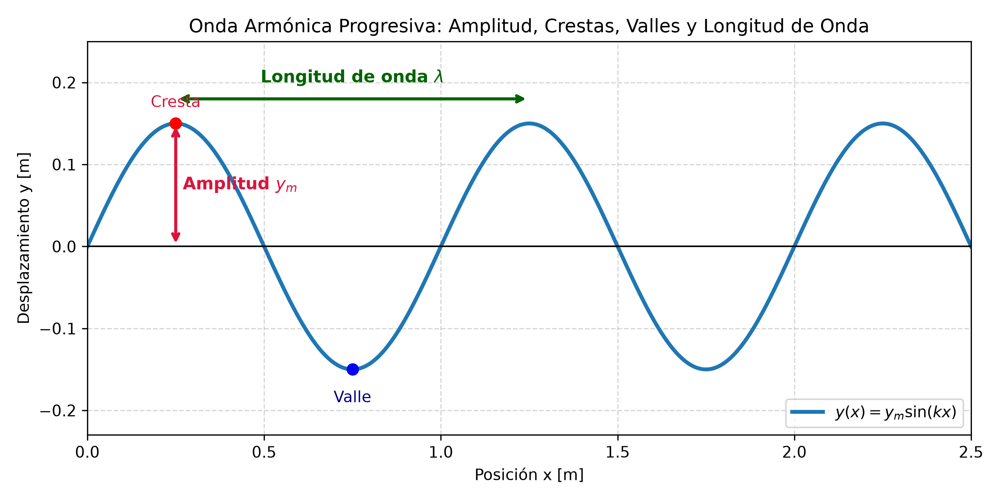
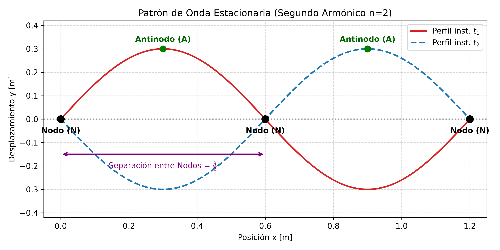
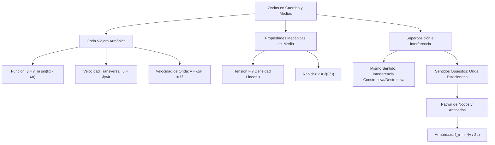

# 4.2 Ecuación de Onda, Velocidad Transversal e Interferencia

---

## 1. Función de Onda Armónica Progresiva

Una onda sinusoidal progresiva que se propaga en la dirección positiva del eje $x$ se describe matemáticamente mediante la función de onda:

$$y(x,t) = y_m \sin(k x - \omega t - \phi)$$

Donde:
* $y(x,t)$: Desplazamiento transversal del elemento del medio en la posición $x$ y tiempo $t$.
* $y_m$ (o $A$): Amplitud máxima del movimiento.
* $(k x - \omega t - \phi)$: Fase de la onda.
* $\phi$: Constante de fase inicial (desplaza la onda en el espacio o en el tiempo).

Si la onda se propaga en la **dirección negativa del eje $x$**, la ecuación toma la forma:

$$y(x,t) = y_m \sin(k x + \omega t - \phi)$$

### Parámetros Angulares
* **Número de onda angular ($k$):**  
  $$k = \frac{2\pi}{\lambda} \quad \left[\frac{\text{rad}}{\text{m}}\right]$$
* **Frecuencia angular ($\omega$):**  
  $$\omega = \frac{2\pi}{T} = 2\pi f \quad \left[\frac{\text{rad}}{\text{s}}\right]$$

---

## 2. Velocidad y Aceleración Transversal de las Partículas

Es fundamental distinguir entre la **velocidad de la onda** ($v$) y la **velocidad transversal de una partícula del medio** ($u$):

* **Velocidad de propagación de la onda (Fase):** Es la rapidez constante con la que avanza la perturbación a lo largo del eje $x$:  
  $$v = \frac{\omega}{k} = \lambda f \quad \left[\frac{\text{m}}{\text{s}}\right]$$
* **Velocidad transversal de la partícula ($u$):** Derivada parcial de $y(x,t)$ respecto al tiempo (manteniendo $x$ constante):  
  $$u(x,t) = \frac{\partial y}{\partial t} = -y_m \omega \cos(k x - \omega t - \phi)$$  
  $$u_{\text{máx}} = y_m \omega \quad \left[\frac{\text{m}}{\text{s}}\right]$$
* **Aceleración transversal de la partícula ($a$):** Derivada parcial de $u(x,t)$ respecto al tiempo:  
  $$a(x,t) = \frac{\partial u}{\partial t} = \frac{\partial^2 y}{\partial t^2} = -y_m \omega^2 \sin(k x - \omega t - \phi) = -\omega^2 y(x,t)$$  
  $$a_{\text{máx}} = y_m \omega^2 \quad \left[\frac{\text{m}}{\text{s}^2}\right]$$

> **Diferencia Crítica de Examen:**  
> La velocidad de la onda $v$ es constante en un medio homogéneo. En cambio, la velocidad transversal $u$ varía de forma armónica entre $+u_{\text{máx}}$ y $-u_{\text{máx}}$. $u$ es máxima cuando el elemento pasa por el equilibrio ($y = 0$), mientras que la aceleración $a$ es máxima en las crestas y valles ($y = \pm y_m$).

---

## 3. Rapidez de Onda en Cuerdas Estiradas

La rapidez de una onda mecánica transversal en una cuerda depende exclusivamente de las propiedades de tensión e inercia del medio:

$$v = \sqrt{\frac{F}{\mu}}$$

Donde:
* $F$: Tensión aplicada a la cuerda $[\text{N}]$.
* $\mu$: Densidad lineal de masa $[\text{kg/m}]$, definida como $\mu = \frac{m}{L}$.

---

## 4. Superposición e Interferencia de Ondas

Cuando dos ondas mecánicas de igual amplitud y frecuencia se propagan en el mismo sentido por el mismo medio con una diferencia de fase $\Delta\phi$, la onda resultante es:

$$y(x,t) = \left[ 2 y_m \cos\left(\frac{\Delta\phi}{2}\right) \right] \sin\left(k x - \omega t - \frac{\phi_1 + \phi_2}{2}\right)$$

* **Interferencia Constructiva Total:** Ocurre cuando $\Delta\phi = 0, 2\pi, 4\pi, \dots$ ($2n\pi$). La amplitud se duplica: $A_{\text{res}} = 2 y_m$.
* **Interferencia Destructiva Total:** Ocurre cuando $\Delta\phi = \pi, 3\pi, 5\pi, \dots$ ($(2n+1)\pi$). La amplitud resultante es nula: $A_{\text{res}} = 0$.

---

## 5. Ondas Estacionarias en Cuerdas Fijadas

La superposición de dos ondas identicas viajando en sentidos opuestos genera una **onda estacionaria**:

$$y(x,t) = [2 y_m \sin(k x)] \cos(\omega t)$$

* **Nodos ($y = 0$):** Puntos donde la amplitud es cero en todo instante. Ocurren en $x = n \frac{\lambda}{2}$ para $n = 0, 1, 2, \dots$.
* **Antinodos ($y = \pm 2y_m$):** Puntos de amplitud máxima. Ocurren en $x = \left(n + \frac{1}{2}\right) \frac{\lambda}{2}$.
* **Frecuencias Permitidas (Armónicos):** En una cuerda de longitud $L$ con ambos extremos fijos:  
  $$f_n = n \left(\frac{v}{2L}\right) = \frac{n}{2L} \sqrt{\frac{F}{\mu}} \quad (n = 1, 2, 3, \dots)$$

---

## 6. Detector de Trampas de Parcial

| La Trampa del Profesor | El Error Típico | La Verdad Física |
| :--- | :--- | :--- |
| **Confundir $v$ con $u$:** Usar $v = \lambda f$ para calcular la velocidad de la partícula. | Mezclar la rapidez del perfil con el movimiento de la partícula. | $v$ es la rapidez horizontal de la onda; $u = \frac{\partial y}{\partial t}$ es la velocidad de oscilación vertical del medio. |
| **Paso de Fase a Seno/Ceno:** Olvidar que $\sin(x + \pi/2) = \cos(x)$. | Errores en la constante de fase al pasar de coseno a seno. | Evaluar siempre la condición en $t=0, x=0$ para determinar $\phi$. |
| **Distancia entre Nodos:** Asumir que la distancia entre nodos consecutivos es $\lambda$. | Olvidar dividir la longitud de onda por 2. | La distancia entre dos nodos adyacentes es $\frac{\lambda}{2}$. |

---

## 7. Esquemas Gráficos

---

## 8. Ejercicios Resueltos con Análisis Dimensional Explícito

### Ejercicio 1: Determinación Completa de la Función de Onda
**Consigna:** Una onda sinusoidal progresiva en la dirección $+x$ tiene una amplitud de $y_m = 0.15 \text{ m}$, longitud de onda de $\lambda = 0.40 \text{ m}$ y frecuencia $f = 8.00 \text{ Hz}$. En $t = 0$ y $x = 0$, el desplazamiento es $y(0,0) = 0.15 \text{ m}$.  
a) Calcule $k$, $T$, $\omega$ y $v$.  
b) Determine $\phi$ y la ecuación general $y(x,t)$.  
c) Calcule la velocidad transversal máxima $u_{\text{máx}}$ de una partícula del medio.

#### Desarrollo y Cancelación de Unidades:

**Paso a): Cálculo de constantes cinemáticas**

1. **Número de onda ($k$):**  
   $$k = \frac{2\pi}{\lambda} = \frac{2\pi \text{ rad}}{0.40 \text{ m}} = 15.708 \text{ rad/m} \approx 15.71 \text{ rad/m}$$  
   $$\text{[Unidades]} = \frac{[\text{rad}]}{[\text{m}]} = \text{m}^{-1}$$

2. **Período ($T$):**  
   $$T = \frac{1}{f} = \frac{1}{8.00 \text{ s}^{-1}} = 0.125 \text{ s}$$  
   $$\text{[Unidades]} = \frac{1}{\left[\frac{1}{\text{s}}\right]} = \text{s}$$

3. **Frecuencia angular ($\omega$):**  
   $$\omega = 2\pi f = 2\pi \cdot (8.00 \text{ s}^{-1}) = 50.265 \text{ rad/s} \approx 50.27 \text{ rad/s}$$  
   $$\text{[Unidades]} = [\text{rad}] \cdot \left[\frac{1}{\text{s}}\right] = \text{s}^{-1}$$

4. **Velocidad de fase ($v$):**  
   $$v = \lambda f = (0.40 \text{ m}) \cdot (8.00 \text{ s}^{-1}) = 3.20 \text{ m/s}$$  
   $$\text{[Unidades]} = [\text{m}] \cdot \left[\frac{1}{\text{s}}\right] = \frac{\text{m}}{\text{s}}$$

---

**Paso b): Constante de fase ($\phi$) y función de onda**

Sustituyendo $x=0$, $t=0$ e $y=0.15 \text{ m}$ en $y(x,t) = y_m \sin(kx - \omega t + \phi_0)$:

$$0.15 = 0.15 \sin(\phi_0) \implies \sin(\phi_0) = 1 \implies \phi_0 = \frac{\pi}{2} \text{ rad}$$

Recordando que $\sin\left(\theta + \frac{\pi}{2}\right) = \cos(\theta)$, la función de onda resulta:

$$y(x,t) = (0.15 \text{ m}) \cos(15.71 x - 50.27 t)$$

---

**Paso c): Velocidad transversal máxima ($u_{\text{máx}}$)**

$$u_{\text{máx}} = y_m \omega = (0.15 \text{ m}) \cdot (50.27 \text{ s}^{-1}) = 7.5405 \text{ m/s} \approx 7.54 \text{ m/s}$$

$$\text{[Unidades]} = [\text{m}] \cdot \left[\frac{1}{\text{s}}\right] = \frac{\text{m}}{\text{s}}$$

---

### Ejercicio 2: Tensión en Cuerda y Modos Armónicos Estacionarios
**Consigna:** Una cuerda de guitarra de longitud $L = 0.65 \text{ m}$ y masa $m = 3.25 \text{ g}$ está sujeta por ambos extremos. Se desea fijar una tensión $F$ tal que su frecuencia fundamental ($n=1$) sea de $f_1 = 440 \text{ Hz}$ (Nota LA4).  
a) Calcule la densidad lineal de masa $\mu$.  
b) Determine la rapidez $v$ de la onda en la cuerda.  
c) Calcule la tensión $F$ requerida en Newtons.

#### Desarrollo y Cancelación de Unidades:

**Paso a): Densidad lineal de masa ($\mu$)**

Convertimos masa a kg: $m = 3.25 \text{ g} = 3.25 \times 10^{-3} \text{ kg}$.

$$\mu = \frac{m}{L} = \frac{3.25 \times 10^{-3} \text{ kg}}{0.65 \text{ m}} = 5.00 \times 10^{-3} \text{ kg/m}$$

$$\text{[Unidades]} = \frac{[\text{kg}]}{[\text{m}]} = \frac{\text{kg}}{\text{m}}$$

---

**Paso b): Rapidez de la onda ($v$)**

Para el modo fundamental ($n=1$), $L = \frac{\lambda_1}{2} \implies \lambda_1 = 2L = 2 \cdot (0.65 \text{ m}) = 1.30 \text{ m}$.

$$v = \lambda_1 f_1 = (1.30 \text{ m}) \cdot (440 \text{ s}^{-1}) = 572.0 \text{ m/s}$$

$$\text{[Unidades]} = [\text{m}] \cdot \left[\frac{1}{\text{s}}\right] = \frac{\text{m}}{\text{s}}$$

---

**Paso c): Tensión $F$ requerida**

Despejando $F$ de $v = \sqrt{\frac{F}{\mu}}$:

$$v^2 = \frac{F}{\mu} \implies F = \mu v^2$$

Sustituyendo valores y unidades:

$$F = (5.00 \times 10^{-3} \text{ kg/m}) \cdot (572.0 \text{ m/s})^2$$

$$F = (5.00 \times 10^{-3} \text{ kg/m}) \cdot (327,184 \text{ m}^2/\text{s}^2) = 1,635.92 \text{ N} \approx 1.64 \text{ kN}$$

Desglose dimensional de unidades:

$$\text{[Unidades]} = \left[\frac{\text{kg}}{\text{m}}\right] \cdot \left[\frac{\text{m}^2}{\text{s}^2}\right] = \frac{\text{kg} \cdot \cancel{\text{m}^2}}{\cancel{\text{m}} \cdot \text{s}^2} = \frac{\text{kg} \cdot \text{m}}{\text{s}^2} = \text{N}$$

---

## 9. Mapa Conceptual

*(Nota: Este bloque de diagramación Mermaid debe ubicarse al final de este apunte).*
