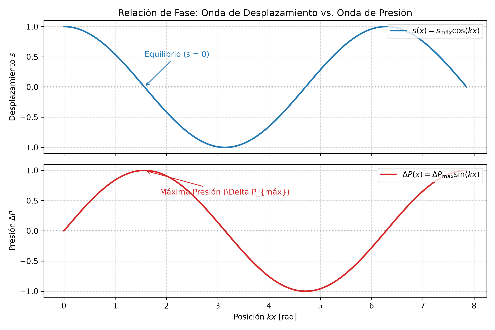
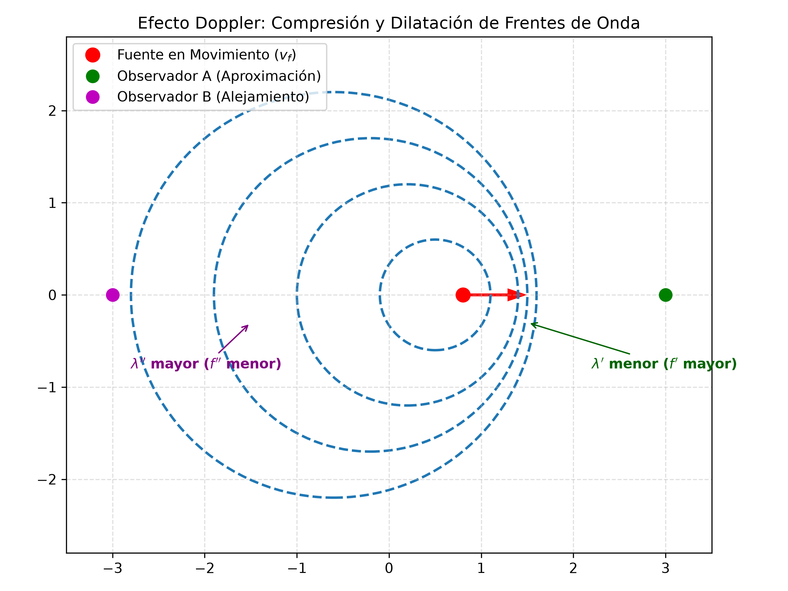
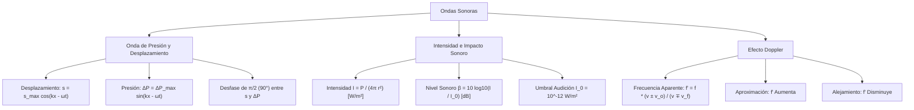

# 4.3 Ondas Sonoras, Intensidad, Nivel del Sonido y Efecto Doppler

---

## 1. Naturaleza de las Ondas Sonoras

Las **ondas sonoras** son ondas mecánicas longitudinales que se propagan a través de un medio gaseoso, líquido o sólido mediante variaciones periódicas de compresión (alta presión y densidad) y rarefacción (baja presión y densidad).

### Descripción Matemática Dual: Desplazamiento vs. Presión
Una onda sonora armónica se puede describir mediante dos funciones complementarias:

1. **Onda de Desplazamiento Longitudinal ($s$):**  
   $$s(x,t) = s_{\text{máx}} \cos(k x - \omega t)$$  
   Donde $s_{\text{máx}}$ es el desplazamiento máximo de las moléculas del medio respecto a su posición de equilibrio.

2. **Onda de Presión ($\Delta P$):**  
   $$\Delta P(x,t) = \Delta P_{\text{máx}} \sin(k x - \omega t)$$  
   Donde $\Delta P(x,t) = P(x,t) - P_0$ es la variación local de presión respecto a la presión de equilibrio $P_0$.

> **Desfase de $\frac{\pi}{2}$ (90°):**  
> Cuando el desplazamiento de las moléculas es máximo ($s = \pm s_{\text{máx}}$), la variación de presión es nula ($\Delta P = 0$). Cuando las moléculas pasan por su posición de equilibrio ($s = 0$), la variación de presión alcanza sus picos máximos ($\Delta P = \pm \Delta P_{\text{máx}}$).

---

## 2. Rapidez del Sonido y Amplitud de Presión

La rapidez de propagación del sonido en un fluido depende de su compresibilidad (Módulo Volumétrico $B$) y de su inercia (Densidad $\rho$):

$$v = \sqrt{\frac{B}{\rho}}$$

### Relación entre Amplitud de Presión y Desplazamiento
A partir de la elasticidad de los fluidos, la amplitud de presión máxima $\Delta P_{\text{máx}}$ se relaciona con $s_{\text{máx}}$ mediante:

$$\Delta P_{\text{máx}} = B s_{\text{máx}} k = \rho v s_{\text{máx}} \omega$$

---

## 3. Potencia, Intensidad y Nivel de Sonido

### A. Intensidad Sonora ($I$)
La intensidad de una onda sonora se define como la potencia acústica promedio transferida por unidad de área perpendicular a la dirección de propagación:

$$I = \frac{\overline{P}}{A} = \frac{1}{2} \rho v \omega^2 s_{\text{máx}}^2 = \frac{(\Delta P_{\text{máx}})^2}{2 \rho v} \quad \left[\frac{\text{W}}{\text{m}^2}\right]$$

### B. Ley del Cuadrado Inverso para Fuentes Puntuales
Para una fuente puntual que emite energía uniformemente en todas las direcciones, la superficie de propagación a una distancia $r$ es $A = 4\pi r^2$:

$$I = \frac{\overline{P}}{4\pi r^2} \implies \frac{I_2}{I_1} = \left(\frac{r_1}{r_2}\right)^2$$

### C. Nivel de Sonido en Decibeles ($\beta$)
Dado que la respuesta del oído humano a la intensidad sonora es logarítmica, se define el Nivel de Sonido ($\beta$ o $NS$):

$$\beta = 10 \log_{10}\left(\frac{I}{I_0}\right) \quad [\text{dB}]$$

* **Intensidad de referencia (Umbral de audición humana):** $I_0 = 1.00 \times 10^{-12} \text{ W/m}^2$ (corresponde a $0 \text{ dB}$).
* **Umbral de dolor:** $I = 1.00 \text{ W/m}^2$ (corresponde a $120 \text{ dB}$).

---

## 4. Cualidades del Sonido

1. **Intensidad (Volumen):** Permite diferenciar sonidos fuertes de débiles; depende de la amplitud de la onda ($s_{\text{máx}}$ o $\Delta P_{\text{máx}}$).
2. **Tono (Altura):** Permite diferenciar sonidos agudos (altas frecuencias) de graves (bajas frecuencias); depende de la frecuencia $f$.
3. **Timbre:** Permite distinguir la fuente sonora que emite dos sonidos de igual frecuencia e intensidad; depende de la mezcla de armónicos secundarios.
4. **Duración:** Tiempo durante el cual se mantiene la emisión sonora.

---

## 5. Efecto Doppler

El **Efecto Doppler** es el cambio aparente en la frecuencia de una onda percibido por un observador debido al movimiento relativo entre el observador y la fuente emisora.

### Fórmula General del Efecto Doppler
$$f' = \left( \frac{v \pm v_o}{v \mp v_f} \right) f$$

Donde:
* $f'$: Frecuencia percibida por el observador $[\text{Hz}]$.
* $f$: Frecuencia real emitida por la fuente $[\text{Hz}]$.
* $v$: Rapidez de propagación del sonido en el medio $[\text{m/s}]$.
* $v_o$: Rapidez del observador $[\text{m/s}]$.
* $v_f$: Rapidez de la fuente $[\text{m/s}]$.

### Regla Signos Crucial para Parciales
* **Numerador ($v_o$):** Se usa **$+$** si el observador se **acerca** a la fuente; se usa **$-$** si se **aleja**.
* **Denominador ($v_f$):** Se usa **$-$** si la fuente se **acerca** al observador; se usa **$+$** si se **aleja**.

> **Criterio Rápido:** Todo movimiento de **aproximación** (ya sea de la fuente o del observador) debe **aumentar** la frecuencia percibida ($f' > f$). Todo movimiento de **alejamiento** debe **disminuirla** ($f' < f$).

---

## 6. Detector de Trampas de Parcial

| La Trampa del Profesor | El Error Típico | La Verdad Física |
| :--- | :--- | :--- |
| **Sumar Decibeles:** Si dos parlantes emiten $80 \text{ dB}$ cada uno, pensar que el total es $160 \text{ dB}$. | Sumar linealmente la escala logarítmica $\beta_1 + \beta_2$. | Se deben sumar las intensidades físicas en $\text{W/m}^2$ ($I_{\text{tot}} = 2I$). Duplicar la intensidad solo agrega $\approx 3 \text{ dB}$ ($83 \text{ dB}$ total). |
| **Signos en Doppler:** Invertir la convención de signos en el numerador o denominador. | Usar $+$ en la fuente cuando se aproxima. | La aproximación de la fuente **resta** en el denominador ($v - v_f$), achicando el denominador y aumentando $f'$. |
| **Efecto de Eco/Rebote:** Calcular la frecuencia reflejada ignorando que la superficie móvil actúa primero como observador y luego como fuente. | Aplicar la fórmula de Doppler solo una vez. | En problemas de sonar/radar, se aplican dos pasos: 1° el objeto en movimiento recibe $f'$, 2° el objeto rebota la onda como una nueva fuente en movimiento. |

---

## 7. Esquemas Gráficos

---

## 8. Ejercicios Resueltos con Análisis Dimensional Explícito

### Ejercicio 1: Cálculo de Intensidad Sonora a partir de Nivel en dB (Ejemplo Giancoli)
**Consigna:** En una esquina congestionada de la ciudad, un medidor da un nivel sonoro de $\beta = 75.0 \text{ dB}$. Calcule la intensidad física del sonido $I$ en $\text{W/m}^2$.

#### Desarrollo y Cancelación de Unidades:

Partimos de la definición de nivel sonoro:

$$\beta = 10 \log_{10}\left(\frac{I}{I_0}\right)$$

Despejamos la razón $\frac{I}{I_0}$:

$$\frac{\beta}{10} = \log_{10}\left(\frac{I}{I_0}\right) \implies \frac{I}{I_0} = 10^{\frac{\beta}{10}}$$

$$I = I_0 \cdot 10^{\frac{\beta}{10}}$$

Sustituimos $I_0 = 1.00 \times 10^{-12} \text{ W/m}^2$ y $\beta = 75.0 \text{ dB}$:

$$I = (1.00 \times 10^{-12} \text{ W/m}^2) \cdot 10^{\frac{75.0}{10}} = (1.00 \times 10^{-12} \text{ W/m}^2) \cdot 10^{7.5}$$

$$10^{7.5} \approx 3.1623 \times 10^7$$

Operación numérica:

$$I = (1.00 \times 10^{-12} \text{ W/m}^2) \cdot (3.1623 \times 10^7) = 3.1623 \times 10^{-5} \text{ W/m}^2 \approx 3.16 \times 10^{-5} \text{ W/m}^2$$

Desglose dimensional de unidades:

$$\text{[Unidades]} = \left[\frac{\text{W}}{\text{m}^2}\right] \cdot [1] = \frac{\text{W}}{\text{m}^2}$$

---

### Ejercicio 2: Efecto Doppler Dual con Refracción/Rebote (Ejemplo Serway)
**Consigna:** Un submarino $A$ se desplaza por el agua a $v_A = 8.00 \text{ m/s}$ emitie una señal de sonar de $f = 1400 \text{ Hz}$. Un segundo submarino $B$ se desplaza directamente hacia $A$ a $v_B = 9.00 \text{ m/s}$. La rapidez del sonido en el agua es $v = 1533 \text{ m/s}$.  
a) Calcule la frecuencia $f'$ que detecta un observador en el submarino $B$ mientras se aproximan.  
b) Si la onda se refleja en el submarino $B$ y retorna al submarino $A$, ¿qué frecuencia $f''$ detecta el submarino $A$?

#### Desarrollo y Cancelación de Unidades:

**Paso a): Frecuencia detectada por $B$ (Aproximación mutua)**

Aquí la fuente ($A$) y el observador ($B$) se mueven uno hacia el otro.  
Por lo tanto, en el numerador ($v_o = v_B$) sumamos y en el denominador ($v_f = v_A$) restamos:

$$f' = \left( \frac{v + v_B}{v - v_A} \right) f$$

Sustituimos valores:

$$f' = \left( \frac{1533 \text{ m/s} + 9.00 \text{ m/s}}{1533 \text{ m/s} - 8.00 \text{ m/s}} \right) \cdot (1400 \text{ Hz})$$

$$f' = \left( \frac{1542 \text{ m/s}}{1525 \text{ m/s}} \right) \cdot (1400 \text{ Hz})$$

Desglose dimensional del factor de velocidad:

$$\text{[Factor]} = \frac{[\text{m/s}]}{[\text{m/s}]} = 1 \quad (\text{adimensional})$$

Calculamos:

$$f' = 1.0111475 \cdot (1400 \text{ Hz}) = 1415.60 \text{ Hz} \approx 1416 \text{ Hz}$$

---

**Paso b): Frecuencia del eco recibida en el submarino $A$**

Ahora el submarino $B$ refleja el sonido actuando como una **fuente móvil** que emite a $f' = 1415.60 \text{ Hz}$ mientras se mueve a $v_f = 9.00 \text{ m/s}$.  
El submarino $A$ actúa como **observador móvil** que se acerca a la fuente a $v_o = 8.00 \text{ m/s}$.

$$f'' = \left( \frac{v + v_A}{v - v_B} \right) f'$$

Sustituimos los valores correspondientes:

$$f'' = \left( \frac{1533 \text{ m/s} + 8.00 \text{ m/s}}{1533 \text{ m/s} - 9.00 \text{ m/s}} \right) \cdot (1415.60 \text{ Hz})$$

$$f'' = \left( \frac{1541 \text{ m/s}}{1524 \text{ m/s}} \right) \cdot (1415.60 \text{ Hz})$$

$$f'' = 1.0111548 \cdot (1415.60 \text{ Hz}) = 1431.39 \text{ Hz} \approx 1431.4 \text{ Hz}$$

---

## 9. Mapa Conceptual

