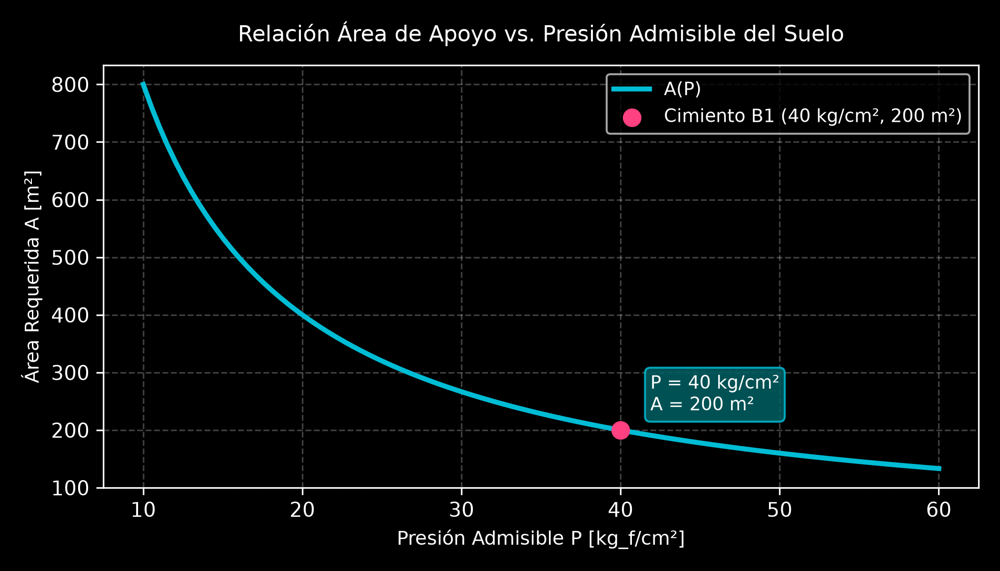
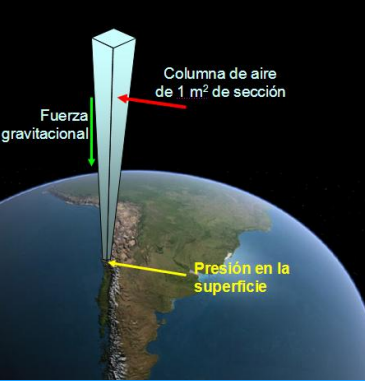
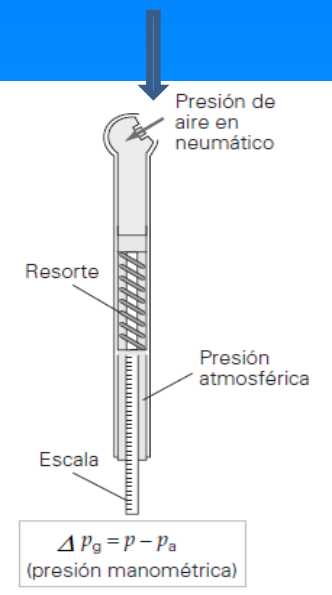
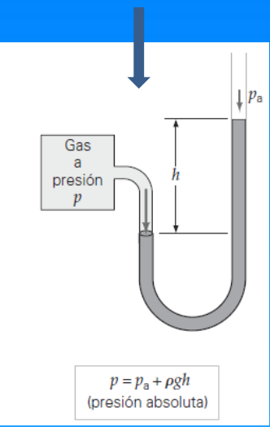
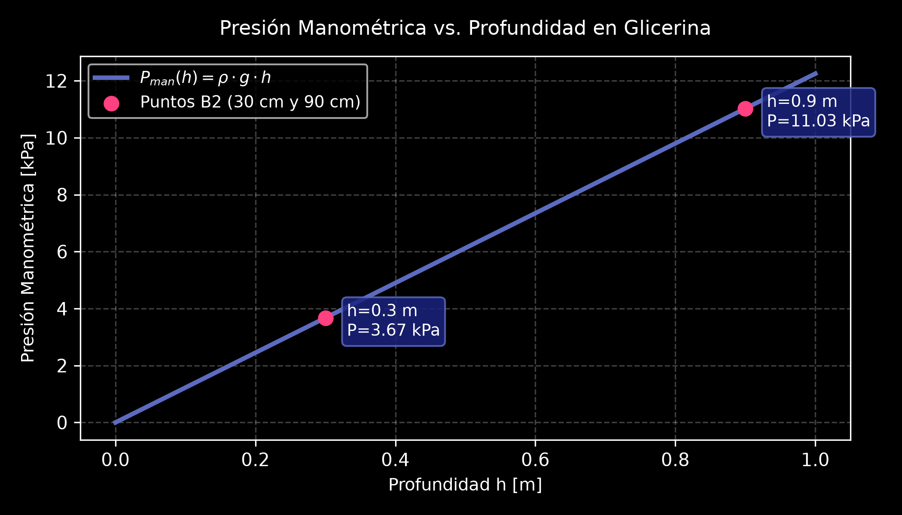
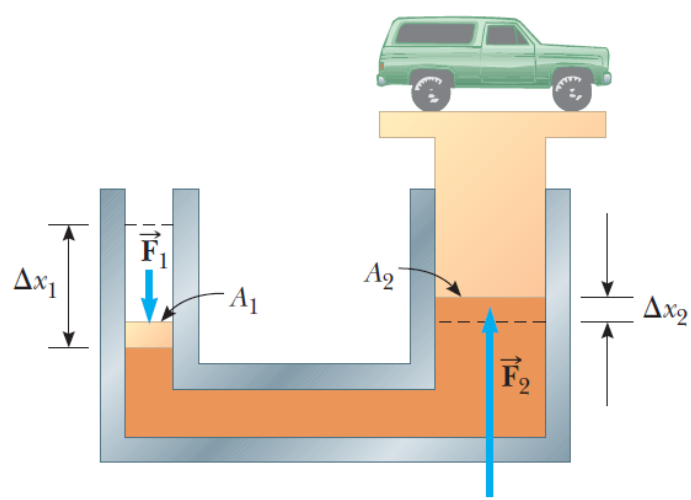
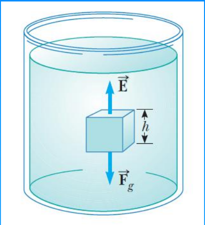
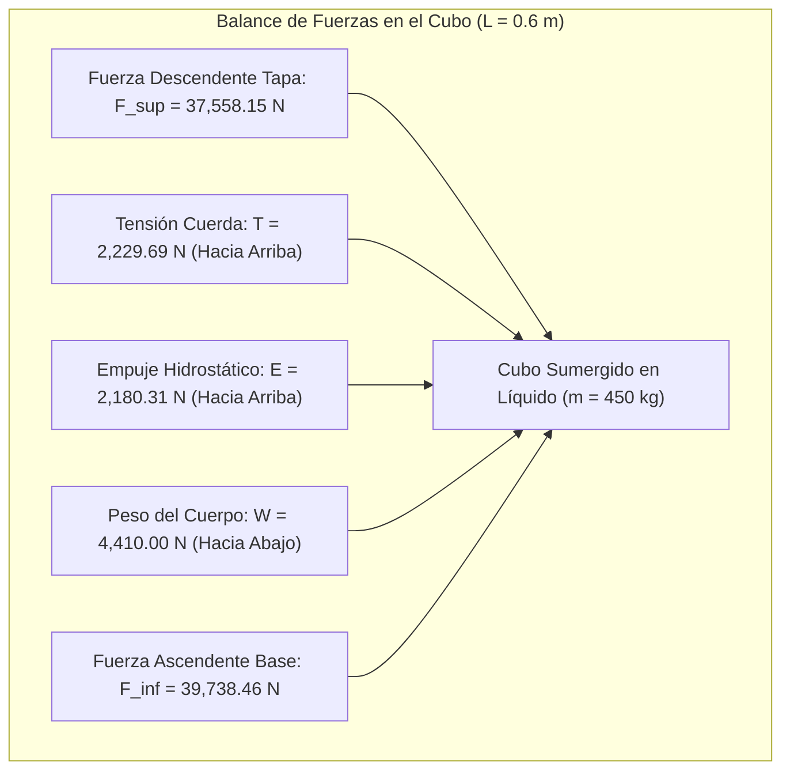
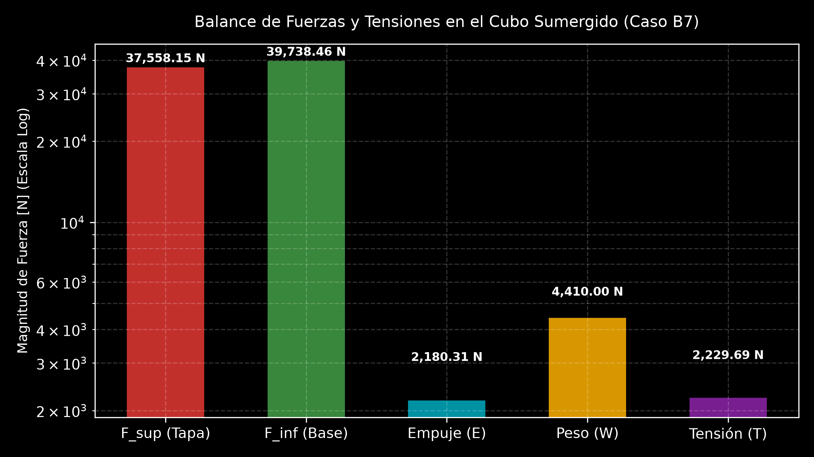

# 5.1 Hidrostática: Teoría, Principios e Integración Práctica

---

## 1. Conceptos Fundamentales y Propiedades de los Fluidos

Un **fluido** es una sustancia (líquido o gas) que se deforma continuamente bajo la aplicación de un esfuerzo cortante o tangencial, por pequeño que sea. En reposo, un fluido es incapaz de resistir fuerzas tangenciales, adoptando la forma del recipiente que lo contiene.

### A. Propiedades Intensivas y Extensivas
* **Propiedades Extensivas:** Dependen del tamaño o masa del sistema (ej. volumen $V$, masa $m$, energía $E$).
* **Propiedades Intensivas:** Son independientes de la masa del sistema (ej. presión $P$, temperatura $T$, densidad $\rho$).

### B. Masa, Densidad y Peso Específico
* **Densidad ($\rho$):** Relación entre la masa de una sustancia y el volumen que ocupa:
  $$\rho = \frac{m}{V} \quad \left[\frac{\text{kg}}{\text{m}^3}\right] \quad \left(\rho_{\text{agua}} = 1000 \text{ kg/m}^3\right)$$
* **Peso Específico ($Pe$):** Peso por unidad de volumen:
  $$Pe = \frac{m \cdot g}{V} = \rho \cdot g \quad \left[\frac{\text{N}}{\text{m}^3}\right]$$
* **Densidad Relativa ($\rho_r$):** Cociente entre la densidad de una sustancia y la de una sustancia patrón (usualmente agua a $4^\circ\text{C}$).

### C. Presión
La presión es la magnitud escalar definida como la fuerza normal ejercida por unidad de área perpendicular:

$$P = \frac{F_{\perp}}{A} \quad \left[\text{Pa} = \frac{\text{N}}{\text{m}^2}\right]$$

#### Factores de Conversión de Presión:
* $1 \text{ atm} = 1.013 \times 10^5 \text{ Pa} = 1.013 \text{ bar} = 760 \text{ mmHg} = 760 \text{ torr} = 14.7 \text{ lb/in}^2$.

---

### 🛠️ Ejemplo Práctico Aplicado: Presión sobre Cimientos (TP - Ejercicio B1)
**Enunciado:** El peso de un edificio es de $8 \times 10^4 \text{ ton}$. Un ingeniero informa que el suelo bajo los cimientos soporta una presión de $40 \text{ kg/cm}^2$. Determine el área total de apoyo de los cimientos.

**Resolución Analítica:**
1. Conversión de unidades al SI:
   * $W = 8 \times 10^4 \text{ ton} = 8 \times 10^7 \text{ kg}_f$
   * $P = 40 \text{ kg}_f/\text{cm}^2$
2. Despeje del área $A$:
   $$P = \frac{F}{A} \implies A = \frac{W}{P} = \frac{8 \times 10^7 \text{ kg}_f}{40 \text{ kg}_f/\text{cm}^2} = 2 \times 10^6 \text{ cm}^2 = \mathbf{200 \text{ m}^2}$$

{: style="display: block; margin: 0 auto; max-width: 80%;" }

---

## 2. Variación de la Presión en Reposo e Instrumentación

### A. Ecuación General de la Hidrostática
Considerando un elemento diferencial de fluido en reposo con área $A$ y espesor $dy$ en equilibrio estático ($\sum F_y = 0$):

$$P \cdot A - (P + dP)A - dm \cdot g = 0 \implies \frac{dP}{dy} = -\rho g$$

Integrando para un fluido incompresible ($\rho = \text{constante}$) entre la superficie ($y_2$, $P_0$) y una profundidad $h = y_2 - y_1$:

$$P = P_0 + \rho g h$$

> **Teorema Fundamental:** La presión en un líquido incompresible aumenta linealmente con la profundidad y es uniforme en todos los puntos pertenecientes a un mismo plano horizontal.

{: style="display: block; margin: 0 auto; max-width: 80%;" }

### B. Medición de Presión
* **Presión Absoluta ($P_{\text{abs}}$):** Presión total referida al vacío perfecto ($P=0$).
* **Presión Manométrica ($P_{\text{man}}$):** Diferencia entre la presión absoluta y la atmosférica local ($P_{\text{man}} = P_{\text{abs}} - P_0$).
* **Barómetro de Torricelli:** Mide la presión atmosférica mediante la altura de una columna de mercurio ($P_0 = \rho_{\text{Hg}} g h$).

  
  

---

### 🛠️ Ejemplos Prácticos Aplicados:

#### 1. Variación de Presión en Glicerina (TP - Ejercicio B2)
**Enunciado:** Un recipiente contiene glicerina ($\rho = 1.25 \text{ g/cm}^3$). Determine la presión manométrica a 30 cm de profundidad y a 60 cm por debajo del primer punto.

**Resolución:**
* A $h_1 = 0.30 \text{ m}$:
  $$P_1 = (1250 \text{ kg/m}^3)(9.8 \text{ m/s}^2)(0.30 \text{ m}) = \mathbf{3675 \text{ Pa}}$$
* A $h_2 = 0.30 + 0.60 = 0.90 \text{ m}$:
  $$P_2 = (1250 \text{ kg/m}^3)(9.8 \text{ m/s}^2)(0.90 \text{ m}) = \mathbf{11025 \text{ Pa}}$$

  {: style="display: block; margin: 0 auto; max-width: 80%;" }

#### 2. Identificación de Fluido en Tubo en U (TP - Ejercicio B3)
**Enunciado:** Un tubo en U abierto contiene agua ($\rho = 1000 \text{ kg/m}^3$). Se vierte un líquido desconocido en una rama formando una columna de 6 cm. La diferencia de altura $h$ entre las superficies de los dos líquidos es de 1.08 cm. ¿Qué fluido se vertió?

**Resolución:**
Igualando presiones en la interfaz horizontal de separación:
$$\rho_x \cdot g \cdot h_x = \rho_{\text{agua}} \cdot g \cdot (h_x - h_{\text{desnivel}})$$
$$\rho_x = 1000 \cdot \frac{6 - 1.08}{6} = \mathbf{820 \text{ kg/m}^3}$$
* **Conclusión:** De la tabla de densidades de la cátedra, el fluido vertido es **Kerosene**.

---

## 3. Principio de Pascal

Cualquier incremento de presión aplicado a un fluido incompresible en reposo contenido en un recipiente indeformable se transmite íntegramente a todos los puntos del fluido y a las paredes del recipiente.

$$\Delta P_1 = \Delta P_2 \implies \frac{F_1}{A_1} = \frac{F_2}{A_2} \implies F_2 = F_1 \left(\frac{A_2}{A_1}\right)$$

{: style="display: block; margin: 0 auto; max-width: 80%;" }

---

### 🛠️ Ejemplo Práctico Aplicado: Elevador Hidráulico (TP - Ejercicio B4)
**Enunciado:** En un elevador hidráulico, el aire comprimido ejerce una fuerza sobre un émbolo de radio $r_1 = 5 \text{ cm}$. Se transmite la presión a un émbolo de radio $r_2 = 15 \text{ cm}$ para levantar un auto de $13300 \text{ N}$.
a) ¿Qué fuerza $F_1$ debe ejercer el aire comprimido?
b) ¿Cuál es la presión del aire?

**Resolución Analítica:**
a) Relación de áreas $A_2 / A_1 = (r_2 / r_1)^2 = (15 / 5)^2 = 9$:
   $$F_1 = \frac{F_2}{9} = \frac{13300 \text{ N}}{9} = \mathbf{1477.78 \text{ N}}$$
b) Presión ejercida:
   $$P = \frac{F_1}{\pi r_1^2} = \frac{1477.78 \text{ N}}{\pi (0.05 \text{ m})^2} = \mathbf{1.88 \times 10^5 \text{ Pa}}$$

---

## 4. Principio de Arquímedes, Flotación y Fenómenos Superficiales

### A. Principio de Arquímedes
Todo cuerpo total o parcialmente sumergido en un fluido experimenta una fuerza de flotación o empuje ($E$) vertical hacia arriba igual al peso del volumen del fluido desplazado:

$$E = \rho_{\text{fluido}} \cdot g \cdot V_{\text{sumergido}}$$

{: style="display: block; margin: 0 auto; max-width: 80%; height: auto;" }

### B. Tensión Superficial ($\gamma$) y Capilaridad
* **Tensión Superficial:** Trabajo necesario para aumentar la superficie de un líquido por unidad de área. En películas con dos caras:
  $$\gamma = \frac{F}{2d}$$
* **Capilaridad (Ley de Jurin):** Elevación o descenso de un líquido en un tubo capilar de radio $r$:
  $$h = \frac{2 \gamma \cos\theta}{\rho g r}$$

---

## 🌟 5. Caso Integrador de Cierre (TP - Ejercicio B7)

**Enunciado:** Un cubo de arista $L = 0.600 \text{ m}$ y masa $m = 450 \text{ kg}$ se encuentra suspendido por una cuerda en un tanque abierto lleno de líquido de densidad $\rho = 1030 \text{ kg/m}^3$. La cara superior está a una profundidad $h_1 = L/2 = 0.300 \text{ m}$.

Calcular:
a) Fuerza descendente ejercida por el líquido y la atmósfera en la cara superior.
b) Fuerza ascendente en la cara inferior.
c) Empuje hidrostático.
d) Tensión en la cuerda y relación entre las cantidades.

### Resolución Analítica Paso a Paso:

1. **Fuerza Descendente en Cara Superior ($F_{\text{sup}}$):**
   $$P_{\text{sup}} = P_0 + \rho g (L/2) = 101300 + (1030)(9.8)(0.300) = 104328.2 \text{ Pa}$$
   $$F_{\text{sup}} = P_{\text{sup}} \cdot L^2 = (104328.2)(0.36 \text{ m}^2) = \mathbf{37558.15 \text{ N}}$$

2. **Fuerza Ascendente en Cara Inferior ($F_{\text{inf}}$):**
   $$P_{\text{inf}} = P_0 + \rho g (1.5 L) = 101300 + (1030)(9.8)(0.900) = 110384.6 \text{ Pa}$$
   $$F_{\text{inf}} = P_{\text{inf}} \cdot L^2 = (110384.6)(0.36 \text{ m}^2) = \mathbf{39738.46 \text{ N}}$$

3. **Empuje Hidrostático ($E$):**
   $$E = F_{\text{inf}} - F_{\text{sup}} = 39738.46 - 37558.15 = \mathbf{2180.31 \text{ N}}$$
   *(Verificación por Arquímedes: $E = \rho_{\text{liq}} g L^3 = 1030 \cdot 9.8 \cdot (0.6)^3 = 2180.30 \text{ N}$)*

4. **Tensión en la Cuerda ($T$) y Relación de Fuerzas:**
   Del equilibrio vertical ($\sum F_y = 0 \implies T + E - W = 0$):
   $$W = m g = (450 \text{ kg})(9.8 \text{ m/s}^2) = 4410 \text{ N}$$
   $$T = W - E = 4410 \text{ N} - 2180.31 \text{ N} = \mathbf{2229.69 \text{ N}}$$

