# 5.2 Hidrodinámica: Teoría, Principios e Integración Práctica

---

## 1. Clasificación del Flujo y Modelo del Fluido Ideal

La **hidrodinámica** es la rama de la física que estudia el comportamiento y las leyes que rigen el movimiento de los fluidos (líquidos y gases). Dado que el movimiento de un fluido real involucra fenómenos complejos como fricción interna y turbulencias, se utiliza el **modelo de fluido ideal** mediante suposiciones simplificadoras.

### A. Clasificación del Flujo de un Fluido
El flujo de un fluido se clasifica atendiendo a cuatro criterios fundamentales:

1. **Atendiendo a la velocidad de las partículas en el tiempo:**
   * **Flujo Estacionario (Laminar):** La velocidad de las partículas de fluido que pasan por un punto dado es constante en todo instante de tiempo.
   * **Flujo No Estacionario:** La velocidad de las partículas en cualquier punto depende del tiempo.
2. **Atendiendo a la velocidad angular neta:**
   * **Flujo Irrotacional:** El elemento de fluido no tiene velocidad angular neta alrededor de ningún punto.
   * **Flujo Rotacional:** Las partículas del fluido poseen velocidad angular neta no nula.
3. **Atendiendo a las variaciones de densidad:**
   * **Flujo Incompresible:** La densidad $\rho$ permanece constante en todo el espacio (característico de los líquidos).
   * **Flujo Compresible:** La densidad varía de punto a punto en función de la posición o la presión.
4. **Atendiendo a los rozamientos internos:**
   * **Flujo No Viscoso:** Ausencia total de rozamiento interno; no hay disipación de energía mecánica.
   * **Flujo Viscoso:** Existen fuerzas tangenciales entre las distintas capas de fluido que disipan energía en forma de calor.

### B. Las 4 Hipótesis del Fluido Ideal
Para el análisis teórico en este nivel académico, se asume un **fluido ideal** que cumple cuatro hipótesis simplificadoras:

$$\text{Fluido Ideal} \iff \begin{cases} \text{1. Flujo Estacionario} & \text{(Velocidad en cada punto constante con el tiempo)} \\ \text{2. Fluido Incompresible} & \text{(Densidad } \rho = \text{constante)} \\ \text{3. Fluido No Viscoso} & \text{(Sin resistencia o fricción al flujo)} \\ \text{4. Flujo Irrotacional} & \text{(Sin momento angular ellinos)} \end{cases}$$

### C. Líneas y Tubos de Corriente
* **Líneas de Corriente (o de flujo):** Son líneas imaginarias dibujadas a través del fluido en movimiento cuya tangente en cualquier punto indica la dirección instantánea del vector velocidad $\vec{v}$ de las partículas. En un flujo estacionario, las líneas de corriente no se cruzan.
* **Tubo de Corriente (o de flujo):** Es la región del fluido delimitada por un haz de líneas de corriente. Ninguna partícula de fluido puede cruzar las paredes laterales de un tubo de corriente.

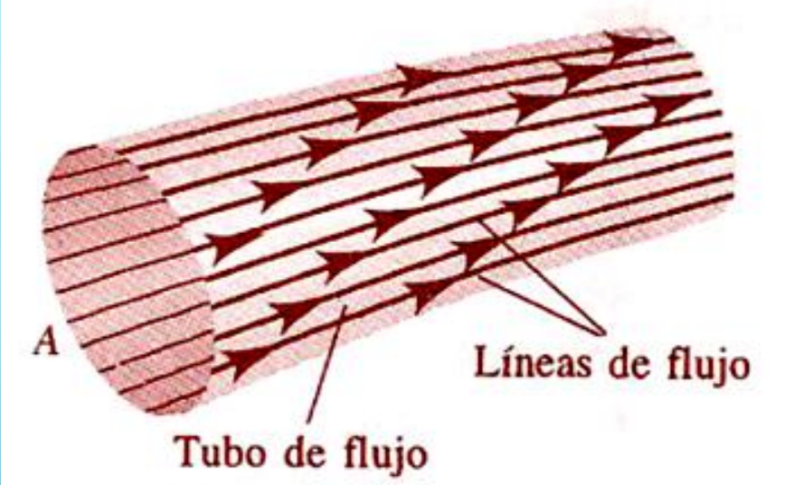{: style="display: block; margin: 0 auto; max-width: 80%; height: auto;" }

---

## 2. Ecuación de Continuidad y Caudal (Gasto)

### A. Deducción del Principio de Conservación de la Masa
Consideremos el flujo de un fluido ideal a través de un tubo de sección transversal variable $A_1$ y $A_2$. En un intervalo de tiempo $\Delta t$, la masa $\Delta m_1$ que ingresa por el extremo 1 debe ser igual a la masa $\Delta m_2$ que sale por el extremo 2:

$$\Delta m_1 = \Delta m_2 \implies \rho_1 \cdot \Delta V_1 = \rho_2 \cdot \Delta V_2$$

Como el volumen es $\Delta V = A \cdot \Delta x$ y el desplazamiento es $\Delta x = v \cdot \Delta t$:

$$\rho_1 \cdot A_1 \cdot v_1 \cdot \Delta t = \rho_2 \cdot A_2 \cdot v_2 \cdot \Delta t$$

Para un **fluido incompresible** ($\rho_1 = \rho_2 = \rho$), la densidad se cancela obteniéndose la **Ecuación de Continuidad**:

$$A_1 \cdot v_1 = A_2 \cdot v_2 = \text{constante}$$

> **Interpretación:** La velocidad de flujo es inversamente proporcional al área de la sección transversal de la tubería. Cuando el área disminuye (estrangulamiento), la velocidad del fluido aumenta proporcionalmente.
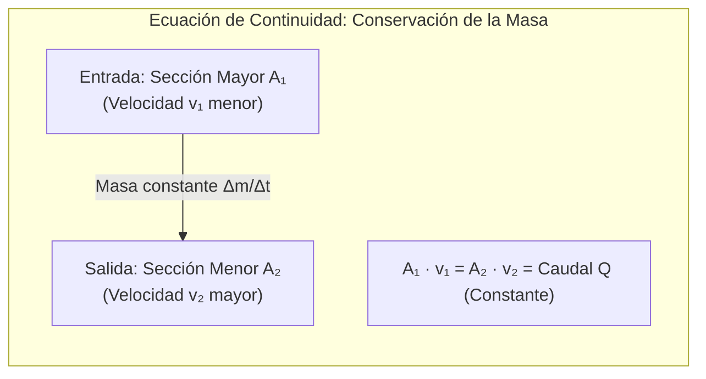
### B. Caudal Volumétrico o Gasto ($Q$)
El producto del área por la velocidad representa la tasa de flujo de volumen por unidad de tiempo, denominada **Caudal ($Q$)**:

$$Q = \frac{V}{\Delta t} = A \cdot v \quad \left[\frac{\text{m}^3}{\text{s}}\right]$$

---

### 🛠️ Ejemplos Prácticos Aplicados:

#### 1. Estrangulamiento en Tubería (TP - Ejercicio B1)
**Enunciado:** Por una tubería de $15\text{ cm}$ de diámetro, circula agua a razón de $75\text{ L/min}$. En un punto se tiene un estrangulamiento de $5\text{ cm}$ de diámetro. ¿Qué velocidad lleva el agua en ese punto?

**Resolución Analítica:**
1. Conversión de unidades al SI:
   * $D_1 = 0.15\text{ m} \implies R_1 = 0.075\text{ m}$
   * $D_2 = 0.05\text{ m} \implies R_2 = 0.025\text{ m}$
   * $Q = 75\text{ L/min} = \frac{75 \times 10^{-3}\text{ m}^3}{60\text{ s}} = 1.25 \times 10^{-3}\text{ m}^3/\text{s}$
2. Cálculo de la velocidad en el estrangulamiento ($v_2$):
   $$Q = A_2 \cdot v_2 = \pi R_2^2 \cdot v_2 \implies v_2 = \frac{Q}{\pi R_2^2}$$
   $$v_2 = \frac{1.25 \times 10^{-3}\text{ m}^3/\text{s}}{\pi (0.025\text{ m})^2} = \mathbf{0.637\text{ m/s}}$$

#### 2. Sección Transversal Variable (TP - Ejercicio B2)
**Enunciado:** Fluye agua por un tubo circular de sección transversal variable, llenándolo en todos sus puntos.
a) En un punto, el radio del tubo es $0.150\text{ m}$. ¿Qué rapidez tiene el agua si la tasa de flujo de volumen es $1.20\text{ m}^3/\text{s}$?
b) En otro punto, la rapidez del agua es $3.80\text{ m/s}$. ¿Qué radio tiene el tubo en este punto?

**Resolución Analítica:**
* **Parte a):**
  $$A_1 = \pi r_1^2 = \pi (0.150\text{ m})^2 = 0.070686\text{ m}^2$$
  $$v_1 = \frac{Q}{A_1} = \frac{1.20\text{ m}^3/\text{s}}{0.070686\text{ m}^2} = \mathbf{16.98\text{ m/s}}$$
* **Parte b):**
  $$Q = A_2 \cdot v_2 \implies A_2 = \frac{Q}{v_2} = \frac{1.20\text{ m}^3/\text{s}}{3.80\text{ m/s}} = 0.3158\text{ m}^2$$
  $$A_2 = \pi r_2^2 \implies r_2 = \sqrt{\frac{A_2}{\pi}} = \sqrt{\frac{0.3158}{\pi}} = \mathbf{0.317\text{ m}}$$

#### 3. Angostamiento del Chorro de Agua en un Grifo (Ejemplo Resnick-Halliday)
**Enunciado:** Al caer la corriente de agua que sale de un grifo, su sección se angosta. Sabiendo que $A_0 = 1.2\text{ cm}^2$ y $A_1 = 0.35\text{ cm}^2$, separados por una distancia vertical $h = 45\text{ mm}$, determine el caudal de agua que fluye de la llave.

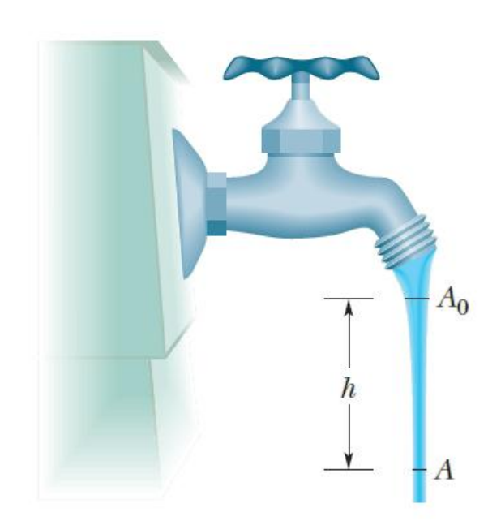{: style="display: block; margin: 0 auto; max-width: 80%; height: auto;" }

**Resolución Analítica:**
1. Planteo de Ecuación de Continuidad y Cinemática de Caída Libre:
   $$A_0 \cdot v_0 = A_1 \cdot v_1 \implies v_1 = \frac{A_0}{A_1} v_0$$
   $$v_1^2 = v_0^2 + 2gh$$
2. Sustitución y despeje de $v_0$:
   $$v_0 = \sqrt{\frac{2 g h A_1^2}{A_0^2 - A_1^2}}$$
3. Reemplazo numérico ($g = 980 \text{ cm/s}^2$, $h = 4.5 \text{ cm}$):
   $$v_0 = \sqrt{\frac{2 (980) (4.5) (0.35)^2}{(1.2)^2 - (0.35)^2}} = 28.6 \text{ cm/s}$$
   $$Q = A_0 \cdot v_0 = (1.2 \text{ cm}^2) (28.6 \text{ cm/s}) = \mathbf{34 \text{ cm}^3\text{/s}}$$

#### 4. Regar un Jardín y Alcance Parabólico (Ejemplo 14.7 Serway-Jewett)
**Enunciado:** Un jardinero usa una manguera de $2.50 \text{ cm}$ de diámetro para llenar una cubeta de $30.0 \text{ L}$ en $1.00 \text{ min}$. Luego acopla una boquilla de $0.500 \text{ cm}^2$ de área sosteniéndola horizontalmente a $1.00 \text{ m}$ sobre el suelo. ¿Sobre qué distancia horizontal se proyecta el agua?

**Resolución Analítica:**
1. Caudal y velocidad inicial en la manguera ($v_1$):
   $$Q = \frac{30.0 \times 10^3 \text{ cm}^3}{60.0 \text{ s}} = 500 \text{ cm}^3\text{/s}$$
   $$A_1 = \frac{\pi (2.50 \text{ cm})^2}{4} = 4.91 \text{ cm}^2 \implies v_1 = \frac{500 \text{ cm}^3\text{/s}}{4.91 \text{ cm}^2} = 1.02 \text{ m/s}$$
2. Velocidad de salida por la boquilla ($v_2 = v_{xi}$):
   $$v_2 = \left(\frac{A_1}{A_2}\right) v_1 = \left(\frac{4.91 \text{ cm}^2}{0.500 \text{ cm}^2}\right) (1.02 \text{ m/s}) = 10.0 \text{ m/s}$$
3. Movimiento de proyectil (caída libre vertical):
   $$y_f = y_i - \frac{1}{2} g t^2 \implies -1.00 \text{ m} = -\frac{1}{2} (9.80 \text{ m/s}^2) t^2 \implies t = \sqrt{\frac{2(1.00)}{9.80}} = 0.452 \text{ s}$$
4. Alcance horizontal ($x_f$):
   $$x_f = v_{xi} \cdot t = (10.0 \text{ m/s}) (0.452 \text{ s}) = \mathbf{4.52 \text{ m}}$$

---

## 3. Ecuación de Bernoulli (Conservación de la Energía Mecánica)

El Teorema de Bernoulli representa el principio de conservación de la energía mecánica aplicado a un flujo de fluido ideal (incompresible, no viscoso, estacionario e irrotacional).

### A. Deducción Formal por Trabajo y Energía
Considerando el movimiento de un elemento de volumen $\Delta V$ a través de un tubo de corriente entre una posición 1 (altura $y_1$) y una posición 2 (altura $y_2$):

1. Trabajo realizado por las fuerzas de presión netas:
   $$W = F_1 \Delta x_1 - F_2 \Delta x_2 = P_1 A_1 \Delta x_1 - P_2 A_2 \Delta x_2 = (P_1 - P_2) \Delta V$$
2. Variación de la Energía Cinética ($\Delta K$) y Potencial Gravitatoria ($\Delta U$):
   $$\Delta K = \frac{1}{2} \Delta m (v_2^2 - v_1^2), \quad \Delta U = \Delta m \cdot g (y_2 - y_1)$$
3. Aplicando el Teorema del Trabajo y la Energía ($W = \Delta K + \Delta U$) y dividiendo por $\Delta V$ ($\rho = \frac{\Delta m}{\Delta V}$):

$$P_1 + \frac{1}{2}\rho v_1^2 + \rho g y_1 = P_2 + \frac{1}{2}\rho v_2^2 + \rho g y_2 = \text{constante}$$

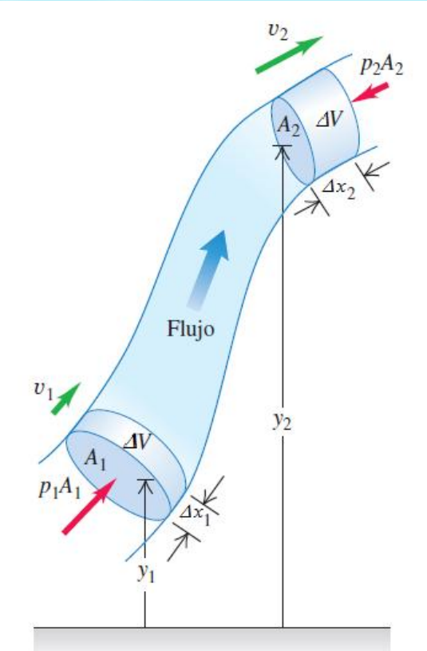{: style="display: block; margin: 0 auto; max-width: 80%; height: auto;" }

### B. Interpretación de Términos
* **$P$:** Presión estática del fluido (energía por unidad de volumen debida a las fuerzas de presión).
* **$\frac{1}{2}\rho v^2$:** Presión dinámica (energía cinética por unidad de volumen).
* **$\rho g y$:** Presión hidrostática o de elevación (energía potencial gravitatoria por unidad de volumen).

> **Nota:** Si el fluido se encuentra en reposo ($v_1 = v_2 = 0$), la ecuación se reduce al Teorema General de la Hidrostática: $P_1 - P_2 = \rho g (y_2 - y_1)$.

---

### 🛠️ Ejemplos Prácticos Aplicados:

#### 1. Tubería Descendente (TP - Ejercicio B3)
**Enunciado:** El agua se desplaza a $5.18 \text{ m/s}$ por un tubo con superficie transversal de $4.20 \text{ cm}^2$. Poco a poco desciende $9.66 \text{ m}$ al aumentar la superficie a $7.60 \text{ cm}^2$.
a) ¿Cuál es la rapidez de flujo en el nivel inferior?
b) La presión en el nivel superior es $152 \text{ kPa}$, calcule la presión en el nivel inferior.

**Resolución Analítica:**
* **Parte a):** Por continuidad $A_1 v_1 = A_2 v_2$:
  $$v_2 = \left(\frac{A_1}{A_2}\right) v_1 = \left(\frac{4.20 \text{ cm}^2}{7.60 \text{ cm}^2}\right) (5.18 \text{ m/s}) = \mathbf{2.863 \text{ m/s}}$$
* **Parte b):** Ecuación de Bernoulli entre el nivel 1 ($y_1 = 9.66 \text{ m}$) y el nivel 2 ($y_2 = 0$):
  $$P_2 = P_1 + \frac{1}{2}\rho(v_1^2 - v_2^2) + \rho g (y_1 - y_2)$$
  $$P_2 = 152000 + \frac{1}{2}(1000)(5.18^2 - 2.863^2) + (1000)(9.8)(9.66) = \mathbf{256 \text{ kPa}}$$

#### 2. Tanque Elevado y Red Doméstica (Ejemplo 2 Resnick-Halliday)
**Enunciado:** Un tanque elevado de altura $h = 32 \text{ m}$ y diámetro $D = 3.0 \text{ m}$ abastece a una casa mediante un tubo horizontal de diámetro $d = 2.54 \text{ cm}$ con un caudal $Q = 0.0025 \text{ m}^3\text{/s}$.
a) Calcule la presión en la tubería en la base.
b) Un tubo de $d' = 1.27 \text{ cm}$ abastece al tercer piso a $y_C = 7.2 \text{ m}$ sobre el suelo. Calcule la presión en este punto.

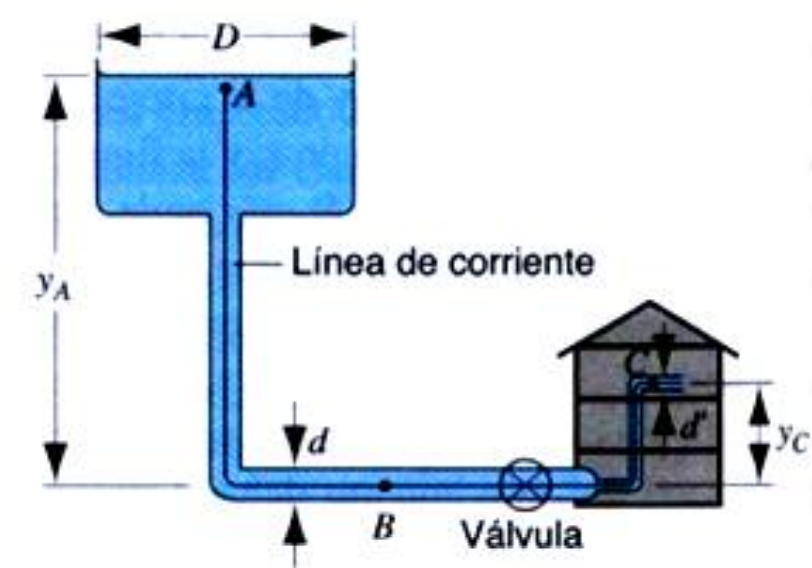{: style="display: block; margin: 0 auto; max-width: 80%; height: auto;" }

**Resolución Analítica:**
1. Velocidades en el tanque ($A$), tubería base ($B$) y tercer piso ($C$):
   * $v_A \approx 0$ (por ser $D \gg d$).
   * $v_B = \frac{Q}{\pi (d/2)^2} = \frac{0.0025}{\pi (0.0127)^2} = 4.9 \text{ m/s}$
   * $v_C = \frac{Q}{\pi (d'/2)^2} = \frac{0.0025}{\pi (0.00635)^2} = 19.7 \text{ m/s}$
2. Presión en la base ($P_B$):
   $$P_B = P_0 + \rho g h - \frac{1}{2}\rho v_B^2 = 1.01 \times 10^5 + (1000)(9.8)(32) - \frac{1}{2}(1000)(4.9)^2 = \mathbf{4.03 \times 10^5 \text{ Pa}}$$
3. Presión en el tercer piso ($P_C$):
   $$P_C = P_0 + \rho g (h - y_C) - \frac{1}{2}\rho v_C^2 = 1.01 \times 10^5 + (1000)(9.8)(32 - 7.2) - \frac{1}{2}(1000)(19.7)^2 = \mathbf{1.49 \times 10^5 \text{ Pa}}$$

---

## 4. Aplicaciones Especiales e Instrumentación Hidrodinámica

### A. Teorema de Torricelli
El Teorema de Torricelli es una aplicación particular de la Ecuación de Bernoulli que permite determinar la rapidez de salida de un líquido a través de un orificio practicado en un recipiente que lo contiene.

#### Deducción General para Recipientes Presurizados y Abiertos
Considerando un tanque con líquido de densidad $\rho$, donde la superficie libre (punto 2, a una altura $y_2$) se encuentra a una presión $P$, y el orificio de salida (punto 1, a una altura $y_1$) descarga a la atmósfera a presión $P_0$:

1. Ecuación de Bernoulli entre los puntos 1 y 2:
   $$P_0 + \frac{1}{2}\rho v_1^2 + \rho g y_1 = P + \frac{1}{2}\rho v_2^2 + \rho g y_2$$
2. Hipótesis de recipiente grande ($A_2 \gg A_1$): La velocidad de descenso del nivel libre es despreciable respecto a la velocidad de salida ($v_2 \approx 0$).
3. Definiendo la profundidad del orificio respecto a la superficie libre como $h = y_2 - y_1$:

$$v_1 = \sqrt{\frac{2(P - P_0)}{\rho} + 2gh}$$

* **Caso Particular (Tanque Abierto a la Atmósfera $P = P_0$):** La velocidad de salida es idéntica a la adquirida por un cuerpo en caída libre desde una altura $h$:

$$v = \sqrt{2gh}$$
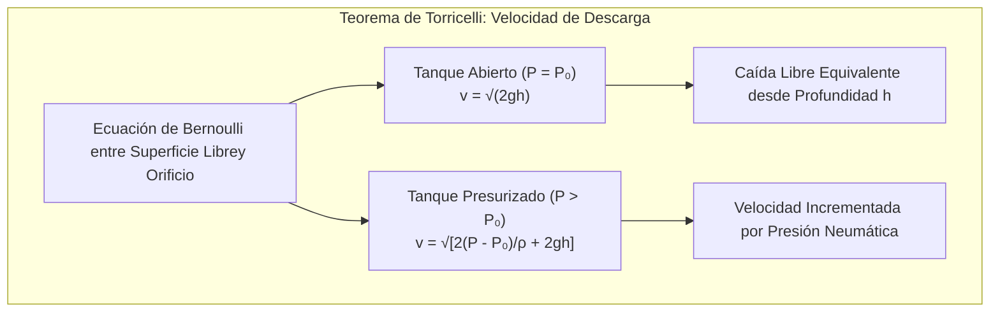

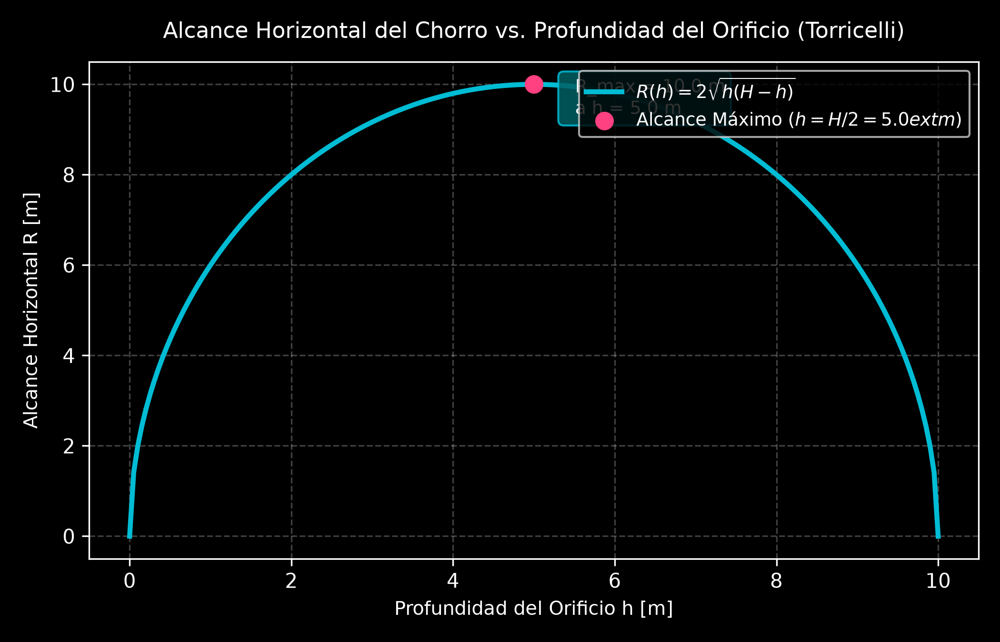

---

### 🛠️ Ejemplos Prácticos Aplicados (Torricelli):

#### 1. Fuga en Tanque Abierto (TP - Ejercicio B4)
**Enunciado:** Un gran tanque de almacenamiento abierto en la parte superior contiene agua. En su costado, a $16\text{ m}$ por debajo del nivel de agua, se produce un orificio pequeño con una tasa de fuga $Q = 2.5 \times 10^{-3}\text{ m}^3/\text{min}$. Determine:
a) La rapidez con la que el agua sale del orificio.
b) El diámetro del orificio.

**Resolución Analítica:**
* **Parte a):** Por Teorema de Torricelli para tanque abierto ($h = 16\text{ m}$):
  $$v = \sqrt{2gh} = \sqrt{2(9.8\text{ m/s}^2)(16\text{ m})} = \mathbf{17.71\text{ m/s}}$$
* **Parte b):** Relación entre Caudal y Área ($Q = A \cdot v$):
  $$Q = \frac{2.5 \times 10^{-3}\text{ m}^3}{60\text{ s}} = 4.167 \times 10^{-5}\text{ m}^3/\text{s}$$
  $$A = \frac{Q}{v} = \frac{4.167 \times 10^{-5}}{17.71} = 2.353 \times 10^{-6}\text{ m}^2 \implies d = \sqrt{\frac{4A}{\pi}} = \mathbf{1.73\text{ mm}}$$

#### 2. Recipiente Circular Descargando (TP - Ejercicio B5)
**Enunciado:** En un recipiente de gran sección lleno de agua, a $1.20\text{ m}$ debajo de la superficie libre se realiza un agujero circular de $5\text{ cm}$ de radio. Calcular la velocidad de salida y el caudal.

**Resolución Analítica:**
1. Velocidad de salida ($h = 1.20\text{ m}$):
   $$v = \sqrt{2gh} = \sqrt{2(9.8)(1.20)} = \mathbf{4.85\text{ m/s}}$$
2. Caudal ($r = 0.05\text{ m} \implies A = \pi (0.05)^2 = 7.854 \times 10^{-3}\text{ m}^2$):
   $$Q = A \cdot v = (7.854 \times 10^{-3}\text{ m}^2)(4.85\text{ m/s}) = \mathbf{0.0381\text{ m}^3/\text{s}} \quad (38.1\text{ L/s})$$

#### 3. Depósito Hermético Presurizado (TP - Ejercicio B6)
**Enunciado:** Un depósito herméticamente cerrado contiene agua y en la parte superior interna la presión es $3\text{ atm}$ ($1\text{ atm} = 101325\text{ Pa}$). Determinar:
a) La presión a $6\text{ m}$ por debajo del nivel del agua.
b) La velocidad inicial de salida por un orificio a $6\text{ m}$ de profundidad.
c) La velocidad si se abriese la parte superior a la atmósfera.

**Resolución Analítica:**
* **Parte a):** Presión absoluta a $6\text{ m}$ ($P_{\text{sup}} = 3 \times 101325 = 303975\text{ Pa}$):
  $$P = P_{\text{sup}} + \rho g h = 303975 + (1000)(9.8)(6) = \mathbf{362775\text{ Pa}} \quad (3.58\text{ atm})$$
* **Parte b):** Velocidad con aire presurizado ($P_0 = 101325\text{ Pa}$):
  $$v = \sqrt{\frac{2(303975 - 101325)}{1000} + 2(9.8)(6)} = \sqrt{405.3 + 117.6} = \mathbf{22.87\text{ m/s}}$$
* **Parte c):** Velocidad si estuviera abierto ($P_{\text{sup}} = P_0$):
  $$v = \sqrt{2gh} = \sqrt{2(9.8)(6)} = \mathbf{10.84\text{ m/s}}$$

#### 4. Descarga en Compuerta de Dique (TP - Ejercicio B7)
**Enunciado:** El agua ingresa de manera continua en un dique de $15.2\text{ m}$ de profundidad. Un tubo horizontal de $4.30\text{ cm}$ de diámetro lo cruza a $6.15\text{ m}$ debajo de la superficie del agua protegida por una compuerta. Calcule:
a) La fuerza de fricción entre la compuerta y la pared del tubo.
b) El volumen de agua que sale en $3\text{ h}$ tras abrir la compuerta.
c) El alcance horizontal del chorro si el tubo descarga a $9.05\text{ m}$ del suelo.

**Resolución Analítica:**
* **Parte a):** Fuerza manométrica estática ($h = 6.15\text{ m}$, $A = 1.452 \times 10^{-3}\text{ m}^2$):
  $$P_{\text{man}} = \rho g h = (1000)(9.8)(6.15) = 60270\text{ Pa}$$
  $$F_{\text{fricción}} = P_{\text{man}} \cdot A = (60270)(1.452 \times 10^{-3}) = \mathbf{87.51\text{ N}}$$
* **Parte b):** Volumen en $3\text{ h}$ ($t = 10800\text{ s}$):
  $$v = \sqrt{2gh} = \sqrt{2(9.8)(6.15)} = 10.98\text{ m/s} \implies Q = A \cdot v = 0.01594\text{ m}^3/\text{s}$$
  $$V = Q \cdot t = (0.01594\text{ m}^3/\text{s})(10800\text{ s}) = \mathbf{172.15\text{ m}^3}$$
* **Parte c):** Alcance horizontal ($y_0 = 9.05\text{ m}$):
  $$t_{\text{caída}} = \sqrt{\frac{2 y_0}{g}} = \sqrt{\frac{2(9.05)}{9.8}} = 1.358\text{ s} \implies x = v \cdot t_{\text{caída}} = (10.98)(1.358) = \mathbf{14.91\text{ m}}$$

#### 5. Tanque Presurizado con Empuje de Retroceso (TP - Ejercicio B8)
**Enunciado:** Un tanque cilíndrico de $1.2\text{ m}$ de diámetro se llena hasta $0.3\text{ m}$ de profundidad con agua. El aire superior está comprimido a $P = 2.026 \times 10^5\text{ N/m}^2$. Se quita un tapón del fondo de área $A_{\text{orificio}} = 2.5\text{ cm}^2$.
a) Calcular la velocidad inicial de salida.
b) Encontrar la fuerza vertical hacia arriba (empuje de reacción) que experimenta el tanque.

**Resolución Analítica:**
* **Parte a):** Velocidad inicial de descarga ($\Delta P = 1.013 \times 10^5\text{ Pa}$):
  $$v = \sqrt{\frac{2 \Delta P}{\rho} + 2gh} = \sqrt{\frac{2(101300)}{1000} + 2(9.8)(0.3)} = \sqrt{202.6 + 5.88} = \mathbf{14.44\text{ m/s}}$$
* **Parte b):** Fuerza de reacción por Segunda Ley de Newton ($F = \rho A v^2$):
  $$F_{\text{reacción}} = \rho \cdot A_{\text{orificio}} \cdot v^2 = (1000)(2.5 \times 10^{-4})(14.44)^2 = \mathbf{52.13\text{ N (Hacia Arriba)}}$$

#### 6. Descarga por Orificio a $5\text{ m}$ (Ejemplo Bueche)
**Enunciado:** Un tanque abierto en su parte superior tiene una abertura de $3.0\text{ cm}$ de diámetro situada a $5.0\text{ m}$ por debajo del nivel de agua. ¿Qué volumen de líquido saldrá por minuto?

**Resolución Analítica:**
1. Velocidad de salida ($h = 5.0\text{ m}$):
   $$v = \sqrt{2gh} = \sqrt{2(9.81)(5.0)} = 9.9\text{ m/s}$$
2. Caudal volumétrico en $\text{m}^3/\text{min}$:
   $$A = \pi (1.5 \times 10^{-2}\text{ m})^2 = 7.068 \times 10^{-4}\text{ m}^2$$
   $$Q = (9.9\text{ m/s})(7.068 \times 10^{-4}\text{ m}^2) = 7.0 \times 10^{-3}\text{ m}^3/\text{s} = \mathbf{0.42\text{ m}^3/\text{min}}$$

---

### B. Tubo de Venturi
El Tubo de Venturi es un dispositivo hidráulico diseñado para medir la velocidad de flujo y el caudal de un fluido incompresible dentro de una tubería mediante una reducción en la sección transversal (garganta).

#### Deducción Analítica Completa
Para una tubería horizontal ($y_1 = y_2$):
1. Ecuación de Bernoulli:
   $$P_1 + \frac{1}{2}\rho v_1^2 = P_2 + \frac{1}{2}\rho v_2^2 \implies P_1 - P_2 = \frac{1}{2}\rho (v_2^2 - v_1^2)$$
2. Por Ecuación de Continuidad ($v_1 = \frac{A_2}{A_1} v_2$):
   $$P_1 - P_2 = \frac{1}{2}\rho v_2^2 \left[1 - \left(\frac{A_2}{A_1}\right)^2\right] \implies v_2 = A_1 \sqrt{\frac{2(P_1 - P_2)}{\rho(A_1^2 - A_2^2)}}$$

#### Integración con Manómetro Diferencial de Mercurio ($\rho_{\text{Hg}}$)
Si se conecta un manómetro en U con líquido manométrico de densidad $\rho_{\text{Hg}}$, la diferencia de presión se iguala a $P_1 - P_2 = g h (\rho_{\text{Hg}} - \rho)$:

$$v_2 = A_1 \sqrt{\frac{2 g h (\rho_{\text{Hg}} - \rho)}{\rho (A_1^2 - A_2^2)}}$$

$$Q = A_2 \cdot v_2 = \sqrt{\frac{2 g A_1^2 A_2^2 (\rho_{\text{Hg}} - \rho) h}{\rho (A_1^2 - A_2^2)}}$$

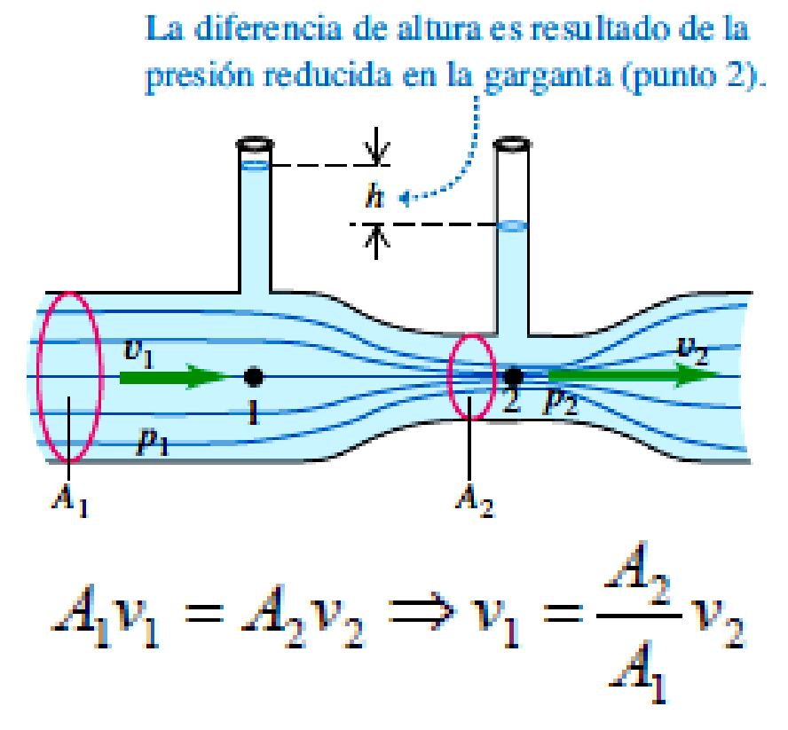{: style="display: block; margin: 0 auto; max-width: 80%; height: auto;" }

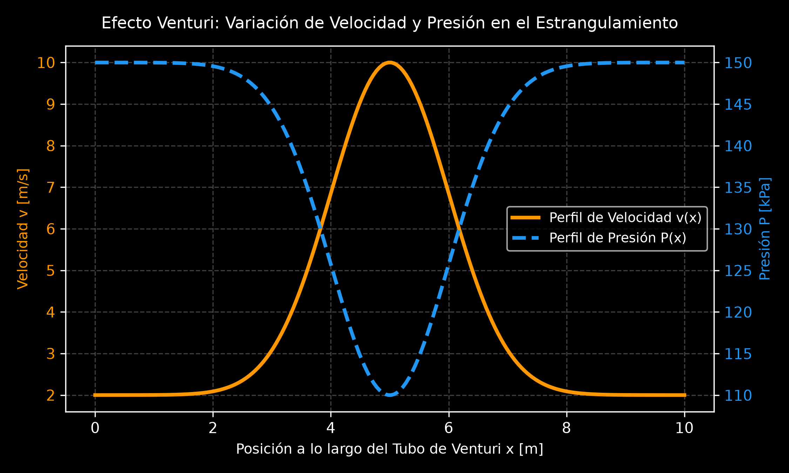

---

### 🛠️ Ejemplos Prácticos Aplicados (Venturi):

#### 1. Venturi Simple en Cañería (TP - Ejercicio B9)
**Enunciado:** Para saber la velocidad del agua en una cañería de $40\text{ cm}^2$ se empalma un conector 10 veces menor ($A_2 = 4\text{ cm}^2$) con dos tubos manométricos. La diferencia de nivel alcanzada es $h = 5\text{ cm}$. Calcular la velocidad en ambas secciones y el caudal.

**Resolución Analítica:**
1. Diferencia de presión piezométrica ($P_1 - P_2 = \rho g h$):
   $$P_1 - P_2 = (1000)(9.8)(0.05) = 490\text{ Pa}$$
2. Velocidad en la sección angosta ($v_2$):
   $$v_2 = A_1 \sqrt{\frac{2 g h}{A_1^2 - A_2^2}} = (40 \times 10^{-4}) \sqrt{\frac{2(9.8)(0.05)}{(40 \times 10^{-4})^2 - (4 \times 10^{-4})^2}}$$
   $$v_2 = 40 \times 10^{-4} \sqrt{\frac{0.98}{1.584 \times 10^{-5}}} = (40 \times 10^{-4})(248.74) = \mathbf{0.995\text{ m/s}}$$
3. Velocidad en la cañería principal ($v_1$) y Caudal ($Q$):
   $$v_1 = \frac{v_2}{10} = \mathbf{0.0995\text{ m/s}}$$
   $$Q = A_1 \cdot v_1 = (40 \times 10^{-4}\text{ m}^2)(0.0995\text{ m/s}) = \mathbf{3.98 \times 10^{-4}\text{ m}^3/\text{s}} \quad (0.398\text{ L/s})$$

#### 2. Venturi con Manómetro de Mercurio (Ejemplo San Juan / TP)
**Enunciado:** Un tubo de Venturi tiene un diámetro de entrada $D_1 = 40\text{ cm}$ y en la garganta $D_2 = 20\text{ cm}$. El manómetro de mercurio ($\rho_{\text{Hg}} = 13.6\text{ g/cm}^3$) indica una diferencia de nivel $h = 30\text{ cm}$. Calcule el caudal de agua.

**Resolución Analítica:**
1. Cálculo de Áreas:
   * $A_1 = \pi (40)^2 / 4 = 1256.64\text{ cm}^2$
   * $A_2 = \pi (20)^2 / 4 = 314.16\text{ cm}^2$
2. Reemplazo en la fórmula de Caudal en CGS ($\rho = 1\text{ g/cm}^3$, $g = 980\text{ cm/s}^2$):
   $$Q = \sqrt{\frac{2(980)(314.16)^2(1256.64)^2(13.6 - 1)(30)}{1 \cdot [(1256.64)^2 - (314.16)^2]}}$$
   $$Q = 3.0 \times 10^5\text{ cm}^3/\text{s} = \mathbf{0.3\text{ m}^3/\text{s}}$$

---

### C. Tubo de Pitot
El Tubo de Pitot es un instrumento utilizado para medir la velocidad de flujo de un gas o líquido en una conducción o la velocidad de una nave con respecto al fluido circundante.

#### Deducción Analítica
Consta de dos tomas: la toma estática (perpendicular al flujo, mide $P_a$) y la toma de estancamiento (dirigida contra la corriente, donde el fluido se detiene $v_b = 0$, midiendo la presión total $P_b$).
1. Ecuación de Bernoulli entre tomas $a$ y $b$:
   $$P_a + \frac{1}{2}\rho_{\text{fluido}} v^2 = P_b$$
2. La diferencia de presión $P_b - P_a$ equilibra la columna manométrica de líquido $\rho_{\text{liq}}$:
   $$\frac{1}{2}\rho_{\text{fluido}} v^2 = \rho_{\text{liq}} \cdot g \cdot h \implies v = \sqrt{\frac{2 \rho_{\text{liq}} g h}{\rho_{\text{fluido}}}}$$

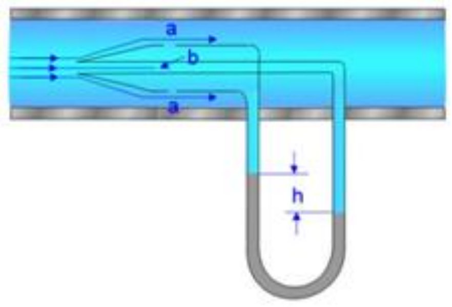{: style="display: block; margin: 0 auto; max-width: 80%; height: auto;" }

---

### 🛠️ Ejemplo Práctico Aplicado (Pitot):

#### 1. Velocidad de Aeroplano (TP - Ejercicio B10)
**Enunciado:** Un tubo de Pitot montado en el ala de un aeroplano determina su velocidad respecto al aire ($\rho_{\text{aire}} = 1.03\text{ kg/m}^3$). El tubo contiene alcohol ($\rho_{\text{alc}} = 810\text{ kg/m}^3$) e indica un desnivel $h = 26.2\text{ cm}$. ¿Cuál es la velocidad del aeroplano?

**Resolución Analítica:**
$$v = \sqrt{\frac{2 \cdot \rho_{\text{alc}} \cdot g \cdot h}{\rho_{\text{aire}}}}$$
$$v = \sqrt{\frac{2 (810\text{ kg/m}^3) (9.8\text{ m/s}^2) (0.262\text{ m})}{1.03\text{ kg/m}^3}} = \sqrt{\frac{4159.27}{1.03}} = \sqrt{4038.13} = \mathbf{63.55\text{ m/s}} \quad (228.8\text{ km/h})$$

---

## 5. Introducción a Fluidos Reales: Viscosidad y Régimen de Flujo

### A. Viscosidad Dinámica ($\eta$)
La **viscosidad** representa el rozamiento interno de un fluido real debido a las fuerzas de cohesión entre sus moléculas. Al deslizar una placa móvil sobre un fluido viscoso confinado sobre una placa fija, se establece un perfil lineal de velocidades.

$$F = \eta \cdot A \cdot \frac{v}{e} \implies \eta = \frac{F \cdot e}{v \cdot A} \quad [\text{Pa}\cdot\text{s}]$$

### B. Número de Reynolds ($N_R$) y Regímenes de Flujo
Osborne Reynolds demostró experimentalmente que el carácter del flujo en una tubería cilíndrica de diámetro $D$ depende de la densidad $\rho$, la velocidad media $v$ y la viscosidad dinámica $\mu$:

$$N_R = \frac{\rho \cdot v \cdot D}{\mu} = \frac{v \cdot D}{\nu}$$

#### Criterios de Clasificación:
* **Flujo Laminar ($N_R \le 2000$):** El fluido se mueve en capas paralelas o láminas suaves sin mezclado macroscópico.
* **Zona de Transición ($2000 < N_R < 4000$):** Inestable; el flujo puede alternar entre laminar y turbulento.
* **Flujo Turbulento ($N_R \ge 4000$):** El flujo presenta remolinos, vórtices y mezcla caótica de partículas.
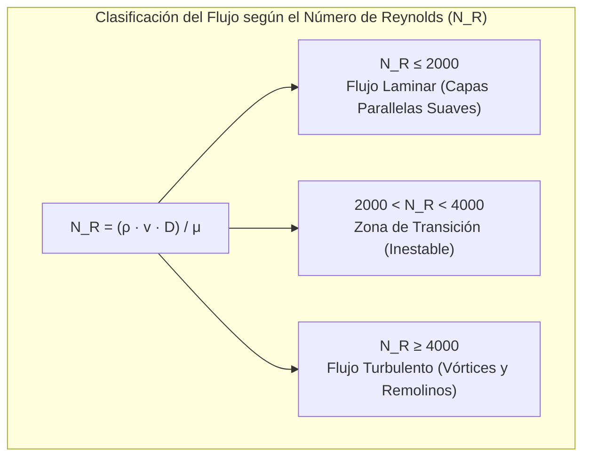

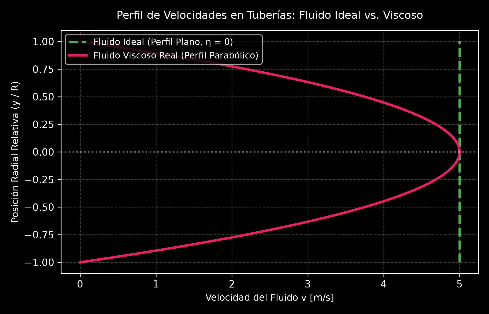