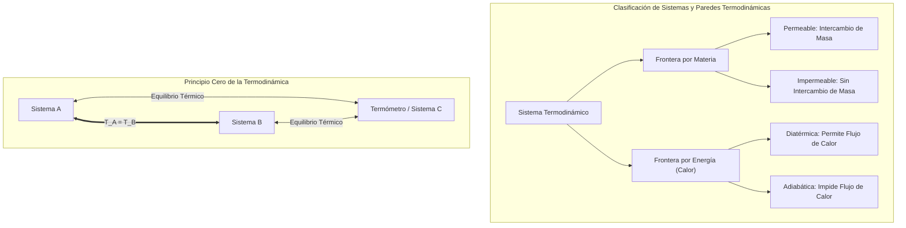
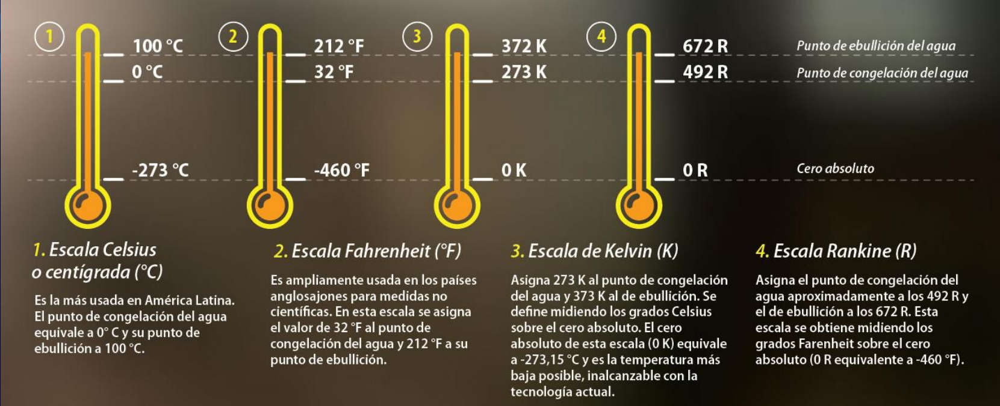
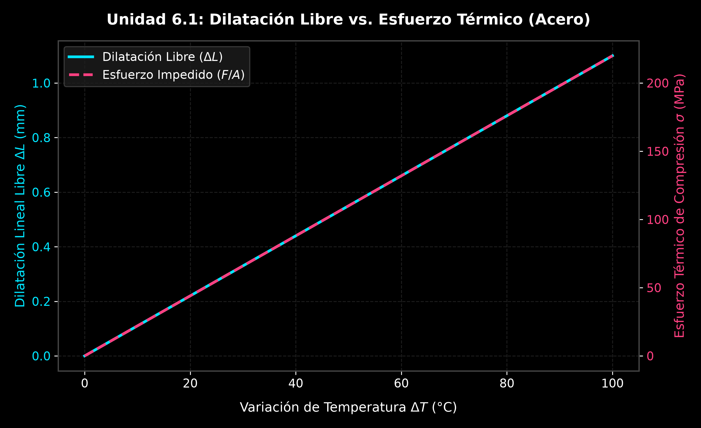
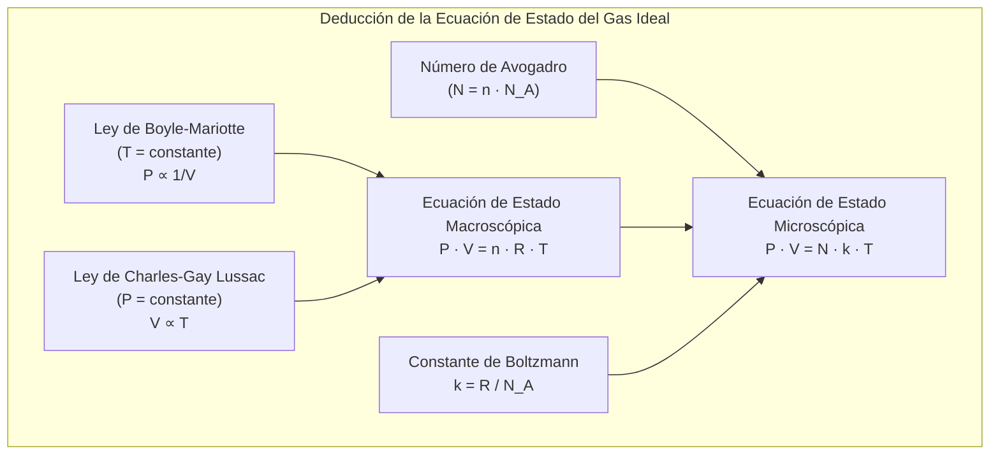
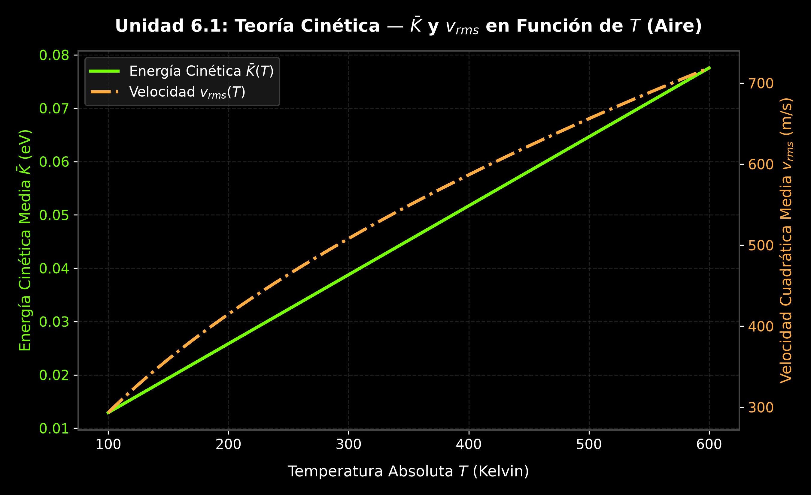

# 6.1 Termometría, Dilatación Térmica y Ecuación de Estado del Gas Ideal

---

## 1. Fundamentos Termodinámicos y Ley Cero

La **termodinámica** es la rama de la física que estudia las transformaciones de la energía, en particular las relaciones entre calor, trabajo y las propiedades macroscópicas de la materia. 

### A. Definiciones de Sistema, Entorno y Frontera
Para analizar cualquier fenómeno termodinámico es indispensable definir con precisión el objeto de estudio y su interacción con el medio circundante:

* **Sistema Termodinámico:** Región del espacio o cantidad de materia seleccionada para su estudio e aislada conceptualmente del resto del universo.
* **Entorno (o Alrededores):** Todo lo que se encuentra fuera del sistema y puede interactuar con él.
* **Frontera (o Límite):** Superficie real o imaginaria que separa al sistema de su entorno.

Las propiedades de la frontera determinan el tipo de interacción entre el sistema y su entorno:
1. **Permeable / Impermeable:** Permite o prohíbe el intercambio de masa (materia).
2. **Diatérmica:** Permite el flujo o intercambio de calor entre el sistema y el entorno.
3. **Adiabática:** Impide totalmente la transferencia de energía en forma de calor.

### B. Equilibrio Térmico y Ley Cero de la Termodinámica
Cuando dos sistemas con diferentes temperaturas entran en contacto mediante una pared diatérmica, la energía se transfiere en forma de calor desde el sistema de mayor temperatura hacia el de menor temperatura hasta que ambos alcanzan un estado estacionario en el que sus propiedades dejan de cambiar. En este punto, se afirma que ambos sistemas están en **equilibrio térmico**.

> **Ley Cero de la Termodinámica:** Si un sistema $A$ está en equilibrio térmico con un sistema $C$, y un sistema $B$ está por separado en equilibrio térmico con el mismo sistema $C$, entonces los sistemas $A$ y $B$ están en equilibrio térmico entre sí.

Este principio fundamental, formulado formalmente por Ralph H. Fowler en la década de 1930, justifica operacionalmente el uso del **termómetro** (sistema $C$) como instrumento estándar para medir la temperatura de cualquier otro sistema.

---

## 2. Escalas Termométricas y Conversiones

La **temperatura** es una magnitud física escalar intensiva que refleja el grado de agitación térmica o energía cinética media de traslación de las moléculas de un cuerpo.

### A. Puntos Fijos y Escalas Termométricas
Para construir una escala de temperatura se definen dos puntos fijos de referencia a la presión atmosférica estándar ($1\text{ atm} = 101.325\text{ kPa}$):
* **Punto Fijo Inferior (Punto de Fusión):** Temperatura en la que coexisten en equilibrio térmico el hielo puro y el agua líquida saturada.
* **Punto Fijo Superior (Punto de Ebullición):** Temperatura en la que coexisten en equilibrio el agua líquida y el vapor de agua.

Las cuatro escalas termométricas de mayor relevancia técnica y científica son:
1. **Escala Celsius ($^\circ\text{C}$):** Divide el intervalo entre fusión ($0^\circ\text{C}$) y ebullición ($100^\circ\text{C}$) en 100 divisiones iguales.
2. **Escala Fahrenheit ($^\circ\text{F}$):** Ampliamente utilizada en los países anglosajones. Asigna $32^\circ\text{F}$ al punto de fusión y $212^\circ\text{F}$ al de ebullición (180 divisiones).
3. **Escala Kelvin ($\text{K}$):** Escala absoluta empleada en el Sistema Internacional (SI). Su cero absoluto ($0\text{ K} = -273.15^\circ\text{C}$) representa el estado límite teórico donde cesa todo movimiento cinético molecular. Sus divisiones tienen el mismo tamaño que las Celsius ($273.15\text{ K}$ fusión, $373.15\text{ K}$ ebullición).
4. **Escala Rankine ($\text{R}$):** Escala absoluta referida a grados Fahrenheit. El cero absoluto corresponde a $0\text{ R} = -459.67^\circ\text{F}$ ($491.67\text{ R}$ fusión, $671.67\text{ R}$ ebullición).

### B. Relaciones Matemáticas de Conversión
Por prorrateo lineal de divisiones entre las lecturas y sus puntos fijos de fusión se establece la relación fundamental:

$$\frac{T_{^\circ\text{C}} - 0}{100} = \frac{T_{^\circ\text{F}} - 32}{180} = \frac{T_\text{K} - 273.15}{100} = \frac{T_\text{R} - 491.67}{180}$$

Despejando las transformaciones directas:
* **De Fahrenheit a Celsius:** $T_{^\circ\text{C}} = \frac{5}{9} \left(T_{^\circ\text{F}} - 32\right)$
* **De Celsius a Fahrenheit:** $T_{^\circ\text{F}} = \frac{9}{5} T_{^\circ\text{C}} + 32$
* **De Celsius a Kelvin:** $T_\text{K} = T_{^\circ\text{C}} + 273.15$
* **De Kelvin a Celsius:** $T_{^\circ\text{C}} = T_\text{K} - 273.15$

---

### 🛠️ Ejemplo Práctico Integrado:
**Enunciado (Apunte de Cátedra):** En Estados Unidos una temperatura ambiental de $50^\circ\text{F}$ es común. Realice la conversión de esta lectura a las escalas Celsius y Kelvin.

**Resolución Analítica:**
1. Conversión a Celsius:
   $$T_{^\circ\text{C}} = \frac{5}{9} (50 - 32) = \frac{5}{9} (18) = \mathbf{10^\circ\text{C}}$$
2. Conversión a Kelvin:
   $$T_\text{K} = 10 + 273.15 = \mathbf{283.15\text{ K}}$$

---

## 3. Dilatación Térmica y Esfuerzo Mecánico

La **expansión o dilatación térmica** es el cambio dimensional que experimenta la materia debido al incremento en la amplitud de las vibraciones térmicas interatómicas al aumentar la temperatura.

### A. Dilatación en Sólidos
Para variaciones moderadas de temperatura $\Delta T$, el cambio en las dimensiones de un sólido es directamente proporcional a sus dimensiones iniciales y a la variación de temperatura:

1. **Dilatación Lineal:** Se aplica a cuerpos donde predomina la longitud frente a las demás dimensiones (barras, hilos, rieles, cintas):
   $$\Delta L = \alpha \cdot L_0 \cdot \Delta T \implies L = L_0 (1 + \alpha \cdot \Delta T)$$
   * $L_0, L$: Longitud inicial y final en $[\text{m}]$.
   * $\alpha$: Coeficiente de dilatación lineal promedio en $[(^\circ\text{C})^{-1}]$ o $[\text{K}^{-1}]$.

2. **Dilatación Superficial:** Aplica a placas, láminas o superficies bidimensionales:
   $$\Delta A = \beta \cdot A_0 \cdot \Delta T \implies A = A_0 (1 + \beta \cdot \Delta T)$$
   * Dónde el coeficiente superficial es $\beta \approx 2\alpha$.

3. **Dilatación Volumétrica (o Cúbica):** Aplica a sólidos tridimensionales y fluidos:
   $$\Delta V = \gamma \cdot V_0 \cdot \Delta T \implies V = V_0 (1 + \gamma \cdot \Delta T)$$
   * Dónde el coeficiente volumétrico es $\gamma \approx 3\alpha$.

### B. Esfuerzo Térmico
Si los extremos de una estructura o barra se sujetan rígidamente impidiendo su libre expansión o contracción térmica ($\Delta L_{\text{total}} = 0$), el cambio térmico genera elevadas fuerzas internas de compresión o tensión denominadas **esfuerzos térmicos**.

Igualando la deformación unitaria libre por temperatura ($\frac{\Delta L}{L_0} = \alpha \Delta T$) con la ley de Hooke para deformación elástica por fuerza externa ($\frac{\Delta L}{L_0} = \frac{F/A}{Y}$):

$$\frac{F}{A} = \alpha \cdot Y \cdot \Delta T$$

* $\frac{F}{A}$: Esfuerzo térmico $[\text{N/m}^2]$ o $[\text{Pa}]$.
* $Y$: Módulo de Young del material $[\text{N/m}^2]$.
* Si $\Delta T > 0$, el esfuerzo es de **compresión** (el material intenta expandirse contra las paredes).
* Si $\Delta T < 0$, el esfuerzo es de **tensión** (el material intenta contraerse jalando los apoyos).

---

### 🛠️ Ejemplos Prácticos Aplicados:

#### 1. Cinta Métrica de Acero (Ejemplo 17.2 Sears-Zemansky)
**Enunciado:** Un topógrafo usa una cinta métrica de acero de $50.000\text{ m}$ a $20^\circ\text{C}$. ¿Qué longitud tendrá en un día caluroso a $35^\circ\text{C}$? ($\alpha_{\text{acero}} = 1.2 \times 10^{-5}\text{ K}^{-1}$).

**Resolución Analítica:**
$$\Delta T = 35^\circ\text{C} - 20^\circ\text{C} = 15\text{ K}$$
$$\Delta L = \alpha L_0 \Delta T = (1.2 \times 10^{-5}\text{ K}^{-1})(50.000\text{ m})(15\text{ K}) = 9.0 \times 10^{-3}\text{ m} = 9.0\text{ mm}$$
$$L = L_0 + \Delta L = 50.000 + 0.009 = \mathbf{50.009\text{ m}}$$

#### 2. Secciones de Ruta de Hormigón (TP10 - Ejercicio B1)
**Enunciado:** Las secciones de cemento de una ruta provincial miden $25\text{ m}$ y se vacían a $50^\circ\text{F}$. Determine la junta de dilatación mínima necesaria entre secciones para evitar pandeos cuando el asfalto alcanza $323.15\text{ K}$ ($\alpha = 12 \times 10^{-6}\text{ }(^\circ\text{C})^{-1}$).

**Resolución Analítica:**
1. Conversión de temperaturas inicial y final:
   * $T_0 = \frac{5}{9}(50 - 32) = 10^\circ\text{C}$
   * $T_f = 323.15 - 273.15 = 50^\circ\text{C}$
   * $\Delta T = 50^\circ\text{C} - 10^\circ\text{C} = 40^\circ\text{C}$
2. Espacio mínimo de la junta ($\Delta L$):
   $$\Delta L = \alpha L_0 \Delta T = (12 \times 10^{-6}\text{ }(^\circ\text{C})^{-1})(25\text{ m})(40^\circ\text{C}) = 0.012\text{ m} = \mathbf{12\text{ mm}}$$

#### 3. Cubo de Latón (TP10 - Ejercicio B2)
**Enunciado:** Un cubo de latón de $33.2\text{ cm}$ de lado está a $20^\circ\text{C}$. Si se calienta a $75^\circ\text{C}$ ($\alpha_{\text{latón}} = 20 \times 10^{-6}\text{ }(^\circ\text{C})^{-1}$):
a) Halle el aumento en el área superficial.
b) Halle el aumento en el volumen.

**Resolución Analítica:**
* Lado inicial $l_0 = 0.332\text{ m}$; $\Delta T = 75 - 20 = 55^\circ\text{C}$.
* **Parte a):** Área superficial inicial de un cubo (6 caras): $A_0 = 6 \cdot (0.332\text{ m})^2 = 0.66134\text{ m}^2$.
  $$\beta = 2\alpha = 40 \times 10^{-6}\text{ }(^\circ\text{C})^{-1}$$
  $$\Delta A = \beta A_0 \Delta T = (40 \times 10^{-6})(0.66134\text{ m}^2)(55^\circ\text{C}) = \mathbf{1.455 \times 10^{-3}\text{ m}^2} \quad (14.55\text{ cm}^2)$$
* **Parte b):** Volumen inicial: $V_0 = (0.332\text{ m})^3 = 0.03659\text{ m}^3$.
  $$\gamma = 3\alpha = 60 \times 10^{-6}\text{ }(^\circ\text{C})^{-1}$$
  $$\Delta V = \gamma V_0 \Delta T = (60 \times 10^{-6})(0.03659\text{ m}^3)(55^\circ\text{C}) = \mathbf{1.207 \times 10^{-4}\text{ m}^3} \quad (120.7\text{ cm}^3)$$

#### 4. Barra de Aluminio (TP10 - Ejercicio B3)
**Enunciado:** Una barra de aluminio tiene un volumen inicial de $0.01\text{ m}^3$ a $16^\circ\text{C}$. Se calienta a $44^\circ\text{C}$ ($\gamma_{\text{Al}} = 67.2 \times 10^{-6}\text{ }(^\circ\text{C})^{-1}$). Calcular:
a) El volumen final.
b) La dilatación cúbica.

**Resolución Analítica:**
* $\Delta T = 44^\circ\text{C} - 16^\circ\text{C} = 28^\circ\text{C}$.
* **Parte b):** $\Delta V = \gamma V_0 \Delta T = (67.2 \times 10^{-6})(0.01\text{ m}^3)(28^\circ\text{C}) = \mathbf{1.8816 \times 10^{-5}\text{ m}^3}$.
* **Parte a):** $V_f = V_0 + \Delta V = 0.01 + 0.000018816 = \mathbf{0.0100188\text{ m}^3}$.

#### 5. Alambre de Acero y Esfuerzo (TP10 - Ejercicio B4)
**Enunciado:** Un alambre de acero con longitud $L_0 = 1.50\text{ m}$ a $20^\circ\text{C}$ se alarga $1.90\text{ cm}$ al calentarse a $420.0^\circ\text{C}$ ($Y = 20 \times 10^{10}\text{ N/m}^2$). Calcule:
a) Su coeficiente de expansión lineal.
b) El esfuerzo en el alambre si se enfría a $20^\circ\text{C}$ sin permitir que se contraiga.

**Resolución Analítica:**
* **Parte a):** $\Delta L = 0.019\text{ m}$; $\Delta T = 420.0 - 20.0 = 400.0^\circ\text{C}$.
  $$\alpha = \frac{\Delta L}{L_0 \Delta T} = \frac{0.019\text{ m}}{(1.50\text{ m})(400.0^\circ\text{C})} = \mathbf{3.167 \times 10^{-5}\text{ }(^\circ\text{C})^{-1}}$$
* **Parte b):** Al enfriarse $\Delta T = -400.0^\circ\text{C}$ impidiendo la contracción, surge un esfuerzo de tensión:
  $$\frac{F}{A} = \alpha Y |\Delta T| = (3.167 \times 10^{-5})(20 \times 10^{10}\text{ N/m}^2)(400.0^\circ\text{C}) = \mathbf{2.53 \times 10^9\text{ N/m}^2} \quad (2.53\text{ GPa})$$

#### 6. Rieles de Ferrocarril Sujetos (TP10 - Ejercicio B5 / Ejemplo 19.2 Serway)
**Enunciado:** Determine el esfuerzo térmico generado en un riel de acero ($Y = 20 \times 10^{10}\text{ N/m}^2$, $\alpha = 11 \times 10^{-6}\text{ }(^\circ\text{C})^{-1}$) al aumentar la temperatura de $12^\circ\text{C}$ a $30^\circ\text{C}$ con expansión impedida.

**Resolución Analítica:**
$$\Delta T = 30^\circ\text{C} - 12^\circ\text{C} = 18^\circ\text{C}$$
$$\frac{F}{A} = \alpha Y \Delta T = (11 \times 10^{-6}\text{ }(^\circ\text{C})^{-1})(20 \times 10^{10}\text{ N/m}^2)(18^\circ\text{C}) = \mathbf{3.96 \times 10^7\text{ N/m}^2} \quad (39.6\text{ MPa})$$

---

## 4. Gas Ideal y Ecuación de Estado

Un **gas ideal** es un modelo teórico compuesto por un conjunto de partículas puntuales en movimiento aleatorio continuo que interactúan únicamente mediante colisiones perfectamente elásticas.

### A. Leyes Empíricas y Deducción de la Ecuación de Estado
Los experimentos macroscópicos con gases a bajas presiones establecen que:
1. **Ley de Boyle-Mariotte ($T = \text{constante}$):** $P_1 V_1 = P_2 V_2 \implies P \propto \frac{1}{V}$.
2. **Ley de Charles-Gay Lussac ($P = \text{constante}$):** $\frac{V_1}{T_1} = \frac{V_2}{T_2} \implies V \propto T$.

Combinando ambas leyes y relacionándolas con la cantidad de sustancia en moles ($n = \frac{m}{M_m}$), se obtiene la **Ecuación de Estado del Gas Ideal**:

$$P \cdot V = n \cdot R \cdot T$$

* $P$: Presión absoluta $[\text{Pa}]$ o $[\text{atm}]$.
* $V$: Volumen del recipiente $[\text{m}^3]$ o $[\text{L}]$.
* $n$: Número de moles $[\text{mol}]$.
* $R$: Constante universal de los gases ideales ($R = 8.3145\text{ J/(mol}\cdot\text{K)} = 0.08206\text{ L}\cdot\text{atm/(mol}\cdot\text{K)}$).
* $T$: Temperatura absoluta $[\text{K}]$.

Al expresar el número de moléculas en función del Número de Avogadro ($N_A = 6.022 \times 10^{23}\text{ moléculas/mol}$) mediante $N = n \cdot N_A$, la ecuación de estado toma forma microscópica:

$$P \cdot V = N \cdot k \cdot T$$

Donde $k = \frac{R}{N_A} = 1.38 \times 10^{-23}\text{ J/K}$ representa la **Constante de Boltzmann**.

---

### 🛠️ Ejemplos Prácticos Aplicados:

#### 1. Volumen Molar a Presión y Temperatura Estándar - PTE (Ejemplo 17.10 Giancoli)
**Enunciado:** Determine el volumen ocupado por $1.00\text{ mol}$ de un gas ideal en condiciones estándar de presión y temperatura (PTE: $T = 273.15\text{ K}$, $P = 1.00\text{ atm} = 1.01325 \times 10^5\text{ Pa}$).

**Resolución Analítica:**
$$V = \frac{n R T}{P} = \frac{(1.00\text{ mol})(8.3145\text{ J/mol}\cdot\text{K})(273.15\text{ K})}{1.01325 \times 10^5\text{ N/m}^2} = 0.022414\text{ m}^3 = \mathbf{22.4\text{ Litros}}$$

#### 2. Neumático de Automóvil en Carretera (TP10 - Ejercicio B6)
**Enunciado:** El neumático de un automóvil tiene una presión manométrica de $200\text{ kPa}$ a $20^\circ\text{C}$ ($P_{\text{atm}} = 101.3\text{ kPa}$). Tras conducir a alta velocidad, la temperatura interna sube a $50^\circ\text{C}$.
a) Suponiendo volumen constante, calcule la nueva presión manométrica.
b) Calcule la presión manométrica si el neumático se dilata aumentando su volumen un $10\%$.

**Resolución Analítica:**
* $T_1 = 20 + 273.15 = 293.15\text{ K}$; $T_2 = 50 + 273.15 = 323.15\text{ K}$.
* Presión absoluta inicial: $P_{1,\text{abs}} = P_{\text{man1}} + P_{\text{atm}} = 200 + 101.3 = 301.3\text{ kPa}$.
* **Parte a) ($V_2 = V_1$):**
  $$\frac{P_1}{T_1} = \frac{P_2}{T_2} \implies P_{2,\text{abs}} = P_{1,\text{abs}} \left(\frac{T_2}{T_1}\right) = (301.3\text{ kPa}) \left(\frac{323.15\text{ K}}{293.15\text{ K}}\right) = 332.14\text{ kPa}$$
  $$P_{\text{man2}} = P_{2,\text{abs}} - P_{\text{atm}} = 332.14 - 101.3 = \mathbf{230.84\text{ kPa}}$$
* **Parte b) ($V_2 = 1.10 V_1$):**
  $$\frac{P_1 V_1}{T_1} = \frac{P_2 V_2}{T_2} \implies P_{2,\text{abs}} = P_{1,\text{abs}} \left(\frac{T_2}{T_1}\right) \left(\frac{V_1}{1.10 V_1}\right) = \frac{332.14\text{ kPa}}{1.10} = 301.95\text{ kPa}$$
  $$P_{\text{man2}} = 301.95 - 101.3 = \mathbf{200.65\text{ kPa}}$$

---

## 5. Teoría Cinética de los Gases y Significado de la Temperatura

La **teoría cinética** conecta las leyes mecánicas microscópicas de las partículas moleculares con los parámetros macroscópicos medibles en laboratorio (presión y temperatura).

### A. Deducción Cinético-Mecánica de la Presión
Consideremos $N$ moléculas puntuales idénticas de masa $m$ encerradas en un volumen cúbico de lado $L$ ($V = L^3$). Al chocar de forma elástica contra una pared perpendicular al eje $x$, el cambio de cantidad de movimiento por colisión es $\Delta p_x = 2 m v_x$.

El intervalo entre choques consecutivos contra la misma pared es $\Delta t = \frac{2L}{v_x}$. Por Segunda Ley de Newton y sumando para todas las moléculas se obtiene la presión ejercida sobre el área $A = L^2$:

$$P = \frac{F}{A} = \frac{N \cdot m \cdot \overline{v_x^2}}{V}$$

Asumiendo isotropía en el movimiento tridimensional ($\overline{v^2} = \overline{v_x^2} + \overline{v_y^2} + \overline{v_z^2} = 3 \overline{v_x^2}$):

$$P \cdot V = \frac{2}{3} N \left(\frac{1}{2} m \overline{v^2}\right) = \frac{2}{3} N \bar{K}$$

Donde $\bar{K} = \frac{1}{2} m \overline{v^2}$ es la energía cinética traslacional promedio por molécula.

### B. Interpretación Cinética de la Temperatura
Igualando la expresión macroscópica del gas ideal ($P V = N k T$) con la ecuación microscópica deducida ($P V = \frac{2}{3} N \bar{K}$):

$$\frac{2}{3} N \bar{K} = N k T \implies \bar{K} = \frac{3}{2} k T$$

> **Conclusión Central:** La temperatura absoluta $T$ es una medida directa de la energía cinética traslacional media de las moléculas de un gas ideal. La energía cinética depende única y exclusivamente de la temperatura absoluta.

La **velocidad cuadrática media ($v_{\text{rms}}$)** de las partículas de gas es:

$$v_{\text{rms}} = \sqrt{\overline{v^2}} = \sqrt{\frac{3 k T}{m}} = \sqrt{\frac{3 R T}{M_m}}$$

---

### 🛠️ Ejemplo Práctico Aplicado:

#### 1. Energía Cinética Molecular del Aire Corporal (Ejemplo 18.1 Giancoli)
**Enunciado:** ¿Cuál es la energía cinética traslacional promedio de las moléculas de un gas ideal a la temperatura corporal humana ($37^\circ\text{C}$)? Determine además la energía cinética total de un mol de moléculas en esas condiciones.

**Resolución Analítica:**
1. Temperatura absoluta: $T = 37 + 273.15 = 310.15\text{ K}$.
2. Energía cinética por molécula ($\bar{K}$):
   $$\bar{K} = \frac{3}{2} k T = \frac{3}{2} (1.38 \times 10^{-23}\text{ J/K})(310.15\text{ K}) = \mathbf{6.42 \times 10^{-21}\text{ Joules}}$$
3. Energía cinética por mol de moléculas ($K_{\text{mol}}$):
   $$K_{\text{mol}} = \bar{K} \cdot N_A = (6.42 \times 10^{-21}\text{ J})(6.022 \times 10^{23}\text{ mol}^{-1}) = \mathbf{3866\text{ Joules}}$$

---

## 6. Trabajo Práctico Integrador de Cierre de la Unidad 6.1

### 📋 Enunciado del Problema Complejo (Tipo Parcial)
Un recipiente cilíndrico de acero ($\alpha = 11 \times 10^{-6}\text{ }(^\circ\text{C})^{-1}$, $Y = 20 \times 10^{10}\text{ N/m}^2$) posee un volumen nominal interno inicial $V_0 = 0.050\text{ m}^3$ a una temperatura inicial $T_1 = 50^\circ\text{F}$ y está confinado entre topes estructurales rígidos e inamovibles. El tanque se llena con $2.50\text{ moles}$ de aire seco ($\bar{M}_m = 28.97\text{ g/mol}$) operando a una presión manométrica inicial $P_{\text{man1}} = 200\text{ kPa}$ ($P_{\text{atm}} = 101.325\text{ kPa}$). Posteriormente, el sistema se somete a calentamiento alcanzando una temperatura final $T_2 = 353.15\text{ K}$.

Se solicita determinar:
1. Las temperaturas inicial y final expresadas en grados Celsius ($^\circ\text{C}$) y Rankine ($\text{R}$).
2. La energía cinética traslacional media por molécula de aire y la velocidad cuadrática media ($v_{\text{rms}}$) a la temperatura inicial $T_1$.
3. La dilatación volumétrica ideal ($\Delta V$) que experimentaría la cavidad interna del tanque al llegar a $T_2$.
4. La presión manométrica final del aire confinado ($P_{\text{man2}}$) considerando la nueva dimensión volumétrica del recipiente.
5. El esfuerzo térmico de compresión generado en la estructura longitudinal del recipiente por impedimento de expansión.

---

### 📐 Resolución Analítica Paso a Paso

#### Paso 1: Conversión Completa de Escalas Termométricas
* **Temperatura Inicial ($T_1 = 50^\circ\text{F}$):**
  $$T_{1,^\circ\text{C}} = \frac{5}{9}(50 - 32) = \mathbf{10^\circ\text{C}}$$
  $$T_{1,\text{K}} = 10 + 273.15 = \mathbf{283.15\text{ K}}$$
  $$T_{1,\text{R}} = 50 + 459.67 = \mathbf{509.67\text{ R}}$$

* **Temperatura Final ($T_2 = 353.15\text{ K}$):**
  $$T_{2,^\circ\text{C}} = 353.15 - 273.15 = \mathbf{80^\circ\text{C}}$$
  $$T_{2,\text{R}} = 353.15 \times 1.8 = \mathbf{635.67\text{ R}}$$
  $$\Delta T = 80^\circ\text{C} - 10^\circ\text{C} = \mathbf{70^\circ\text{C} = 70\text{ K}}$$

#### Paso 2: Análisis Microcinético a la Temperatura Inicial ($T_1 = 283.15\text{ K}$)
* Energía cinética traslacional promedio por molécula:
  $$\bar{K}_1 = \frac{3}{2} k T_1 = \frac{3}{2} (1.38 \times 10^{-23}\text{ J/K})(283.15\text{ K}) = \mathbf{5.861 \times 10^{-21}\text{ J}}$$

* Velocidad cuadrática media ($v_{\text{rms}}$) con masa molar $\bar{M}_m = 0.02897\text{ kg/mol}$:
  $$v_{\text{rms}} = \sqrt{\frac{3 R T_1}{\bar{M}_m}} = \sqrt{\frac{3 (8.3145\text{ J/mol}\cdot\text{K})(283.15\text{ K})}{0.02897\text{ kg/mol}}} = \sqrt{243818} = \mathbf{493.78\text{ m/s}}$$

#### Paso 3: Dilatación Volumétrica del Recipiente de Acero
Con $\gamma = 3\alpha = 3(11 \times 10^{-6}\text{ }(^\circ\text{C})^{-1}) = 33 \times 10^{-6}\text{ }(^\circ\text{C})^{-1}$:
$$\Delta V = \gamma \cdot V_0 \cdot \Delta T = (33 \times 10^{-6}\text{ }(^\circ\text{C})^{-1})(0.050\text{ m}^3)(70^\circ\text{C}) = \mathbf{1.155 \times 10^{-4}\text{ m}^3} \quad (115.5\text{ cm}^3)$$
$$V_2 = V_0 + \Delta V = 0.050 + 0.0001155 = \mathbf{0.0501155\text{ m}^3}$$

#### Paso 4: Cálculo de la Presión Manométrica Final del Gas
* Presión absoluta inicial: $P_{1,\text{abs}} = P_{\text{man1}} + P_{\text{atm}} = 200 + 101.325 = 301.325\text{ kPa}$.
* Aplicando la ecuación combinada del gas ideal entre estados 1 y 2:
  $$\frac{P_1 V_1}{T_1} = \frac{P_2 V_2}{T_2} \implies P_{2,\text{abs}} = P_{1,\text{abs}} \left(\frac{T_2}{T_1}\right) \left(\frac{V_1}{V_2}\right)$$
  $$P_{2,\text{abs}} = (301.325\text{ kPa}) \left(\frac{353.15\text{ K}}{283.15\text{ K}}\right) \left(\frac{0.050\text{ m}^3}{0.0501155\text{ m}^3}\right)$$
  $$P_{2,\text{abs}} = (301.325) (1.24721) (0.997695) = \mathbf{374.93\text{ kPa}}$$
* Presión manométrica final:
  $$P_{\text{man2}} = P_{2,\text{abs}} - P_{\text{atm}} = 374.93 - 101.325 = \mathbf{273.61\text{ kPa}}$$

#### Paso 5: Esfuerzo Térmico Longitudinal por Impedimento de Expansión
Dado que las fijaciones externas impiden la deformación longitudinal del acero ($\Delta T = 70^\circ\text{C}$):
$$\frac{F}{A} = \alpha \cdot Y \cdot \Delta T = (11 \times 10^{-6}\text{ }(^\circ\text{C})^{-1})(20 \times 10^{10}\text{ N/m}^2)(70^\circ\text{C}) = \mathbf{1.54 \times 10^8\text{ N/m}^2} \quad (154\text{ MPa})$$