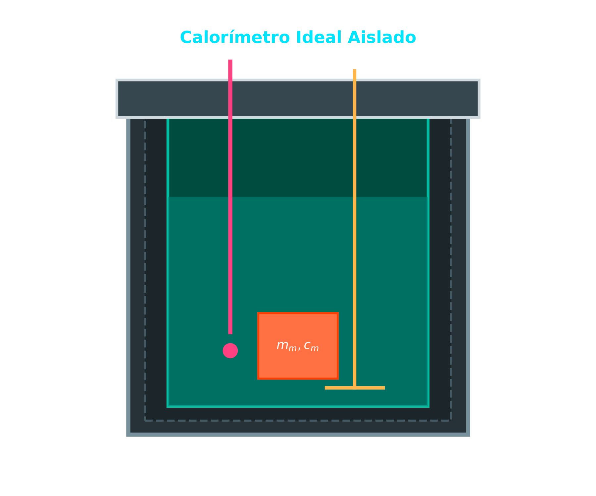
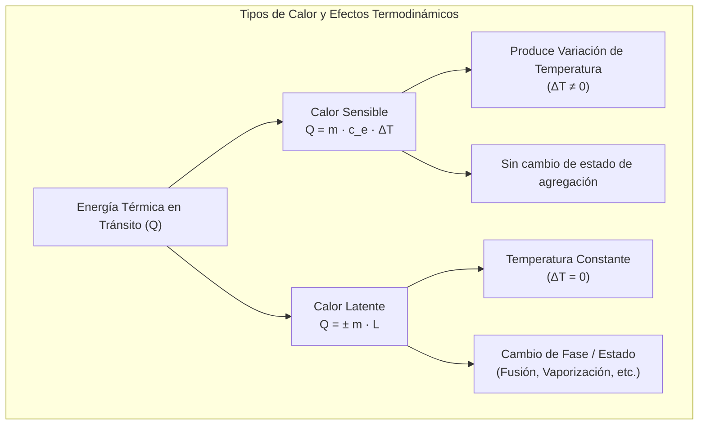
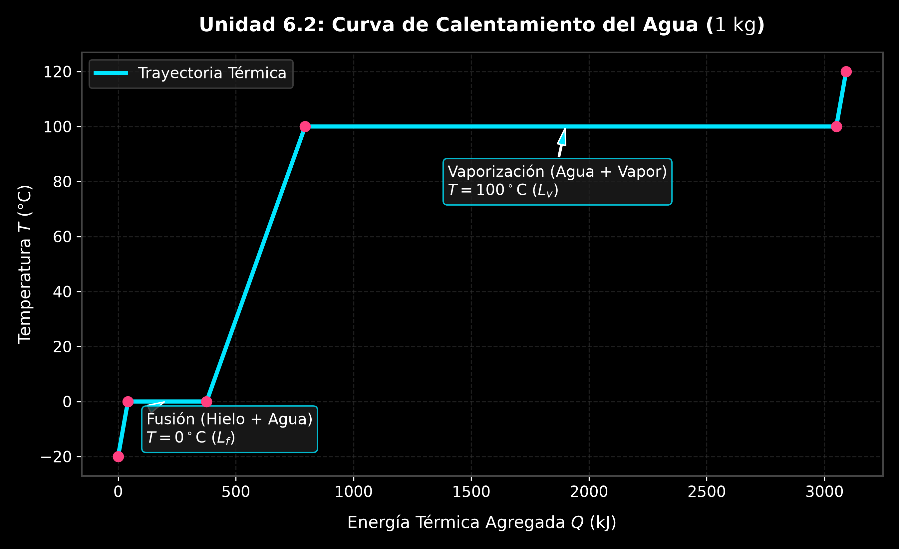
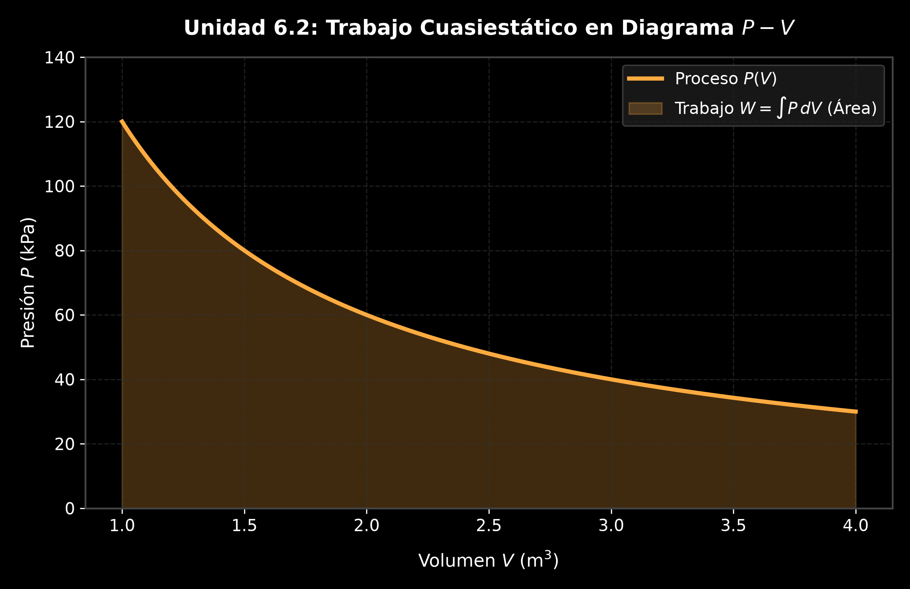
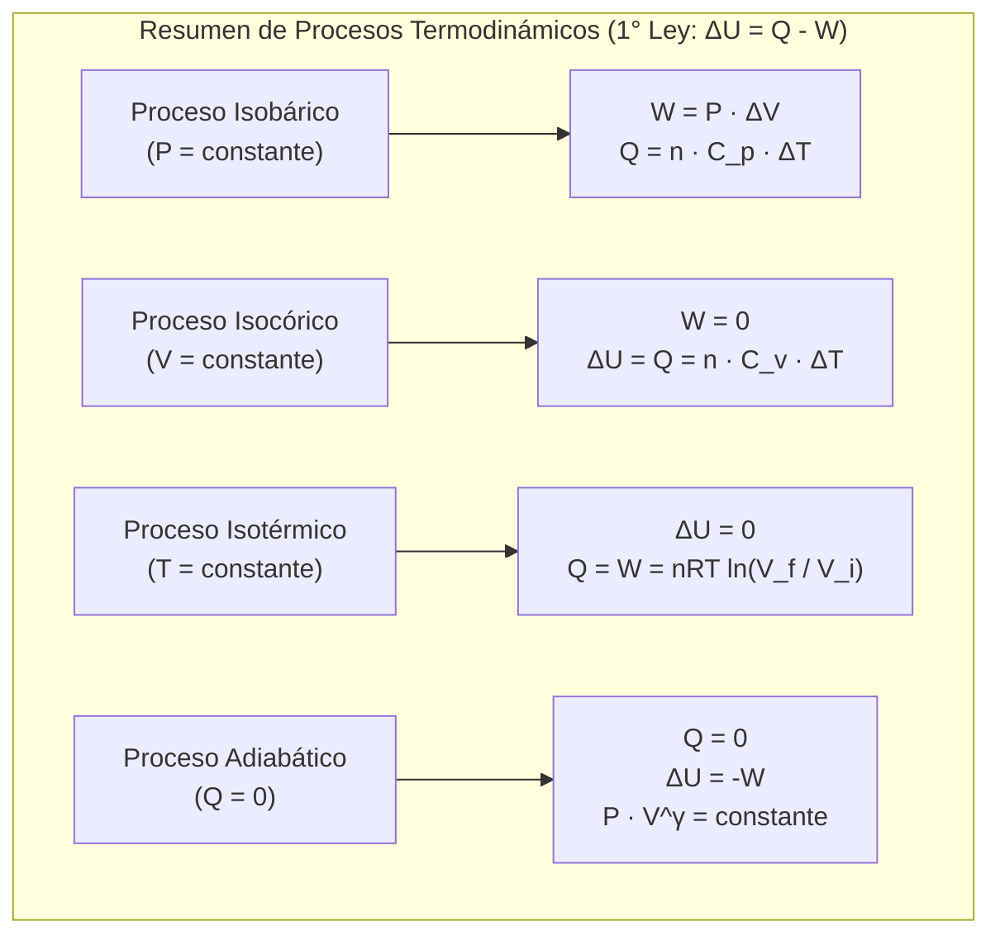
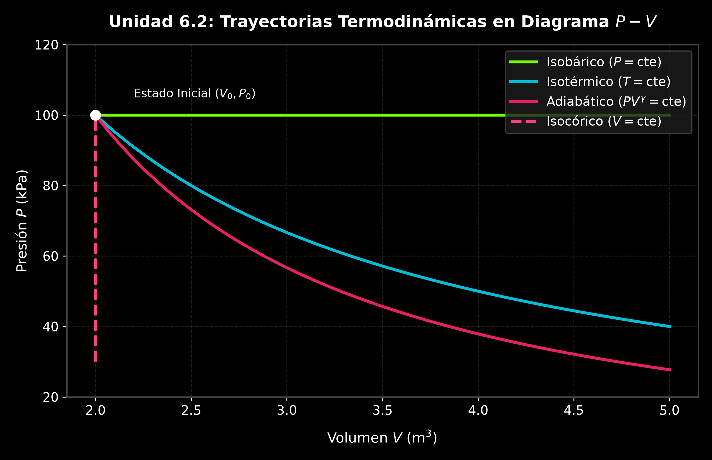
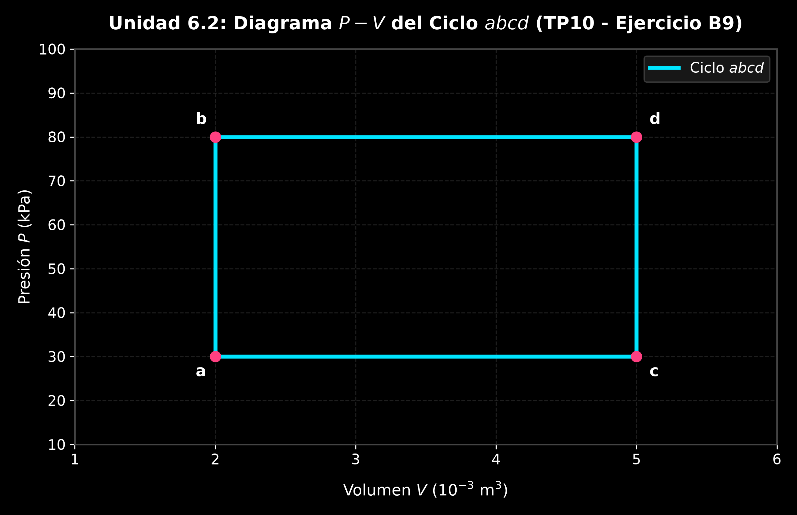
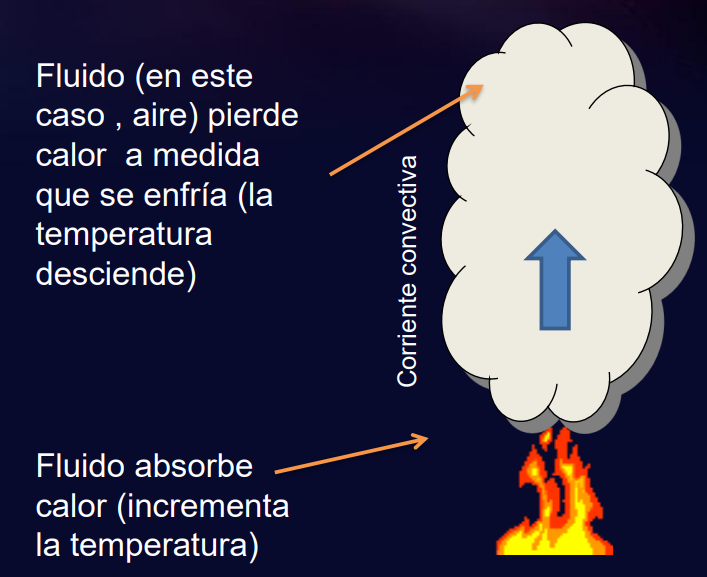
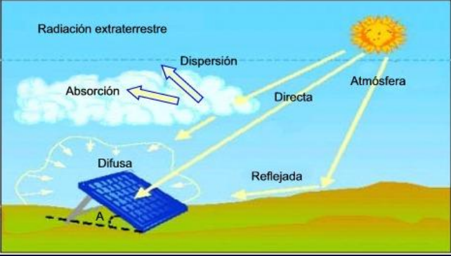

# 6.2 Calorimetría, Primera Ley de la Termodinámica y Transferencia de Calor

---

## 1. Calorimetría, Calor Sensible y Cambios de Fase

El **calor ($Q$)** es la energía en tránsito que se transfiere a través de la frontera de un sistema debido exclusivamente a una diferencia de temperatura entre el sistema y su entorno.

### A. Calor Sensible y Capacidad Calorífica
Cuando se añade o extrae calor a una sustancia sin que esta cambie su estado de agregación, su temperatura varía de forma proporcional a la cantidad de energía transferida:

$$Q = m \cdot c_e \cdot \Delta T = m \cdot c_e \cdot (T_f - T_0)$$

* $Q$: Cantidad de calor transferido en Joules $[\text{J}]$ o calorías $[\text{cal}]$ ($1\text{ cal} = 4.186\text{ J}$).
* $m$: Masa de la sustancia en $[\text{kg}]$ o $[\text{g}]$.
* $c_e$: **Calor específico**, propiedad intensiva que indica la energía requerida para elevar $1\text{ K}$ (o $1^\circ\text{C}$) la temperatura de $1\text{ kg}$ de sustancia $[\text{J/(kg}\cdot\text{K)}]$.
* Si $Q > 0$, el sistema **absorbe calor** ($\Delta T > 0$). Si $Q < 0$, el sistema **cede calor** ($\Delta T < 0$).

### B. Transiciones de Fase y Calor Latente
Durante un cambio de fase (sólido-líquido, líquido-gas), la energía transferida no incrementa la energía cinética media de las moléculas, sino que interviene en la formación o ruptura de enlaces intermoleculares. Por lo tanto, **la temperatura permanece estrictamente constante** durante todo el proceso de transición.

$$Q = \pm m \cdot L$$

* $L_f$: **Calor latente de fusión** (para agua: $L_f = 3.34 \times 10^5\text{ J/kg} = 79.7\text{ cal/g}$).
* $L_v$: **Calor latente de vaporización** (para agua: $L_v = 2.256 \times 10^6\text{ J/kg} = 539\text{ cal/g}$).
* Signo $(+)$ si absorbe calor (fusión, vaporización); signo $(-)$ si cede calor (solidificación, condensación).

---

### 🛠️ Ejemplos Prácticos Aplicados:

#### 1. Incremento de Temperatura Corporal por Fiebre (Ejemplo 17.6 Sears-Zemansky)
**Enunciado:** Un hombre de $80\text{ kg}$ aquejado de gripe presenta una fiebre de $39.0^\circ\text{C}$ en lugar de su temperatura normal de $37.0^\circ\text{C}$. Suponiendo que el cuerpo humano está compuesto principalmente por agua ($c_e \approx 4190\text{ J/(kg}\cdot\text{K)}$), ¿cuánto calor se requirió para elevar su temperatura esa cantidad?

**Resolución Analítica:**
$$\Delta T = 39.0^\circ\text{C} - 37.0^\circ\text{C} = 2.0\text{ K}$$
$$Q = m c_e \Delta T = (80\text{ kg})(4190\text{ J/(kg}\cdot\text{K)})(2.0\text{ K}) = 6.704 \times 10^5\text{ J} = \mathbf{670.4\text{ kJ}} \quad (160\text{ kcal})$$

#### 2. Sobrecurso Térmico en Microelectrónica (Ejemplo 17.7 Sears-Zemansky)
**Enunciado:** Un elemento de circuito electrónico de silicio de $m = 23\text{ mg}$ disipa energía a razón de $P = 7.4\text{ mW} = 7.4 \times 10^{-3}\text{ J/s}$. Si no se contempla disipación de calor al exterior, ¿con qué rapidez aumentará su temperatura? ($c_{e,\text{silicio}} = 705\text{ J/(kg}\cdot\text{K)}$).

**Resolución Analítica:**
Derivando la ecuación de calor sensible respecto al tiempo $t$:
$$\frac{dQ}{dt} = P = m \cdot c_e \cdot \frac{dT}{dt} \implies \frac{dT}{dt} = \frac{P}{m \cdot c_e}$$
$$\frac{dT}{dt} = \frac{7.4 \times 10^{-3}\text{ J/s}}{(23 \times 10^{-6}\text{ kg})(705\text{ J/(kg}\cdot\text{K)})} = \mathbf{0.456\text{ K/s}} \quad (\approx 27.4^\circ\text{C/min})$$

#### 3. Calor Específico de una Barra de Plata (TP10 - Ejercicio B7)
**Enunciado:** La temperatura de una barra de plata de $525\text{ g}$ aumenta $10^\circ\text{C}$ cuando absorbe $1.23\text{ kJ}$ de calor. Determine el calor específico de la plata.

**Resolución Analítica:**
$$c_e = \frac{Q}{m \cdot \Delta T} = \frac{1230\text{ J}}{(0.525\text{ kg})(10\text{ K})} = \mathbf{234.28\text{ J/(kg}\cdot\text{K)}}$$

---

## 2. Conservación de Energía y Equilibrio Térmico en Calorímetros

En un sistema aislado de sus alrededores (calorímetro ideal), la cantidad total de calor absorbida por los componentes fríos debe ser exactamente igual a la cantidad de calor cedida por los componentes calientes:

$$Q_{\text{ganado}} = -Q_{\text{cedido}} \implies \sum_{i=1}^n Q_i = 0$$

---

### 🛠️ Ejemplos Prácticos Aplicados:

#### 1. Enfriamiento de un Lingote Metálico (TP10 - Ejercicio B8 / Ejemplo 20.2 Serway)
**Enunciado:** Un lingote metálico de $0.100\text{ kg}$ a $100^\circ\text{C}$ ($212^\circ\text{F}$) se coloca en un calorímetro de aluminio de $0.200\text{ kg}$ que contiene $0.500\text{ kg}$ de agua a $20.0^\circ\text{C}$. La temperatura final de equilibrio es $21.4^\circ\text{C}$. Determine el calor específico del metal ($c_{e,\text{agua}} = 4186\text{ J/(kg}\cdot\text{K)}$, $c_{e,\text{Al}} = 900\text{ J/(kg}\cdot\text{K)}$).

**Resolución Analítica:**
1. Balance de calor:
   $$Q_{\text{metal}} + Q_{\text{agua}} + Q_{\text{calorímetro}} = 0$$
2. Sustitución de expresiones:
   $$m_m c_m (T_f - T_{m0}) + m_w c_w (T_f - T_{w0}) + m_{\text{Al}} c_{\text{Al}} (T_f - T_{w0}) = 0$$
   $$(0.100) c_m (21.4 - 100) + (0.500)(4186)(21.4 - 20.0) + (0.200)(900)(21.4 - 20.0) = 0$$
   $$-7.86 \cdot c_m + 2930.2 + 252.0 = 0 \implies 7.86 \cdot c_m = 3182.2$$
   $$c_m = \frac{3182.2}{7.86} = \mathbf{404.86\text{ J/(kg}\cdot\text{K)}}$$ *(Correspondiente a una aleación de latón/cobre).*

#### 2. Calorimetría con Cambio de Fase: Vapor Inyectado en Agua (Ejemplo 20.4 Serway)
**Enunciado:** ¿Qué masa de vapor de agua $m_v$ inicialmente a $130^\circ\text{C}$ se necesita inyectar para calentar $200\text{ g}$ de agua en un recipiente de vidrio de $100\text{ g}$ de $20.0^\circ\text{C}$ a $50.0^\circ\text{C}$? ($c_{e,\text{vapor}} = 2010\text{ J/(kg}\cdot\text{K)}$, $L_v = 2.26 \times 10^6\text{ J/kg}$, $c_{e,\text{vidrio}} = 837\text{ J/(kg}\cdot\text{K)}$).

**Resolución Analítica:**
1. **Calor absorbido por agua fría y vidrio:**
   $$Q_{\text{frio}} = (0.200)(4186)(50 - 20) + (0.100)(837)(50 - 20) = 25116 + 2511 = 27627\text{ J}$$
2. **Calor cedido por el vapor (3 etapas):**
   * Enfriamiento del vapor ($130^\circ\text{C} \rightarrow 100^\circ\text{C}$): $Q_1 = m_v (2010)(-30) = -60300 \cdot m_v$
   * Condensación a $100^\circ\text{C}$: $Q_2 = -m_v (2.26 \times 10^6) = -2260000 \cdot m_v$
   * Enfriamiento del agua condensada ($100^\circ\text{C} \rightarrow 50^\circ\text{C}$): $Q_3 = m_v (4186)(-50) = -209300 \cdot m_v$
   * $Q_{\text{cedido}} = -m_v (60300 + 2260000 + 209300) = -2.5296 \times 10^6 \cdot m_v$
3. **Igualación:**
   $$27627 = 2.5296 \times 10^6 \cdot m_v \implies m_v = \mathbf{0.01092\text{ kg} = 10.92\text{ g}}$$

---

## 3. Primera Ley de la Termodinámica y Trabajo de Expansión

La **Primera Ley de la Termodinámica** es el principio universal de conservación de la energía aplicado a sistemas térmicos:

$$\Delta U = Q - W$$

* $\Delta U = U_f - U_0$: Cambio en la **energía interna** del sistema (función de estado), en Joules $[\text{J}]$.
* $Q$: Calor neto transferido hacia el sistema (positivo si entra, negativo si sale).
* $W$: Trabajo neto realizado **por** el sistema sobre sus alrededores (positivo en expansión, negativo en compresión).

### A. Trabajo Cuasiestático de Expansión/Compresión
El trabajo realizado por un fluido al desplazar un pistón con fuerza $F = P \cdot A$ una distancia infinitesimal $dx$ es:

$$dW = P \cdot A \cdot dx = P \cdot dV \implies W = \int_{V_i}^{V_f} P \, dV$$

Geométricamente, **el trabajo $W$ equivale al área bajo la curva del proceso en un diagrama $P-V$**. Dado que el trabajo depende de la trayectoria seguida entre los estados inicial y final, $W$ y $Q$ no son funciones de estado.

---

## 4. Procesos Termodinámicos Particulares y Ciclos

1. **Proceso Isobárico ($P = \text{constante}$):**
   $$W = P (V_f - V_i) = P \Delta V$$
   $$Q = n \cdot C_p \cdot \Delta T$$
   $$\Delta U = n \cdot C_v \cdot \Delta T$$

2. **Proceso Isocórico o Isovolumétrico ($V = \text{constante}$):**
   $$W = 0 \implies \Delta U = Q = n \cdot C_v \cdot \Delta T$$

3. **Proceso Isotérmico ($T = \text{constante}$):**
   Para un gas ideal, al no variar la temperatura, $\Delta U = 0$:
   $$Q = W = n R T \ln \left(\frac{V_f}{V_i}\right) = n R T \ln \left(\frac{P_i}{P_f}\right)$$

4. **Proceso Adiabático ($Q = 0$):**
   Sin intercambio de calor con el entorno:
   $$\Delta U = -W \implies P \cdot V^\gamma = \text{constante}, \quad T \cdot V^{\gamma-1} = \text{constante}$$
   $$W = \frac{P_i V_i - P_f V_f}{\gamma - 1} = \frac{n R (T_i - T_f)}{\gamma - 1}$$
   * Dónde $\gamma = \frac{C_p}{C_v}$ es el coeficiente de expansión adiabática ($\gamma \approx 1.67$ monoatómico, $\gamma \approx 1.40$ diatómico).

---

### 🛠️ Ejemplos Prácticos Aplicados:

#### 1. Expansión Isobárica de Oxígeno en Cilindro con Pistón (TP10 - Ejercicio B9)
**Enunciado:** Un cilindro contiene $1.00\text{ mol}$ de oxígeno ($\text{O}_2$, gas diatómico $C_v = \frac{5}{2}R$, $C_p = \frac{7}{2}R$) a $T_1 = 27^\circ\text{C} = 300.15\text{ K}$ sujeto a una presión constante de $1.00\text{ atm} = 101.325\text{ kPa}$. Se calienta hasta $T_2 = 127^\circ\text{C} = 400.15\text{ K}$.
a) Calcule el trabajo realizado por el gas.
b) Calcule la variación de energía interna.
c) Calcule el calor suministrado.

**Resolución Analítica:**
$$\Delta T = 400.15 - 300.15 = 100.0\text{ K}$$
* **Parte a) Trabajo $W$:**
  $$W = P \Delta V = n R \Delta T = (1.00\text{ mol})(8.3145\text{ J/(mol}\cdot\text{K)})(100.0\text{ K}) = \mathbf{831.45\text{ J}}$$
* **Parte b) Energía interna $\Delta U$:**
  $$\Delta U = n C_v \Delta T = n \left(\frac{5}{2}R\right) \Delta T = \frac{5}{2} (831.45\text{ J}) = \mathbf{2078.63\text{ J}}$$
* **Parte c) Calor suministrado $Q$:**
  $$Q = \Delta U + W = 2078.63 + 831.45 = \mathbf{2910.08\text{ J}} \quad \left(Q = n C_p \Delta T = \frac{7}{2} (831.45) = 2910.08\text{ J}\right)$$

#### 2. Análisis Comparativo de Ciclo Termodinámico (Ejemplo 19.4 Sears / TP10)
**Enunciado:** En la gráfica $P-V$ del ciclo $abcd$, se agregan $150\text{ J}$ de calor en el proceso $ab$ y $600\text{ J}$ en el proceso $bd$. Los estados son $P_a = P_c = 3.0 \times 10^4\text{ Pa}$, $P_b = P_d = 8.0 \times 10^4\text{ Pa}$, $V_a = V_b = 2.0 \times 10^{-3}\text{ m}^3$, $V_c = V_d = 5.0 \times 10^{-3}\text{ m}^3$. Calcule:
a) $\Delta U_{ab}$, b) $\Delta U_{abd}$ y c) El calor total $Q_{acd}$.

**Resolución Analítica:**
* **Parte a) Proceso $ab$ (Isocórico, $V_a = V_b$):**
  $$W_{ab} = 0 \implies \Delta U_{ab} = Q_{ab} = \mathbf{150\text{ J}}$$
* **Parte b) Proceso $abd$:**
  * Trabajo en $bd$ (Isobárico a $8.0 \times 10^4\text{ Pa}$):
    $$W_{bd} = P_b (V_d - V_b) = (8.0 \times 10^4\text{ Pa})(5.0 \times 10^{-3} - 2.0 \times 10^{-3}\text{ m}^3) = 240\text{ J}$$
  * Trabajo total $W_{abd} = W_{ab} + W_{bd} = 0 + 240 = 240\text{ J}$.
  * Calor total $Q_{abd} = Q_{ab} + Q_{bd} = 150 + 600 = 750\text{ J}$.
  * Energía interna: $\Delta U_{abd} = Q_{abd} - W_{abd} = 750 - 240 = \mathbf{510\text{ J}}$.
* **Parte c) Trayectoria $acd$:**
  * Al ser la energía interna una función de estado: $\Delta U_{acd} = \Delta U_{abd} = 510\text{ J}$.
  * Trabajo en $ac$ (Isobárico a $3.0 \times 10^4\text{ Pa}$):
    $$W_{ac} = P_a (V_c - V_a) = (3.0 \times 10^4\text{ Pa})(3.0 \times 10^{-3}\text{ m}^3) = 90\text{ J}$$
  * Trabajo en $cd$ (Isocórico): $W_{cd} = 0 \implies W_{acd} = 90\text{ J}$.
  * Calor total: $Q_{acd} = \Delta U_{acd} + W_{acd} = 510 + 90 = \mathbf{600\text{ J}}$.

---

## 5. Mecanismos de Transferencia de Calor y Aplicaciones Técnicas

La transferencia de calor ocurre a través de tres mecanismos físicos fundamentales:

### A. Conducción Térmica
Transmisión de energía a nivel atómico en sólidos por gradiente de temperatura sin transporte de materia. Rigida por la **Ley de Fourier**:

$$H = \frac{dQ}{dt} = k \cdot A \cdot \frac{T_H - T_C}{L}$$

* $H$: Corriente de calor o flujo térmico $[\text{J/s}]$ o $[\text{W}]$.
* $k$: Conductividad térmica del material $[\text{W/(m}\cdot\text{K)}]$.
* $A$: Área transversal perpendicular al flujo $[\text{m}^2]$.
* $L$: Espesor del conductor $[\text{m}]$.

### B. Convection
Mecanismo propio de fluidos (líquidos y gases) donde el calor se transporta mediante el movimiento macroscópico de masa debido a diferencias de densidad creadas por gradientes de temperatura (convección natural o forzada).

  

### C. Radiación Térmica
Emisión continua de energía en forma de ondas electromagnéticas por todo cuerpo debido a su temperatura. Descrita por la **Ley de Stefan-Boltzmann**:

$$H_{\text{emitido}} = e \cdot \sigma \cdot A \cdot T^4$$

* $\sigma = 5.6704 \times 10^{-8}\text{ W/(m}^2\cdot\text{K}^4\text{)}$: Constante de Stefan-Boltzmann.
* $e$: Emisividad de la superficie ($0 \le e \le 1$).

{: style="display: block; margin: 0 auto; max-width: 80%; height: auto;" }

---

## 6. Trabajo Práctico Integrador de Cierre de la Materia

### 📋 Enunciado del Problema Complejo (Tipo Examen Parcial)
Un sistema termodinámico compuesto por $n = 1.50\text{ moles}$ de un gas ideal monoatómico ($C_v = \frac{3}{2}R$, $C_p = \frac{5}{2}R$) parte de un estado inicial $A$ con $P_A = 100\text{ kPa}$ y $V_A = 0.020\text{ m}^3$. El gas recorre un ciclo termodinámico cerrado $A \rightarrow B \rightarrow C \rightarrow A$:
1. **Etapa $A \rightarrow B$:** Expansión isobárica a $100\text{ kPa}$ hasta duplicar su volumen ($V_B = 0.040\text{ m}^3$).
2. **Etapa $B \rightarrow C$:** Enfriamiento isocórico hasta reducir su presión a la mitad ($P_C = 50\text{ kPa}$).
3. **Etapa $C \rightarrow A$:** Compresión siguiendo una trayectoria en línea recta en el plano $P-V$ hasta retornar al estado inicial $A$.

Se solicita:
1. Calcular las temperaturas absolutas $T_A$, $T_B$ y $T_C$.
2. Calcular $W$, $\Delta U$ y $Q$ para cada una de las 3 etapas y para el ciclo completo.
3. Si la cantidad de calor cedida por el gas en la etapa $B \rightarrow C$ se aprovecha en un calorímetro aislado para fundir un bloque de hielo a $0^\circ\text{C}$ ($L_f = 3.34 \times 10^5\text{ J/kg}$), determine qué masa de hielo $m_{\text{hielo}}$ se logrará derretir.

---

### 📐 Resolución Analítica Paso a Paso

#### Paso 1: Cálculo de Temperaturas en los Nodos del Ciclo
* **Estado A:**
  $$T_A = \frac{P_A V_A}{n R} = \frac{(100 \times 10^3\text{ Pa})(0.020\text{ m}^3)}{(1.50\text{ mol})(8.3145\text{ J/(mol}\cdot\text{K)})} = \mathbf{160.37\text{ K}}$$
* **Estado B ($V_B = 2 V_A = 0.040\text{ m}^3$, $P_B = P_A$):**
  $$T_B = \frac{P_B V_B}{n R} = 2 \cdot T_A = \mathbf{320.74\text{ K}}$$
* **Estado C ($V_C = V_B = 0.040\text{ m}^3$, $P_C = 0.5 P_B = 50\text{ kPa}$):**
  $$T_C = \frac{P_C V_C}{n R} = \frac{(50 \times 10^3\text{ Pa})(0.040\text{ m}^3)}{(1.50)(8.3145)} = \mathbf{160.37\text{ K}} \quad (T_C = T_A)$$

#### Paso 2: Balance Energético por Etapas

* **Etapa $A \rightarrow B$ (Isobárica):**
  * $W_{AB} = P_A (V_B - V_A) = (100 \times 10^3\text{ Pa})(0.040 - 0.020\text{ m}^3) = \mathbf{2000.0\text{ J}}$
  * $\Delta U_{AB} = n C_v (T_B - T_A) = (1.50) \left(\frac{3}{2} \cdot 8.3145\right) (320.74 - 160.37) = \mathbf{3000.0\text{ J}}$
  * $Q_{AB} = \Delta U_{AB} + W_{AB} = 3000 + 2000 = \mathbf{5000.0\text{ J}}$

* **Etapa $B \rightarrow C$ (Isocórica):**
  * $W_{BC} = \mathbf{0\text{ J}}$
  * $\Delta U_{BC} = n C_v (T_C - T_B) = (1.50) \left(\frac{3}{2} \cdot 8.3145\right) (160.37 - 320.74) = \mathbf{-3000.0\text{ J}}$
  * $Q_{BC} = \Delta U_{BC} = \mathbf{-3000.0\text{ J}}$ *(El gas cede $3000\text{ J}$ de calor)*

* **Etapa $C \rightarrow A$ (Compresión Lineal en $P-V$):**
  * Como $T_A = T_C$, el cambio de energía interna es nulo: $\Delta U_{CA} = \mathbf{0\text{ J}}$.
  * Trabajo $W_{CA}$ = Área del trapecio bajo la recta en $P-V$ (con signo negativo por compresión):
    $$W_{CA} = -\frac{P_C + P_A}{2} (V_C - V_A) = -\frac{50 \times 10^3 + 100 \times 10^3}{2} (0.040 - 0.020) = \mathbf{-1500.0\text{ J}}$$
  * $Q_{CA} = \Delta U_{CA} + W_{CA} = 0 - 1500 = \mathbf{-1500.0\text{ J}}$

* **Neto del Ciclo Completo:**
  * $W_{\text{neto}} = W_{AB} + W_{BC} + W_{CA} = 2000 + 0 - 1500 = \mathbf{500.0\text{ J}}$
  * $\Delta U_{\text{neto}} = 3000 - 3000 + 0 = \mathbf{0\text{ J}}$
  * $Q_{\text{neto}} = 5000 - 3000 - 1500 = \mathbf{500.0\text{ J}}$

#### Paso 3: Aplicación Calorimétrica con el Calor Cedido
El calor cedido por el gas en la etapa $B \rightarrow C$ es $|Q_{BC}| = 3000\text{ J}$. Igualando a la ecuación de fusión del hielo a $0^\circ\text{C}$:

$$|Q_{BC}| = m_{\text{hielo}} \cdot L_f \implies m_{\text{hielo}} = \frac{|Q_{BC}|}{L_f}$$
$$m_{\text{hielo}} = \frac{3000\text{ J}}{3.34 \times 10^5\text{ J/kg}} = 8.982 \times 10^{-3}\text{ kg} = \mathbf{8.98\text{ gramos}}$$